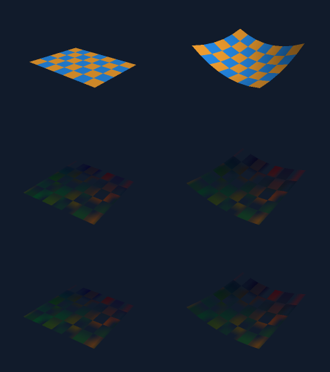

# Checkerboard parametric triangle surfaces

`three.CheckerboardSurface` builds two real mesh partitions from one finite
parameter grid. Cell `(uCell,vCell)` belongs to group `(uCell+vCell)%2`.
Both triangles of that cell use that group's material. Alternation is geometry
partitioning, independent of texture, lighting, camera or output resolution.
The constructor contains no color/material/timeline policy.

```go
func CheckerboardSurface(
    uMin, uMax, vMin, vMax float64, uSteps, vSteps int,
    sample func(u, v float64) (geom.Vec3, error),
) ([2]*Mesh, error)
```

```go
groups, err := three.CheckerboardSurface(-2, 2, -1, 1, 16, 8,
    func(u, v float64) (geom.Vec3, error) {
        return geom.Vec3{X: u, Y: v, Z: .2*u*u - .15*v*v}, nil
    })
if err != nil { panic(err) } // Use application error handling as appropriate.
colors := [2]color.NRGBA{{R: 230, G: 145, B: 45, A: 255},
                       {R: 35, G: 130, B: 225, A: 255}}
var instances []three.Instance
for group, mesh := range groups {
    if mesh == nil { continue }
    instance := three.NewInstance(mesh)
    instance.Material.Color = colors[group]
    instances = append(instances, instance)
}
// Supply instances to the existing three.Renderer, or create two scene3d
// MeshTracks with distinct positive IDs and matching camera/TRS timelines.
```

A group with no cells is `nil`. Under the accepted positive step counts this
occurs only for group 1 on a 1x1 grid. Skip it when creating renderer instances
or scene3d tracks; it is not a valid empty Mesh. Every nonempty partition has
valid indexed triangles, normals and UVs with no unused vertices. Any error
returns `[2]*Mesh{}` with no partially constructed group.

## Grid, winding and normals

Both ranges are finite and strictly increasing, with finite differences.
`uSteps` and `vSteps` count cells, not sample nodes. The inclusive grid contains
`(uSteps+1)*(vSteps+1)` samples. Exact endpoints are preserved. Interior values
are computed from the closer endpoint to reduce cancellation, and every axis
node must be representably greater than its predecessor. An unrepresentable
parameter step is rejected before any callback invocation.

For cell `(i,j)`, let `a=P(i,j)`, `b=P(i+1,j)`, `c=P(i+1,j+1)`,
`d=P(i,j+1)`. The diagonal is always `a-c`: triangles are `(a,b,c)` and
`(a,c,d)`. Front winding follows the sampled `dP/du cross dP/dv` orientation.
Cells enumerate v rows outside u columns; each partition retains that relative
cell/triangle order. Both halves of a nonplanar quadrilateral are real planar
triangles; the renderer does not substitute an analytic or bilinear patch.

The fixed default is smooth **area-weighted triangle normals** over the full
grid, calculated before material splitting. Each triangle contributes its
unnormalized cross product to its three nodes; each incident sum is normalized
once. Thus a node copied to both groups has exactly equal position, normal and
UV. Normals are not calculated independently per color and cannot create a
checker-shaped lighting seam. This follows the existing ParametricSurface
policy; it does not request analytic derivatives. Degenerate triangles and
zero/canceled incident normals are errors. Folded or self-intersecting surfaces
are not globally detected or repaired; they must still satisfy those checks.

There is no flat/smooth flag. If an application wants renderer flat triangle
shading, it can clear each nonempty mesh's `Normals` during authoring, as with
other caller-owned meshes. No automatic face-normal/crease mode is claimed.

## UVs, boundaries and domain flips

Node `(i,j)` has normalized image UV `(i/uSteps,1-j/vSteps)`: U increases with
the u parameter, V increases toward decreasing v. UVs span the complete domain,
including exact 0 and 1; they do not restart within each cell or depend on the
authored numeric parameter magnitude. Both material partitions can independently
use any existing texture/sampler or remain untextured. Texture alpha multiplies
material alpha through the existing depth/fragment/SSAA paths.

Internal grid nodes are shared by index within a partition. Material boundaries
copy the same grid values into independent slices. Outer parameter edges are
not welded, capped, inferred periodic or automatically assigned a neighboring
normal. If a callback returns coincident values at the first/last parameter,
those ends remain separate with U/V seams and one-sided incident normals. A
sphere-like collapsed pole produces degenerate triangles and is rejected; use
an appropriate topology rather than expecting pole repair here.

Decreasing or zero-width ranges are errors. To change parameter orientation,
explicitly mirror/remap the callback or apply a model transform. A callback
reflection can reverse winding/normals. Instance reflections retain the existing
renderer rule: effective triangle winding is reversed and normals use the
inverse transpose. Nonuniform scale and affine shear act on real vertices.
The constructor never silently reverses a domain or guesses an intended front.

## Callback lifetime and error policy

On success the callback is invoked exactly once at each grid node, in v-row/u-
column order. Calls run synchronously on the constructing goroutine; there is
no parallel callback dispatch, adaptive resampling, derivative sampling or
per-frame callback. The function and captured state are not retained by a Mesh.

* Invalid domains, missing callback or excess counts fail before callbacks.
* A returned error stops at that node and is wrapped with `%w` and grid indices,
  preserving `errors.Is`/`errors.As`. Its returned position is ignored.
* A callback panic, including `panic(nil)`, becomes an indexed constructor error.
  Panic payloads are not formatted or inspected; a hostile String method is
  never called. Unrelated internal panics are not globally swallowed.
* A nonfinite/out-of-coordinate position stops at that node. Later nodes are
  not invoked. Triangle degeneracy and normal cancellation are checked after
  the complete node grid has been sampled.

All these failures return two nil pointers. Callback side effects cannot be
rolled back: use a deterministic sampler, return an error for expected failures,
and complete authoring before construction. The invocation count is bounded;
the time/memory spent inside user callbacks is not. There is no timeout or
recovery from `runtime.Goexit`, process termination, fatal runtime errors or a
callback that never returns.

Returned meshes are ordinary mutable caller-owned Mesh values. Their positions,
normals, UVs and triangle buffers do not alias one another across groups or
constructions. Finish edits before rendering concurrently. Existing `scene3d.New`
takes independent immutable mesh/material/key snapshots; later authoring changes
and arbitrary-order concurrent `Sample` calls cannot trigger surface resampling.
Keep both partitions on matching poses/visibility if they represent one surface;
different tracks/material animation are application choices, not hidden grouping.

## Explicit budgets and work

| Property | Limit/policy |
| --- | --- |
| u/v cell count | Each integer in [1,256] |
| Callback invocations | At most `three.MaxCheckerboardSamples` = 66,049 |
| Sampled position components | Finite and within +/-`three.MaxCoordinate` = 1e12 |
| Parameter values | Finite, strictly increasing; finite span; distinct axis nodes |
| Combined triangles | Exactly `2*uSteps*vSteps`, at most 131,072 |
| Combined vertex capacity | At most `2*(uSteps+1)*(vSteps+1)` = 132,098 |
| Rendering/snapshots | Existing aggregate mesh/fragment/light and scene3d budgets |

Both step counts are checked before multiplication, so authored MaxInt values
cannot cause integer-overflow allocation. Sample and combined mesh bounds are
checked before grid callbacks. Empty groups allocate no Mesh. There is no
unbounded cache, topology search or general tessellation.

At 256x256 each group uses 66,047 vertices/65,536 triangles (combined 132,094
used vertices/131,072 triangles). The allocated output slice capacities are
bounded by 11,600,000 payload bytes on a 64-bit host: positions/normals/UVs at
two complete node capacities, plus all triangle indices. Position/normal grids,
two remap arrays and parameter axes add at most 4,231,248 temporary payload
bytes. These exclude Mesh/slice headers, allocator padding, callback allocations,
GC and renderer/scene3d buffers; they are not an RSS promise.

Construction work is O(sample nodes + cell triangles): one callback grid,
triangle-normal accumulation, normal normalization, partition copying and final
Mesh.Validate. There is no new per-frame surface sampling workload. Individually
valid surfaces may together exceed existing frame or timeline snapshot budgets;
those calls continue to return errors rather than drop a material partition.

## Scope relative to Manim Surface

The pinned read-only reference is Manim
`16ea443e2a5f1d79db0a721161411ce916d6e733`,
`manim/mobject/three_d/three_dimensions.py`, class `Surface`.
Its `set_fill_by_checkerboard` assigns color index
`(face.u_index + face.v_index) % n_colors`; this API implements the bounded
two-group case without binding colors into geometry.

This is a finite triangle-grid subset. It does not reproduce Manim's VMobject
Bezier handle deformation, per-face stroke/default styling, arbitrary color
count, jagged/updater behavior or full ThreeDScene/Surface parity. Checkerboard
semantics are source checked; geometric/visual correctness is established with
independent analytic coordinates/plane classification and triangle rays. No
matched Manim render, Python runtime or external fallback is claimed.

## Independent validation

All new tests/benchmarks are `tests/_cases/three/checkerboard*_test.go`; fixtures,
images, logs and final hashes are under `tests/data/three/checkerboard/`.
Runtime implementation adds only `three/checkerboard.go`. Existing three
production sources and golden fixtures are preserved.

The reference reconstructs expected cells from parameter corners and independently
accumulates full-grid normals, without reading production meshes. It transforms
positions by explicit matrix components and normals by cofactors, then uses
independent camera rays/Moller-Trumbore hits, four-tap premultiplied filtering,
lighting and front-to-back transmittance. This is independent of raster edge
rules, perspective interpolation and depth/fragment buffers. A second planar
reference directly classifies hit coordinates with floor(cell UV), using no
triangle list, normals or barycentric math.

Tests cover topology/parity and shared normals/UVs over 1x1, skinny and odd/even
grids at scales 1e-9,1,1e10; exact domain endpoints/order, open periodic seams,
callback reflection, huge finite parameters, errors/panics/nonfinite output,
degenerate triangles/normal cancellation, no aliasing and maximum sample/count
budgets. Eight concurrent constructors and renderer readers, instance/triangle
permutations and fragment/light error recovery are checked.

108 full-frame 41x31 ray comparisons cover planar and nonplanar geometry,
perspective/orthographic projection, SSAA1/2/4, three intermediate affine poses
(rotation, nonuniform scale, shear and reflection), clipping, opaque/alpha
materials, mixed-alpha textures, three colored point lights and opaque mesh
occlusion. The direct analytic plane classifier adds three complete frames.
Expected pixels agree within one byte per channel.

scene3d tests compare 14 endpoint/intermediate/visibility frames across both
projections against independent Rodrigues TRS and ray math. After New, all mesh,
pose, camera, material/visibility and point-light authoring inputs are corrupted;
eight readers sample out of order and check exact frozen output and bitmap ID.
Sampled frame edits do not affect later frames; callback invocation count stays
fixed. Nil odd-group authoring and aggregate snapshot overflow are checked.

Opt-in contact sheet: columns planar/curved; rows untextured material partitions,
affine rotated textured alpha with three point lights, independent expected rays.
Each panel is 240x180, SSAA2.



```sh
CGO_ENABLED=0 go run ./tests/cmd/run -pkg=three -run '^TestCheckerboard' -count=1
CGO_ENABLED=0 go run ./tests/cmd/run -pkg=three -count=1
CGO_ENABLED=0 go run ./tests/cmd/run -pkg=three -race -count=1
CGO_ENABLED=0 go vet -tags noasm ./three
CGO_ENABLED=0 go build -tags noasm ./three
GOMATH_CHECKERBOARD_ARTIFACTS="$PWD/tests/data/three/checkerboard" CGO_ENABLED=0 \
  go run ./tests/cmd/run -pkg=three -run '^TestCheckerboardArtifacts$' -count=1 -v
CGO_ENABLED=0 go run ./tests/cmd/run -pkg=three -run '^$' \
  -bench '^(BenchmarkBuildCheckerboard|BenchmarkRenderCheckerboard)$' \
  -benchmem -benchtime=300ms -count=3 -p 1
```

The central runner supplies noasm and virtual private/external package tests.
This slice has its own validation/source hash manifest. Sixth-wave checkpoint
results are not evidence for these additions.

## Scoped results and cost observations — 2026-11-05

The final complete three suite passes in 5.144s; complete three race passes in
32.605s. CGO_ENABLED=0/noasm vet/build and native dependency inspection pass.
The scoped tests include the external three_test scene3d integration described
above; this is not a claim that a new whole-repository checkpoint ran. Existing
legacy tests/pixel hashes pass. All 16 preexisting three production files retain
their initial hashes, recorded in `legacy-source-preservation.json`. No existing
golden image was overwritten. The final contact sheet passes independent ray
comparison and has been visually inspected.

Environment: Go1.27.3, darwin/arm64, Apple M2, 16GiB, GOMAXPROCS8, CGO0/noasm.
Benchmarks ran after this agent's race completed, serially with `-p 1`, three
300ms samples per workload. The host is shared and other agents' load is not
controlled. These are bounded workload observations, not a claim that this
library is faster. `benchmark.txt` retains every observation/iteration count,
while `environment.txt` records host/toolchain metadata.

`BenchmarkBuildCheckerboard` measures full checking, callback grid, triangle
normal accumulation/normalization, both remaps/output partitions and final
Mesh.Validate. The callback returns the nonplanar polynomial
`(u,v,.27*u*u+.19*v*v+.13*u*v)` over [-1,1]x[-.8,.9]. There is no mesh/template
cache; results escape to a test sink. Callback cost is included for that function,
not a promise about arbitrary user callbacks.

| Cell grid / calls / combined triangles | Median ms/op | Observed range ms | Approx bytes/op | Allocs/op |
| --- | --- | --- | --- | --- |
| 32x32 / 1,089 / 2,048 | .138146 | .135598–.139863 | 269,312 | 16 |
| 256x256 / 66,049 / 131,072 | 8.895622 | 8.511142–9.216455 | 15,880,916 | 16 |

`BenchmarkRenderCheckerboard` renders one 16x12 surface as two independently
materialed mesh partitions, 438 copied vertices and 384 triangles, at 320x240
perspective. The model includes translation, rotation1.13 about (.3,1,.7),
signed nonuniform scale and affine shear. Opaque mode uses two solid colors,
default directional light and backface culling. UV-lights mode disables culling
and uses per-group mixed-alpha 13x9 bilinear textures, material alpha137/181,
three colored point sources and ambient light.

Timed work includes frame validation, fresh buffers, model/normal/camera
transforms, clipping, texture/lighting, depth tests, transparent composition and
SSAA resolve. Mesh/texture/renderer/reference creation, scene3d frame wrapping,
encoding and I/O are excluded. Results escape to a sink; no frame cache is used.

| Workload / SSAA | Median ms/frame | Observed range ms | Approx bytes/frame | Allocs/frame |
| --- | --- | --- | --- | --- |
| Opaque / 1 | .658048 | .649797–.739286 | 958,794 | 12 |
| Opaque / 2 | 3.206875 | 3.162817–3.252915 | 4,030,857 | 14 |
| UV-lights / 1 | 1.972599 | 1.917415–2.299745 | 1,162,025 | 17 |
| UV-lights / 2 | 8.389648 | 8.075027–8.728119 | 4,627,308 | 23 |

Construction creates reusable geometry. Per-frame rendering uses the existing
CPU mesh/material paths; camera, lights, raster, scene3d and old constructors
have no production changes in this slice.
