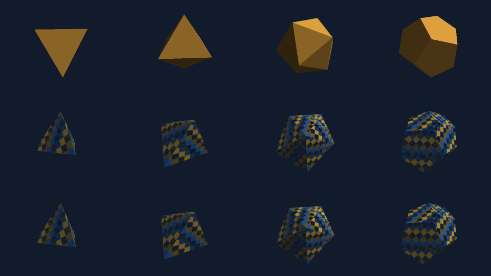

# Checked convex polyhedra and Platonic meshes

`gomath/three` supplies four new real triangle-mesh constructors:

```go
func Tetrahedron(edgeLength float64) (*Mesh, error)
func Octahedron(edgeLength float64) (*Mesh, error)
func Icosahedron(edgeLength float64) (*Mesh, error)
func Dodecahedron(edgeLength float64) (*Mesh, error)
func Polyhedron(vertices []geom.Vec3, faces [][]int) (*Mesh, error)
```

All return caller-owned mesh buffers with flat outward unit normals and
per-face planar UVs. Existing camera, model transforms, material/texture alpha,
opaque depth, transparent sample sorting, lighting and SSAA render the actual
triangles. Nothing is implemented as a projected bitmap or screen-space shape.
The existing `Box(edgeLength,edgeLength,edgeLength)` supplies cube geometry;
this change does not alter Box or its UV-free topology.

```go
mesh, err := three.Dodecahedron(1.2)
if err != nil { return err }
instance := three.NewInstance(mesh)
instance.Model = geom.Translation(geom.Vec3{X: .2}).Mul(
    geom.Rotation(geom.Vec3{X: .3, Y: 1, Z: .7}, .43),
)
instance.Material.Color = color.NRGBA{R: 239, G: 173, B: 67, A: 191}
renderer, err := three.NewRenderer(three.DefaultConfig(320, 240))
if err != nil { return err }
camera := three.Camera{
    Position: geom.Vec3{X: 3.7, Y: -4.1, Z: 2.8}, Up: geom.Vec3{Z: 1},
    Projection: three.Perspective, Near: .1, Far: 20,
    FOVY: math.Pi/3,
}
pixels, err := renderer.Render(camera, instance)
```

The example uses ordinary `geom`, `three`, `image/color` and `math` imports.
Scene3d accepts the resulting Mesh through its existing mesh tracks; there is
no new scene/timeline API or special runtime dependency.

## Edge length, axes and topology

Named constructors are centered at world zero, with the same unrotated
coordinate families, vertex order and polygon face sets as the pinned Manim
Community source. Edge length means the distance along each **polygon boundary
edge**, excluding the diagonals introduced when triangulating pentagons.

Let `l=edgeLength`, `a=l*(1+sqrt(5))/4`, `b=l*(3+sqrt(5))/4`, `c=l/2`.

| Constructor | Unrotated coordinate families | Logical V/E/F | Polygon corners | Output vertices / triangles |
| --- | --- | --- | --- | --- |
| Tetrahedron | `(u,u,u),(u,-u,-u),(-u,u,-u),(-u,-u,u)`, `u=l*sqrt(2)/4` | 4 / 6 / 4 | 3 per face | 12 / 4 |
| Octahedron | `+/-l*sqrt(2)/2` along each X/Y/Z axis | 6 / 12 / 8 | 3 per face | 24 / 8 |
| Icosahedron | `(0,+/-c,+/-a),(+/-c,+/-a,0),(+/-a,0,+/-c)` | 12 / 30 / 20 | 3 per face | 60 / 20 |
| Dodecahedron | eight `(+/-a,+/-a,+/-a)` plus `(0,+/-c,+/-b),(+/-c,+/-b,0),(+/-b,0,+/-c)` | 20 / 30 / 12 | 5 per face | 60 / 36 |

Each named input edge must be finite in `[1e-6,three.MaxCoordinate]`, currently
`[1e-6,1e12]`. Every resulting position component must also be within +/-1e12.
Dodecahedron therefore additionally requires `b<=1e12`, or
`l<=1e12/((3+sqrt(5))/4)`. Oversized, negative, zero, NaN, infinite and
unrepresentable inputs return nil/error; there is no silent dimension clamp.
The other three solids accept edge length 1e12. Smallest named edge 1e-6 is
tested for all four.

Triangle fronts wind counterclockwise when viewed from outside in the existing
right-handed coordinate system. The pinned source's polygon lists contain
mixed winding. Only the four fixed tables get automatic outward orientation:
keep the first vertex and reverse the remaining cycle where necessary. Face
order and first-corner anchors are preserved. The public generic constructor
never repairs caller winding. These outward corrections apply to source face
indices 2/3 for Tetrahedron; 0/1 for Octahedron; 1/2/4/5/7/8/9/10/11/12/17/19
for Icosahedron; and 0/4/7 for Dodecahedron (zero based).

Every face owns its boundary positions/normals/UVs; geometric positions repeat
at hard edges. Pentagon fan triangles share their same face normal and do not
create lighting seams along internal fan diagonals. Reflected model transforms
still use the renderer's existing winding reversal and inverse-transpose
normal handling. Negative edge lengths are rejected rather than used as a
reflection operation.

## Face UVs and material policy

For each validated face, origin is its first corner, U direction is its first
edge, and the positive local height direction is `outwardNormal cross U`.
Project every corner into this plane, normalize each axis's projected bounding
interval, and set `V=1-normalizedHeight`. Thus U increases along the first edge
and image V increases downward. Output UVs are in [0,1], independently at each
face; triangle interpolation remains the renderer's perspective-correct UV
interpolation. Each face can repeat the entire texture. This is a face-local
mapping, without a packed/global atlas, cross-face continuity or upstream
texture-parity claim. The UV rectangle can contain area outside a triangular
or pentagonal polygon; raster coverage remains the polygon's real triangles.

A Mesh uses the existing Instance.Material uniformly. Textured/transparent
materials, nearest/bilinear sampling, clamp/repeat, colored point-light lists
and ordinary directional shading work unchanged. This API does not create
separate face mobjects, per-face materials, edge strokes or vertex spheres.
Mesh buffers remain mutable and independent, like existing three primitives;
finish mutation before rendering them concurrently. Construction copies values
and retains no input vertex, face or nested index slice. Independent constructor
calls share no mutable cache. Scene3d continues to take its own mesh snapshots.

## Generic Polyhedron contract and resource bounds

`faces` contains polygon boundary cycles of **indices into unique vertices**.
Do not repeat the first index at the end. Supply outward cycles yourself; the
solid can be translated, need not be symmetric, and need not contain world
zero. No hull inference, concave ear clipping, face projection/repair, welding,
automatic reversal, hole filling or fallback tessellator is invoked.

All structural size checks occur before normalized geometry work:

| Input / resource | Bound |
| --- | --- |
| Unique input positions | 4..1,024 (`MaxPolyhedronVertices`) |
| Polygon faces | 4..2,048 (`MaxPolyhedronFaces`) |
| Corners of a face | 3..256 (`MaxPolyhedronFaceVertices`) |
| Sum of all face corners | <=8,192 (`MaxPolyhedronCorners`), before copying/triangulation |
| Position components | finite within +/-1e12 |
| Largest axis-aligned bounding-box extent | >=1e-9 (`MinPolyhedronSpan`) |
| Relative distance tolerance | 1e-10 (`PolyhedronTolerance`), normalized by the largest extent |
| Output positions/normals/UVs | exactly sum(face corners); independent per face |
| Output triangles | exactly sum(face corners-2); fan anchored at each first corner |

Validation rebases positions around the bounding-box center and scales by its
largest extent. It rejects pairs of positions at distance <=1e-10 in that
normalized frame, including repeated coordinates under distinct indices. All
indices must be valid, each face must use distinct corners, and every input
position must participate. Faces with equal vertex sets are duplicates even
if cycles start elsewhere or reverse direction.

Each face's area vector supplies its normal. Area magnitude must exceed
tolerance squared. Corner-to-plane distance must be <=tolerance. For every
directed face edge, all other face corners must be strictly inside its left
half-plane with distance >tolerance: this rejects reflex, collinear, folded,
crossed and star boundaries. The mean of all vertices must be strictly on the
interior side of every face by >tolerance; every input vertex must lie on or
inside every face's support plane within tolerance. These are convex solid
checks, not acceptance of arbitrary input polygon lists.

Each undirected boundary edge must occur exactly twice in opposite directions;
the face graph must be connected; the logical Euler characteristic must be 2;
and each vertex's neighboring-edge link must be a single cycle with at least
three neighbors. These checks reject open/disconnected/nonmanifold shells and
inconsistent winding. Coplanar subdivisions into separate convex faces are
permitted when all topology/geometry checks pass. After validation only,
polygon fans are emitted with flat normals and face-local UVs. Mesh.Validate
checks the actual emitted world-coordinate triangles as a final guard.

Finite floating-point tolerance is explicit: departures from planarity or
support planes greater than 1e-10 times extent are rejected. Tiny features,
nearly collinear corners, extremely thin solids and large translations with
unresolved local separations may be rejected even if ideal real-number geometry
would be valid. No positions are snapped/projected to hide such input.
Structural/geometry failure returns nil/error, with no partially built Mesh.
Invalid-input error wording/order is not a stable diagnostic classification;
an invalid solid can violate several checks at once.

For N input positions, F faces, C total corners and K corners per face, geometry
work is bounded by `O(N^2 + F*N + sum(K^2))`, plus bounded sorting/topology work.
At the structural caps, pair distinctness uses <=523,776 distance checks,
support planes <=2,097,152 vertex checks, and within-face convexity
<=2,080,768 edge/corner checks. A real 1,024-position/2,044-face bipyramid passes
the inclusive vertex limit. Construction has no user callbacks or recursion.
Output vector/UV payload is <=512KiB; triangle-index payload is <192KiB on
64-bit Go, for <704KiB total output payload. These are conservative structural
bounds; topology can imply smaller limits. Scratch maps/slices, Mesh headers,
allocator/GC overhead and concurrent calls are additional. This is not a process
RSS or wall-clock guarantee. Existing render geometry/sample/fragment/light
budgets remain separate and continue to error on overflow.

## Pinned source and independent verification

Control source is `manim/mobject/three_d/polyhedra.py` at commit
`16ea443e2a5f1d79db0a721161411ce916d6e733`; the reference checkout stays read-only.
Source copyright notices are retained in `three/platonic.go`, with the existing
MIT notices in `LICENSE`, `LICENSES/manim-LICENSE.txt` and
`LICENSES/manim-LICENSE.community.txt`.

`tests/reference/three_polyhedra.py` verifies the commit and extracts only
whitelisted arithmetic/list AST expressions from the four upstream constructors.
It imports no Manim/NumPy renderer. Independently, exhaustive supporting triples
discover convex facets from the source positions; their vertex sets must match
the upstream face sets. Those support planes, the raw/outward-corrected cycles
and source SHA256 are frozen in
`tests/data/three/polyhedra/manim-controls.json`. Normal Go tests load that JSON
and never launch Python or another runtime.

Geometry tests check all logical vertex/edge/face counts, Euler characteristic,
boundary edge lengths, origin centering, circumradius, analytic area/volume,
outward fan winding, constant unit face normals, hard seams, UV directions and
face-local [0,1] bounds. They cover edge lengths 1e-6, .25, 1, 3.7, .7e12 and
maximal admissible dimensions, invalid/nonfinite inputs, structural quotas,
unused/repeated vertices, duplicate faces, open/nonplanar/inward/nonconvex/crossed
or disconnected inputs, thin geometry, reflected caller winding and translated
representable coordinates. Input slices and independent output buffers are
checked for isolation.

The independent pixel reference intersects camera rays with the **convex
support-plane interval**, rather than using production triangles or a fan. It
uses separate Rodrigues TRS inversion, signed nonuniform scales, transformed
support normals and independently derived planar UVs from frozen source data.
It never reads the output Mesh's vertex/triangle/normal/UV buffers and does not
call production camera, projection, clipping or lighting interpolation helpers.
Independent sampler/shading/alpha math is shared with earlier three references.

384 complete 43x31 frame comparisons cover all four solids, angles
0/.43/1.17/2.23, perspective/orthographic, 1/2/4x SSAA, opaque directional
lighting, constant alpha, bilinear texture alpha and three colored point lights.
Two intermediate poses include reflected nonuniform scales; the last also
cuts the observer near/far/side bounds. Every channel agrees within one byte.
Concurrent construction and eight renderer readers, transparent instance-order
permutations, fragment/light quota failures and successful post-error renders
are also checked. Existing directional and single-point legacy hashes remain
part of the full three suite; no preexisting golden is overwritten.



Columns: tetrahedron, octahedron, icosahedron, dodecahedron. Rows: unrotated
opaque directional material, angle .63 with reflected nonuniform model and
bilinear UV/partial alpha, and its independent support-plane reference. All
edges are 1.1 world units; each column's camera distance is adjusted to its
circumradius for readable framing. Panels are 240x180 at SSAA2. The contact
sheet was visually inspected. This is a pinned geometry plus independent
renderer-reference validation, not a matched Manim render. Manim's Polyhedron
also creates faces/graph/Dot3D subobjects and an updater, with different default
opacity/styling. Those graph/editing/animation semantics and full Manim 3D parity
are not claimed here.

Reproduction from repository root:

```sh
python3 tests/reference/three_polyhedra.py
CGO_ENABLED=0 go run ./tests/cmd/run -pkg=three -count=1
CGO_ENABLED=0 go run ./tests/cmd/run -pkg=three -race -count=1
CGO_ENABLED=0 go vet -tags noasm ./three
CGO_ENABLED=0 go build -tags noasm ./three
GOMATH_THREE_ARTIFACTS="$PWD/tests/data/three/polyhedra" CGO_ENABLED=0 \
  go run ./tests/cmd/run -pkg=three -run '^TestPolyhedronArtifacts$' -count=1 -v
CGO_ENABLED=0 go run ./tests/cmd/run -pkg=three -run '^$' \
  -bench '^(BenchmarkBuildPlatonic|BenchmarkBuildPolyhedron|BenchmarkRenderPolyhedra)$' \
  -benchmem -benchtime=500ms -count=3 -p 1
```

All test/benchmark sources are central under `tests/_cases/three/polyhedron*.go`;
the production implementation adds only `three/polyhedron.go` and
`three/platonic.go`. Logs, fixtures, visual and final source hashes are recorded
under `tests/data/three/polyhedra/`. No root, camera, light, CLI, export or example
implementation changes are required.

## Scoped validation and measured costs — 2026-11-04

The complete central three suite, full three race suite and scoped
CGO_ENABLED=0/noasm vet/build pass. The final maximum-polygon regression also
constructs a closed 256-sided prism, exercising the inclusive 256-corner face
limit with 512 input positions, 258 faces, 1,536 output vertices and 1,020
triangles. Its targeted race check passes. Raw results are `suite.txt`,
`race.txt`, `race-max-face.txt`, `targeted.txt`, `vet.txt` and `build.txt` in
`tests/data/three/polyhedra/`. The native dependency inspection is empty.
No whole-repository result is claimed by this slice.

Environment: Go1.27.3, darwin/arm64, Apple M2, 16GiB, GOMAXPROCS=8 (benchmark
suffix -8), CGO_ENABLED=0/noasm. Benchmarks run serially with `-p 1`, three
500ms samples, after this agent's tests/race completed. Other agents share the
host and their load was not controlled. These are measured costs, not speedup
claims; e.g. opaque/SSAA1 varies .473–.634ms and the medium generic construction
varies .466–.593ms. Full iteration counts and all three observations are retained
in `benchmark.txt`; `environment.txt` records host/toolchain metadata.

`BenchmarkBuildPlatonic` times full checked construction at edge length 1,
including source-table creation, outward orientation, normalized geometric and
topological validation, independent output allocation, flat normals/UVs and
final Mesh.Validate. Its result escapes to a test sink. There is no asset cache
or prebuilt-mesh clone hidden in this measurement.

| Constructed mesh | Median microseconds/op | Observed range | Bytes/op | Allocs/op |
| --- | --- | --- | --- | --- |
| Tetrahedron | 3.600 | 3.264–3.873 | 2,672 | 75 |
| Octahedron | 6.086 | 6.015–6.192 | 5,832 | 134 |
| Icosahedron | 16.275 | 15.444–16.719 | 18,400 | 325 |
| Dodecahedron | 16.382 | 15.412–16.846 | 17,568 | 312 |

`BenchmarkBuildPolyhedron` times all generic validation/output creation from
already authored bipyramid input buffers. Input trigonometry/list authoring is
excluded; none of the validation or output buffers are cached. Shapes have two
triangular faces per ring side, and each face duplicates its three corners.

| Ring sides / logical positions / faces | Median ms/op | Observed range ms | Approx bytes/op | Allocs/op |
| --- | --- | --- | --- | --- |
| 32 / 34 / 64 | .047672 | .047611–.047796 | 58,320 | 930 |
| 256 / 258 / 512 | .488391 | .466419–.593044 | 475,809 | 7,005 |
| 1,022 / 1,024 / 2,044 | 3.179699 | 3.171684–3.194431 | 1,956,969 | 27,733 |

`BenchmarkRenderPolyhedra` renders all four solids together, 156 split vertices
and 68 real triangles, in a fixed 320x240 perspective frame. Each has edge 1.1,
angle .63 about (.3,1,.7), and a separate translated grid position. Opaque mode
uses default directional lighting and backface culling. Textured-alpha-lights
mode uses mixed-alpha 64x64 bilinear textures, material alpha191, three colored
world-space point sources and both front/back polygon surfaces with culling
disabled. Timed iterations include fresh raster/depth/fragment allocations,
world/model/normal transforms, clipping, shading, texture filtering, depth tests,
transparent sorting/composition and optional SSAA resolve. Construction of
meshes/textures/renderer, encoding, I/O and independent references are excluded.
Every returned image escapes to a test sink; no frame cache is retained.

| Render workload | SSAA | Median ms/frame | Observed range ms | Approx bytes/frame | Allocs/frame |
| --- | --- | --- | --- | --- | --- |
| Opaque | 1 | .477343 | .472901–.634453 | 939,119 | 18 |
| Opaque | 2 | 2.988470 | 2.978185–2.998164 | 4,011,184 | 20 |
| Textured alpha + three point sources | 1 | 2.533031 | 2.531210–2.554273 | 1,240,654 | 24 |
| Textured alpha + three point sources | 2 | 11.206121 | 11.177070–11.246297 | 4,902,551 | 32 |

Per-frame renderer limits and the existing pure-Go paths are unchanged. The
new geometry cost is construction plus its authored face/triangle counts;
there is no new per-frame polyhedron runtime, subprocess, native library or
external reference dependency.
