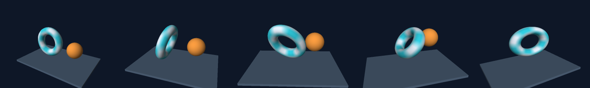
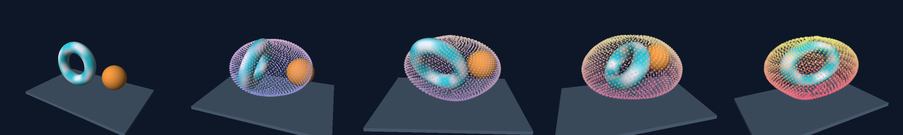
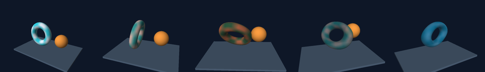
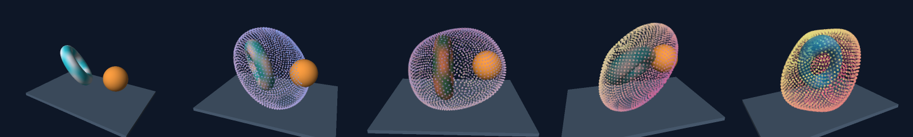
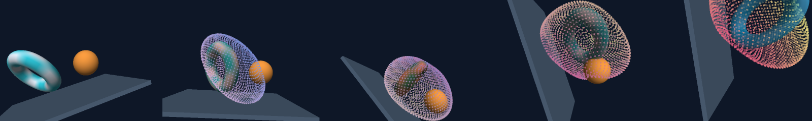

# Immutable CPU mesh and point timelines

`gomath/scene3d` compiles mesh, point and camera keyframes into an immutable
`render.FrameSource`. `Sample(t)` renders visible triangles and point disks using
`three.Renderer`, then returns a real immutable `gomath.Bitmap` inside a
`gomath.Frame`. There are no redraw callbacks, subprocesses, native bindings,
integrated simulation state or modifications to the core `gomath.Scene`.
This is a finite keyframe subset, not complete Manim ThreeDScene support.

## Minimal API

```go
cfg := scene3d.DefaultConfig(640, 360, 2) // width, height, duration in seconds
box, err := three.Box(1.2, .8, 1)
if err != nil { return err }
camera := three.Camera{
    Position: geom.Vec3{X: 3, Y: -4, Z: 3}, Target: geom.Vec3{},
    Up: geom.Vec3{Z: 1}, Projection: three.Perspective,
    Near: .1, Far: 20, FOVY: math.Pi/3,
}
endCamera := camera
endCamera.Position = geom.Vec3{X: -3, Y: -4, Z: 2}
endCamera.Target = geom.Vec3{X: .5}
endCamera.FOVY = math.Pi/4
first, last := scene3d.IdentityPose(), scene3d.IdentityPose()
last.Position = geom.Vec3{X: 1}
last.Scale = geom.Vec3{X: 1.2, Y: .8, Z: 1}
last.Angle = 2 * math.Pi // preserves one complete turn
source, err := scene3d.New(cfg,
    []scene3d.CameraKey{{Time: 0, Camera: camera}, {Time: 2, Camera: endCamera}},
    []scene3d.MeshTrack{{
        ID: 1, Mesh: box, Material: three.DefaultMaterial(),
        Axis: geom.Vec3{Z: 1},
        Keys: []scene3d.PoseKey{{Time: 0, Pose: first}, {Time: 2, Pose: last}},
        Visible: []scene3d.Visibility{{Add: .25, Remove: 0}},
    }},
)
if err != nil { return err }
frame, err := source.Sample(.75) // any order; no authoring cursor to advance
if err != nil { return err }
_ = frame
```

| API | Contract |
| --- | --- |
| `Config{Duration, FrameWidth, Renderer}` | Duration and 2D bitmap world width; a copied `three.Config` (including owned PointLights) controls resolution, lighting, shadows, SSAA and work/fragment budgets |
| `DefaultConfig(width,height,duration)` | FrameWidth=8, renderer=`three.DefaultConfig`; no implicit camera or meshes |
| `New(config, cameraKeys, meshTracks)` | Validate and synchronously copy authoring data; returns immutable `*Scene` |
| `NewWithPoints(config, cameraKeys, meshTracks, pointTracks)` | Adds real point timelines to the same 3D depth/transparent-sort render; `New` is equivalent to a nil point list |
| `NewWithOrientedCamera(config, cameraTrack, meshTracks, pointTracks)` | Explicit eye/quaternion camera timeline, same immutable mesh/point render; nil points allowed |
| `OrientedCameraTrack{Projection,Near,Far,Keys}` | Fixed projection/clipping, with absolute-time OrientedCameraKeys; cannot mix look-at keys |
| `OrientedCameraKey{Time,Position,Orientation,FOVY,OrthoHeight}` | Linear eye/lens fields and normalized shortest-arc quaternion orientation; at least one required |
| `CameraKey{Time,Camera}` | Absolute-time look-at camera keys; at least one required |
| `MeshTrack{ID,Mesh,MeshKeys,Material,MaterialKeys,Axis,Keys,RotationKeys,Visible}` | Exactly one static mesh or fixed-topology geometry keys; fixed texture/sampler, optional base color/alpha keys, either fixed-axis angles or quaternion orientations, TRS keys and visibility |
| `MeshKey{Time,Mesh}` | Full local vertex/normal/UV snapshot; fixed counts, attribute presence and exact triangle indices/order |
| `MaterialKey{Time,Color}` | Replaces Material.Color only; premultiplied sRGB byte/alpha interpolation, fixed texture and sampler |
| `Pose{Position,Scale,Angle}` / `IdentityPose()` | Translation, signed nonuniform scale, radians about the track's fixed axis; identity has scale (1,1,1) |
| `PoseKey{Time,Pose}` | Absolute scene time, strictly increasing; no keys selects identity |
| `PointTrack{ID,Cloud,PointKeys,Axis,Keys,RotationKeys,Visible}` | Exactly one static local-space cloud or fixed-count point buffer keys, plus TRS/orientation keys and visibility |
| `RotationKey{Time,Rotation}` | Optional unit-quaternion orientation keys; normalizes finite nonzero inputs, shortest-arc SLERP; requires zero Axis and zero PoseKey angles |
| `PointKey{Time,Cloud}` | Full position/color/pixel-radius snapshot; same point count and index correspondence throughout a track |
| `Visibility{Add,Remove}` | Add-inclusive, Remove-exclusive; Remove=0 means no removal through the endpoint |
| `scene.Duration()` / `scene.Sample(t)` | Satisfies `render.FrameSource`; sample times must be finite in [0,Duration] |
| `scene.CameraAt(t)` | Independent camera value, including validation of an interpolated look-at frame |
| `scene.PoseAt(id,t)` | Pose value, visibility and error; unknown ID errors, no mesh storage escapes |
| `scene.RotationAt(id,t)` | Effective local quaternion orientation for either mesh or point ID, including hidden tracks; legacy angle tracks remain supported |
| `scene.BitmapID()` | Stable positive `gomath.Object.ID` of the output bitmap; different scenes have different identities |

`MeshTrack.ID` and `PointTrack.ID` share one positive unique **scene-local**
namespace. Duplicate IDs across either kind are rejected. A track does not
become a separate object in the returned frame: meshes and points occlude
in one real 3D render, with one bitmap object in `Frame.Objects`. Input track
order is the three renderer's submission order; its documented exact opaque
depth ties still retain the first submitted triangle. `Frame.Find(BitmapID())`
finds the bitmap at every successful sample, even when no track is visible.
Material's zero color has alpha=0 and is invisible; use `three.DefaultMaterial`
for opaque white. No implicit conversion makes a zero material visible.

## Interpolation and event boundaries

All key times are absolute scene seconds. Before the first key, its value
holds; after the last key, its value holds. Exact key times return the exact
stored endpoint values. Duplicate/decreasing keys are rejected. Interpolation
is linear in time, with no custom rate callbacks or easing in this slice.

Each pose reconstructs `Translation(Position) * Rotation(Axis,Angle) *
Scaling(Scale.X,Scale.Y,Scale.Z)` from values at t. Scale acts first, then
rotation about the mesh's local origin, then world translation. This is real
axis-angle rotation, not element-wise interpolation between model matrices.
Angles interpolate as written, without shortest-angle wrapping: 0 to 2π makes
a complete turn and has a half-turn at the midpoint. Arbitrary finite bounded
nonzero axes normalize once; omitted/zero Axis selects +Z. Changing the axis,
changing a pivot, shear and arbitrary matrix keyframes are outside this subset.
Explicit quaternion orientation tracks are described below. Bake a pivot offset into local mesh vertices
before New when needed. Reflections and nonuniform scales reuse three's
inverse-transpose normal and winding handling.

Every scale component must be nonzero and keep its sign across the whole
track. A positive-to-negative interpolation is rejected instead of passing
through a singular model or silently switching reflection. The maximum
absolute component ratio is limited to keep the generated TRS models away
from three's condition threshold. This does not eliminate floating-point
degeneracy when transforming extreme meshes; such render errors propagate.

In the original New/NewWithPoints look-at mode, Camera Position and Target interpolate independently in world coordinates,
as do FOVY and OrthoHeight. They are straight paths, not automatic circular
orbits or a camera-pose matrix blend. Projection, Up, Near and Far must be
identical in all keys; a projection/up/clipping-plane switch is rejected.
The unused projection-size field must still be finite (zero is allowed).
For perspective, FOVY is radians; for orthographic, OrthoHeight is the full
vertical world span. The active field uses three's usual limits.

Valid camera endpoints can produce an invalid interior look-at frame, for
example when Position passes through Target or the view becomes parallel to
Up. `CameraAt` and `Sample` return a descriptive error at that time; they do
not freeze the preceding camera, invent an orientation or claim a continuous
path is valid from endpoint checks alone.

### Eye and quaternion camera mode

`NewWithOrientedCamera` is an explicit alternative with a single camera track;
it accepts the same mesh/point tracks and produces the same FrameSource bitmap.
Pass nil points for a mesh-only scene. For example, using cfg and box above:

```go
qa := geom.IdentityQuat() // eye at +Z, looking along world -Z
qb, err := geom.QuatFromAxisAngle(geom.Vec3{Z: 1}, math.Pi/3) // camera roll
if err != nil { return err }
source, err := scene3d.NewWithOrientedCamera(cfg,
    scene3d.OrientedCameraTrack{
        Projection: three.Perspective, Near: .1, Far: 20,
        Keys: []scene3d.OrientedCameraKey{
            {Time: 0, Position: geom.Vec3{Z: 5}, Orientation: qa,
             FOVY: math.Pi/3, OrthoHeight: 4},
            {Time: 2, Position: geom.Vec3{X: .5, Z: 4.7}, Orientation: qb,
             FOVY: math.Pi/4, OrthoHeight: 5},
        },
    },
    []scene3d.MeshTrack{{ID: 1, Mesh: box, Material: three.DefaultMaterial()}},
    nil,
)
if err != nil { return err }
_ = source
```

Orientation maps a right-handed local camera frame into world coordinates:
local +X is right, +Y is up, -Z is forward. A positive roll about local +Z
rotates the camera's right axis toward its up axis; the scene appears to turn
the opposite way on screen. With quaternion rotation matrix R and world eye e,
view coordinates are diag(1,1,-1) * transpose(R) * (worldPoint-e). Thus view Z
remains **positive forward**, matching three's existing clipping, depth and
perspective interpolation. Matrices are not linearly blended. No synthetic
eye+forward target is made, so direction components survive even when the eye
is so large that adding a unit target offset would lose precision. Viewport
coordinates remain X right/Y down, and both perspective and orthographic
projection use the existing frustum and SSAA renderer.

Projection/Near/Far are fixed at track level. Keys contain a complete eye,
quaternion and both lens-size fields. Eye/FOVY/OrthoHeight interpolate linearly;
Orientation normalizes and follows geom.Quat's shortest-arc SLERP, antipodal,
near-parallel and exact-half-turn policies described below. Held/exact keys
and absolute times follow the existing timeline rules. Neither a target nor
an Up vector exists in this track: there is no look-at/quaternion composition,
automatic orbit, target tracking, Euler-angle interpolation or automatic roll
correction. Quaternion interpolation has no Up-pole singularity. Equivalent
endpoint orientations do not encode full revolutions; author intermediate
orientations for a winding path. Camera orientation keys are independent of mesh
and point RotationKeys, which continue to rotate local geometry only.

New/NewWithPoints still accept look-at CameraKeys only and explicitly reject
oriented three.Camera values. The underlying renderer also has explicit
`three.Camera.Mode`: zero `LookAtCamera` requires zero Orientation;
`OrientedCamera` requires zero Target and Up, and uses Position/Orientation.
Unknown modes and mixed fields error. A direct renderer caller can set this
mode without a scene3d timeline. CameraAt returns that camera **by value**,
with a normalized quaternion, zero Target/Up and no retained input references.
It works with three.Camera.Validate, WorldToView, Project and RenderWithPoints.
There is no mode change inside one timeline, and existing look-at behavior is
preserved with its original frame arithmetic.

At least one and at most the remaining shared 65,536 key slots are required.
Every camera key participates in the same total as mesh/point pose, geometry,
material and orientation keys. OrientedCameraKey stores 80 logical bytes on
the supported 64-bit layout: all-camera key payload is at most 5 MiB, plus
track/slice/allocator overhead. Both camera modes require bounded finite eye
components within +/-1e12; clipping requires 1e-6 <= Near < Far <= 1e12.
Active FOVY is [1e-4,pi-1e-4] radians, active OrthoHeight [1e-6,1e12]; the
unused lens field must still be finite in scene3d. Finite nonzero quaternion
components may have any magnitude, including huge and subnormal scales;
zero/NaN/infinite inputs error. All keys are validated before snapshotting,
copied and normalized synchronously. Finish authoring before construction;
later caller mutations or changes to returned cameras cannot affect samples.
CameraAt validates the sampled camera and propagates numerical errors, and
failed Sample still returns nil Frame without corrupting future samples.
Sampling and queries remain safe in arbitrary concurrent order. No external
runtime or cancellation contract is added; Sample remains synchronous.

With no Visible entries, a track is visible throughout [0,Duration]. Otherwise
spans must be sorted and disjoint. Add is inclusive and nonzero Remove is
exclusive, including when Remove==Duration. Remove=0 is an explicit sentinel
meaning no removal, so `Visibility{Add: Duration}` can appear only in the exact
endpoint sample. A no-removal span must be last. Adjacent spans may touch;
the new Add is already visible at the shared boundary. Re-adding the same
track does not restart its absolute-time motion or allocate a new identity.
No events mutate sample state, and arbitrary/repeated/reverse sample order
has no effect on results.

## Explicit quaternion orientations

MeshTrack and PointTrack accept the same optional `RotationKeys`. When present,
they replace the track's fixed-axis rotation; Axis must be exactly zero and
every PoseKey.Angle must be zero. Explicit nonzero Axis is rejected even if
all pose angles are zero. Translation and signed nonuniform Scale still come
from PoseKeys, and the model is T(Position) * R(quaternion) * S(Scale).
Local mesh/point geometry keys interpolate before this model, preserving real
world depth, inverse-transpose mesh normals, textures, point pixel radii,
camera animation, transparency and SSAA. Camera orientation is a separate
opt-in track described below; mesh/point RotationKeys do not affect the camera.

For example, add orientations to a mesh track before passing it to New:

```go
qa, err := geom.QuatFromAxisAngle(geom.Vec3{Z: 1}, math.Pi/8)
if err != nil { return err }
qb, err := geom.QuatFromAxisAngle(geom.Vec3{X: 1, Y: 2}, math.Pi*.8)
if err != nil { return err }
track.Axis = geom.Vec3{}
pose := scene3d.IdentityPose()
pose.Scale = geom.Vec3{X: -1.2, Y: .8, Z: 1}
track.Keys = []scene3d.PoseKey{{Pose: pose}} // Angle remains zero
track.RotationKeys = []scene3d.RotationKey{
    {Time: .25, Rotation: qa}, {Time: 1.75, Rotation: qb},
}
```

Key times are strictly increasing absolute scene times in [0,Duration]. First
and last orientations hold outside their key range, and a single key holds
throughout the scene. New snapshots the slice and normalizes every quaternion,
including hidden tracks. Any finite nonzero magnitude is accepted, including
subnormal components and components near MaxFloat64: scaled normalization
avoids a squared-norm overflow or underflow. A zero quaternion, NaN or infinity
errors; a zero-valued RotationKey is not an implicit identity. No caller-owned
quaternion array escapes into sampling. Every rotation key consumes one slot
in the existing shared 65,536-key budget, with 40 logical bytes per stored key
on the supported 64-bit layout (at most 2.5 MiB if all slots were orientations).
There is no per-sample orientation buffer or accumulated angular state.

Interior samples use normalized shortest-arc spherical interpolation. q and
-q describe the same orientation, so antipodal quaternion keys hold that
orientation rather than cancelling through zero. A near-parallel pair uses
normalized linear interpolation when its normalized dot is at least 1-1e-12;
this avoids division by a tiny sine with angular-speed error near roundoff.
At an exact relative 180 degrees (normalized dot == 0), the relative quaternion
is chosen with its first nonzero X/Y/Z component positive, matching the SciPy
reference's canonical rotation-vector tie rule. Within floating roundoff of a
half-turn, either same-length limiting arc may be selected by the computed
dot sign. Exact key queries retain their normalized authored signs: the
quaternion components may change sign at a key without an orientation jump.
There is no easing, angular-velocity continuity enforcement or SQUAD spline.

Shortest-arc orientation keys cannot encode a complete revolution by merely
using equivalent first/last orientations. Author intermediate orientations
with successive rotations below pi when a winding path is needed, or retain
the existing Axis/Pose.Angle mode for explicit full turns. Without RotationKeys,
the original model arithmetic and full-turn semantics are preserved. PoseAt
still returns Position/Scale/Angle and visibility; its Angle is zero in
quaternion mode. RotationAt returns the effective quaternion for either mode,
but a quaternion query cannot preserve the legacy angle's winding count.
Queries return values and are safe in arbitrary concurrent order. Sampling
keeps the existing nil-Frame error behavior for invalid transformed world
coordinates and renderer resource limits. There is no new cancellation API:
Sample is synchronous, and media output retains render.RenderScene's existing
context behavior rather than an interruption guarantee inside a Sample call.

The reusable pure-Go `geom.Quat` uses named W,X,Y,Z fields, scalar first, with
Hamilton multiplication and active right-handed rotation of column vectors.
A positive pi/2 about +Z sends +X to +Y. `a.Mul(b)` applies b before a for unit
inputs. It is raw quaternion arithmetic, without implicit normalization or
validation, and arbitrary huge raw products can overflow under IEEE-754;
normalize inputs before composing rotations. `Conjugate` negates X/Y/Z and is
the inverse for a unit quaternion. `Normalize`, `Matrix`, `Rotate` and `Slerp`
reject invalid rotations; Matrix and Rotate normalize their receiver. Matrix
returns a row-major homogeneous geom.Mat4 with zero translation. Rotate also
rejects nonfinite vectors and nonfinite output caused by overflow.
`IdentityQuat()` returns W=1; `QuatFromAxisAngle(axis,radians)` rejects a zero
axis even at zero angle and normalizes finite extreme axes safely. The reusable
Slerp method accepts only finite parameters in [0,1], without extrapolation.

## Mesh geometry and material timelines

Use `Mesh` for static geometry or `MeshKeys` for complete geometry snapshots;
exactly one is required. Using cfg, camera and box from the first example:

```go
deformed := &three.Mesh{
    Vertices: append([]geom.Vec3(nil), box.Vertices...),
    Triangles: append([]three.Triangle(nil), box.Triangles...),
}
// Both keys omit normals: the renderer derives each deformed face normal.
flatBox := &three.Mesh{Vertices: box.Vertices, Triangles: box.Triangles}
for i, p := range deformed.Vertices {
    deformed.Vertices[i].X = p.X + .4*p.Z
}
track := scene3d.MeshTrack{
    ID: 1, // omit Mesh when providing MeshKeys
    MeshKeys: []scene3d.MeshKey{
        {Time: 0, Mesh: flatBox}, {Time: 2, Mesh: deformed},
    },
    Material: three.DefaultMaterial(),
    MaterialKeys: []scene3d.MaterialKey{
        {Time: 0, Color: color.NRGBA{R: 240, G: 100, B: 60, A: 255}},
        {Time: 2, Color: color.NRGBA{R: 70, G: 180, B: 240, A: 128}},
    },
}
source, err := scene3d.New(cfg,
    []scene3d.CameraKey{{Camera: camera}}, []scene3d.MeshTrack{track})
if err != nil { return err }
_ = source
```

All keys must have the same vertex count, identical triangle index arrays in
the same order, and identical normal/UV presence and counts. Index i denotes
the same vertex across keys. There is no topology matching, reindexing,
padding, seam welding or winding repair. Split UV seams and hard-normal
boundaries into distinct vertices in every key, preserving that correspondence.
Textured tracks require one UV per vertex in every key. Texture and sampler
are fixed assets; keys cannot switch either or other material/render settings.

Positions and raw UV components interpolate linearly in local coordinates,
then the track's real TRS is applied. Repeat-address UVs are not unwrapped:
interpolating .95 to .05 passes through .5; author an explicit 1.05 when that
is the intended seam crossing. Normals, when supplied, interpolate their raw
authored components and then normalize at interior times. Endpoint magnitudes
therefore affect the intermediate direction; author unit normals for ordinary
nlerp. Exact key samples preserve original attributes. No normals are rebuilt
automatically; when every key omits them, three computes flat normals from the
sampled triangles. Authored normals need not agree with face winding, just as
for static three meshes.

MeshKeys, MaterialKeys, TRS Keys and visibility use independent absolute scene
times. Each key sequence holds its first/last values outside its key range;
visibility retains its Add/Remove interval semantics. MaterialKeys
**replace** the base Material.Color, including alpha; they do not multiply it.
Between keys, premultiplied RGB and alpha interpolate in sRGB byte space, then
unassociate and round to NRGBA once. This matches PointKey color semantics,
without linear-light conversion. Alpha-zero endpoint RGB cannot tint an
intermediate visible color; exact keys still retain hidden RGB bytes. The
renderer then multiplies this color/alpha by the fixed texture and applies its
lighting, opaque depth, shared point/mesh transparency ordering and SSAA.

Every mesh endpoint is validated and snapshotted at construction, including
hidden tracks. Sample validates the interpolated local mesh before rendering
each visible track, even when its material alpha is zero. Collapsed triangles,
zero/cancelled normals and nonfinite or out-of-range attributes return an
error with track/time context and a nil Frame. A hidden track does not generate
intermediate geometry. New cannot certify every continuous instant: endpoint
validity alone does not establish interior validity. Existing transformed
geometry, fragment and shadow errors still propagate. In particular, a visible
partially transparent material/texture with directional shadows errors under
three's opaque-caster restriction; no opaque shadow approximation is inserted.
Errors leave subsequent and concurrent samples independent. PoseAt returns
only TRS and visibility, not deformed vertex arrays. The returned bitmap plane
does not move or deform to simulate this geometry.

## Point cloud timelines

Using cfg, camera and box from the mesh example above:

```go
cloudA, err := three.NewPointCloud(
    []geom.Vec3{{X: -.5, Z: -.3}, {X: .5, Z: .3}},
    []color.NRGBA{{R: 240, G: 80, A: 255}, {B: 240, A: 128}},
    []float64{2, 3}, // output-pixel radii
)
if err != nil { return err }
cloudB, err := three.NewPointCloud(
    []geom.Vec3{{X: -.3, Z: .6}, {X: .3, Z: -.6}},
    []color.NRGBA{{G: 240, A: 128}, {R: 240, B: 80, A: 255}},
    []float64{4, 2},
)
if err != nil { return err }
start, end := scene3d.IdentityPose(), scene3d.IdentityPose()
end.Position = geom.Vec3{Y: .5}
end.Scale = geom.Vec3{X: 1.2, Y: .8, Z: 1}
end.Angle = math.Pi
cameraKeys := []scene3d.CameraKey{{Camera: camera}}
meshTracks := []scene3d.MeshTrack{{ID: 1, Mesh: box, Material: three.DefaultMaterial()}}
source, err := scene3d.NewWithPoints(cfg, cameraKeys, meshTracks,
    []scene3d.PointTrack{{
        ID: 20, // must differ from every mesh and point track ID
        PointKeys: []scene3d.PointKey{
            {Time: 0, Cloud: cloudA}, {Time: 2, Cloud: cloudB},
        },
        Axis: geom.Vec3{Y: 1},
        Keys: []scene3d.PoseKey{{Pose: start}, {Time: 2, Pose: end}},
        Visible: []scene3d.Visibility{{Add: .1}},
    }},
)
if err != nil { return err }
_ = source
```

Use `PointTrack{ID: 20, Cloud: cloudA}` for a static point buffer, adding Keys
for TRS if desired. Exactly one of nonnil Cloud or nonempty PointKeys is
required. PointKeys use full `three.PointCloud` snapshots; there is no sparse
attribute inheritance. Although three's cloud renderer treats its positions
as world coordinates, this timeline treats input cloud positions as **local**
coordinates. NewWithPoints reads and copies every point by value, including
positions, NRGBA colors and effective radii. It retains no input cloud pointer,
so even replacing a caller's cloud struct after construction cannot affect the
scene. Repeated use of one cloud in different keys/tracks produces separate
owned snapshots and counts separately against storage.

Point keys must have the same count, in [1,262144]. Index i identifies the same
point across keys; no matching, padding, reordering or topology inference is
performed. Add/remove individual points using distinct tracks and visibility
spans, or animate alpha to zero for a fixed slot. Alpha-zero slots still count
toward point/storage limits and transformed-coordinate validation. A nil radius
slice in the three constructor becomes an effective radius of 1 pixel, including
when interpolating toward an explicitly sized key.

PointKeys, pose Keys and visibility all use independent absolute scene times.
Before/after the first/last point key, its values hold. Exact point keys retain
the original bytes, including invisible RGB at alpha=0. Between keys, local
positions and pixel radii interpolate linearly; colors interpolate premultiplied
RGB and alpha in sRGB byte space, then unassociate and round once to 8-bit NRGBA
before the three renderer. There is no linear-light conversion. If interpolated
alpha is exactly zero the intermediate color is zero. Alpha-zero endpoint RGB
does not tint a visible intermediate point. Byte quantization can make a very
small interpolated alpha zero. TRS is applied **after** local position
interpolation: worldPosition = T * R * S * localPosition. A Z translation/rotation
can move a point in front of or behind a mesh; the output image plane itself
stays fixed. PoseAt accepts both point and mesh IDs and returns only track TRS
and visibility, not point buffers.

Radius is always the circle's **radius in three's output pixels**, finite
[1/16,64]. It does not scale with model Scale, camera distance, FOV, orthographic
span or SSAA. Changing output resolution keeps the same numeric pixel radius;
downstream bitmap resizing scales the completed image as usual. Animated radius
keys provide explicit size changes. There are no world-sized spheres, Gaussian
splats, normals, per-point textures or material multipliers. Points remain unlit
and neither cast nor receive shadows, including when mixed with opaque meshes
using directional shadows; unsupported mesh casters still error. Point light
plus directional shadows remains an explicit renderer configuration error.

Point centers clip inclusively against near/far. Offscreen centers may still
have a visible disk portion. At each internal SSAA sample center, circular
coverage is inclusive; disk depth is the projected center's constant depth.
Tiny disks may miss every sample center. Opaque meshes and points write one
depth buffer; transparent point and mesh samples in front of that buffer share
one per-sample depth sort and one fragment budget, followed by one SSAA resolve.
Exact opaque mesh/point ties keep the mesh; exact opaque point/point ties choose
the smallest packed RGB. Transparent ties follow three's fixed color/alpha tie
rule. These are the existing renderer's exact floating-point rules, not a new
epsilon or painter's ordering.

This is a fixed-count point animation subset. It does not implement PMobject
alignment, mutable point families, filtering/thinning, point emitters, dynamic
topology or full Manim point-cloud behavior.

## Media output and 2D overlays

No adapter is needed for the existing render and media APIs:

```go
output := render.DefaultConfig()
output.Width, output.Height, output.FPS, output.Workers = 640, 360, 30, 2
sink, err := export.NewPNGSequence("frames") // target must not already exist
if err != nil { return err }
_, err = render.RenderScene(context.Background(), source, output, sink)
return err
```

The same source works with existing GIF/MOV/MP4 sinks and their supported
options. Sink codec, color, alpha, timing and cleanup limitations still apply;
scene3d does not add or bypass codecs. `RenderScene` samples i/FPS for
`ceil(Duration*FPS)` frames, normally omitting the exact final instant.
Direct `Sample(Duration)` includes the endpoint. Hold the final key over
additional duration when that final appearance must occupy output frames.

The output bitmap is centered, with width Config.FrameWidth and height chosen
from three's raster aspect ratio. Each returned Frame sets a fresh, unrotated
Camera2D with that width. A matching output aspect ratio fills the frame;
matching pixel dimensions also avoid an extra bitmap resize. Other dimensions
use the existing bilinear bitmap filter; other aspect ratios crop or letterbox
according to the existing centered 2D viewport. There is no hidden rerender at
the downstream sink's resolution. The three background is part of the bitmap;
the downstream renderer background shows through its alpha.

For a screen-space overlay, append ordinary 2D objects to the returned
`frame.Objects` and use a higher ZIndex (the bitmap starts at 0). Retain the
frame's Camera2D to use its FrameWidth coordinates. Each bitmap object, path,
object slice and Camera2D is independent, so modifying a returned frame does
not affect later calls. Share completed overlay geometry immutably or make
your own copies when using concurrent workers. Overlay objects are 2D layers:
they do not participate in mesh depth or lighting. This package does not
implement a combined mutable 2D/3D scene, overlay scheduler, parent transforms,
fixed-orientation objects, dynamic mesh topology, automatic normal generation
for smooth deformation, texture/sampler/light animation, audio or caption tracks.

## Ownership, validation and resource limits

All three constructors retain no caller-owned mutable mesh or keyframe slices. Positions,
normals, triangle indices and UVs of every static mesh and every geometry key,
material colors, pose keys, camera keys and visibility intervals are copied.
Repeated mesh pointers are copied and charged separately, including all keys.
Config and materials are copied by value. Completed `three.Texture`
assets are immutable and shared; their original image copy already belongs to
the texture. Point cloud/key contents are copied into private arrays, with
explicit radii even if the input used default radii. Finish authoring before
construction; mutating authoring inputs
concurrently with construction is unsupported. After New returns, those input
arrays may be reused or changed while Scene samples concurrently. Scene has
no authoring methods, mutation callbacks, global frame cache or accumulating
state. Sampling never consumes new object IDs.

| Resource/input | Limit |
| --- | --- |
| Duration / key times | Finite 0..1e9 seconds, keys within the duration |
| FrameWidth | Finite [1e-6,1e6] 2D world units |
| Tracks | At most `three.MaxInstances` = 1,024 mesh and point tracks combined; IDs positive and unique in one namespace |
| Geometry, whole scene | At most 262,144 vertices and 524,288 triangles across tracks, counting each track's fixed topology once, including hidden/disjoint tracks |
| Owned mesh snapshots | At most `MaxMeshBufferBytes` = 64 MiB across static meshes and every geometry key; position/normal = 24, UV = 16, triangle = 24 logical bytes |
| Keyframes | At most 65,536 total camera, mesh/point pose/orientation, mesh/point buffer and material keys |
| Visibility spans | At most 65,536 total across all tracks |
| Scene point count | At most 262,144 summed fixed point counts across all tracks, even hidden/disjoint tracks; count each track once regardless of key count |
| Owned point snapshots | At most `MaxPointBufferBytes` = 64 MiB across static clouds and every buffer key; charge 36 bytes per point including explicit effective radius |
| Point candidate work | `Renderer.PointSampleLimit`: default 16,777,216 / hard 67,108,864 clipped bounding-box samples, including later occluded points |
| Point radii | Finite [1/16,64] output pixels, including every key; scale-independent |
| Distinct referenced textures | At most 64 MiB pixel payload, counted once per texture pointer |
| Position/Axis | Finite components within +/-1e12; zero Axis selects +Z |
| Absolute scale components | [1e-6,1e6], fixed signs, largest/smallest <=1e4 |
| Angle | Finite +/-1e6π radians |
| Render work/storage | All existing three dimensions, raster, geometry, fragment, shadow and numeric limits apply |

Static-only geometry copies have at most 28 MiB vector/UV/index logical
payload; adding geometry keys raises the owned mesh payload bound to 64 MiB.
Camera and pose/orientation keys plus buffer/material key metadata together have at most 10 MiB
logical payload on the supported 64-bit Go layout, and visibility spans at
most 1 MiB; other metadata, alignment and
maps are additional. Texture payload is shared, not copied by Scene. Sampling
adds an O(track count) instance list, one image object/path and one immutable
bitmap copy of at most 16 MiB beyond three's existing frame storage. No
per-key rendered frames or per-sample world-position buffers are retained
between calls. Interior geometry keys add at most 16 MiB of temporary local
position/normal/UV payload across visible meshes; immutable private triangle
arrays are reused. Exact/held mesh endpoints and tracks without MeshKeys use
the stored mesh directly, with no per-sample geometry copies. Material keys
allocate no attribute buffers; absent MaterialKeys preserve the original
material value. Visible points add at most 18 MiB of logical temporary world
buffers: 9 MiB for positions/colors/radii and 9 MiB copied into validated three
clouds. The three point renderer additionally allocates up to 12 MiB projected
point records. These allocations are bounded but not pooled. Hidden tracks do
not build world buffers. Stored point snapshots can use another 64 MiB;
per-buffer slice headers and allocator overhead are additional.
Concurrent sampling multiplies transient frame/renderer memory; these are
per-scene/payload bounds, not process RSS or GC limits. Binary searches select
keys/spans independently for each track. Three's original worst-case mesh
raster work can still be O(triangles * sample pixels) in each of two passes;
there is no wall-clock deadline.

New validates key values and every mesh/material snapshot structure. Sample validates
the actual camera and renders only currently visible tracks. Transformed
world bounds, floating-point degeneracy, fragment overflow and unsupported
visible transparent directional-shadow casters are reported by three at the
requested time. Invalid hidden mesh/key inputs still reject construction;
invisible tracks do not consume per-frame fragments or shadow-caster work.
Visible alpha-zero or clipped points still undergo world-coordinate validation;
all authored point keys are validated/snapshotted even if never visible. A large
intermediate radius can exceed a candidate/fragment budget even when its keys
were structurally valid. Such sampling errors return nil Frame, preserve scene
state and do not clamp or drop points. No new renderer API is required.
Point light plus directional shadows is rejected by three.NewRenderer during
construction. Every failed Sample returns a nil Frame, leaves immutable state
unchanged and cannot poison later/concurrent samples. No core API changes are
required for this package.

### Fixed multiple world-space point lights

All three scene constructors accept the explicit point-list renderer mode:

```go
cfg.Renderer.Light = three.Light{Kind: three.PointLightList, Ambient: .12}
cfg.Renderer.PointLights = []three.PointLightSource{
    {Position: geom.Vec3{X: 2, Y: -1, Z: 3}, RGB: [3]float64{1, .12, .03},
        Diffuse: .85, Attenuation: .07},
    {Position: geom.Vec3{X: -2, Y: 1, Z: 2}, RGB: [3]float64{.03, .3, 1},
        Diffuse: .7, Attenuation: .04},
}
cfg.Renderer.PointLightEvaluationLimit = 16 * 1024 * 1024 // optional
```

`three.NewRenderer` synchronously validates, copies and sorts the at-most-16
source list; Scene retains only that immutable renderer. Later source-slice
mutations do not affect any arbitrary-order/concurrent Sample. Position is in
world space, so camera movement does not move lights. Geometry, normal, UV,
material-alpha and TRS/orientation interpolation use the existing real triangle
pipeline; point disks remain unlit and share its depth/alpha composition.
Source color/position/attenuation are fixed per scene, without lighting keys.

Each RGB channel/Diffuse is finite [0,1], Position is finite within +/-1e12,
and Attenuation is finite [0,1e12]. Ambient is added once before summing separate
per-source Lambert/attenuation contributions and saturating each channel.
There is no source alpha. Empty/nil lists give ambient only. List mode requires
all legacy Direction, Position, Diffuse and Attenuation fields to be zero;
replace the entire Light value as above. Legacy/list mixtures and enabled
directional shadows error during New, even for black or zero-strength sources.
The original default directional and single PointLight pixels remain unchanged.
No point or translucent shadows, directional-plus-point mode or PBR is implied.

The per-Sample evaluation quota defaults to 67,108,864; explicit values are
1..268,435,456. It charges each shaded internal mesh sample times source count
across both passes, including zero-strength lights and canceled normals.
Opaque overdraw surviving the current z buffer counts, so submission order
can affect quota success. Clipped, alpha-zero, wrong-pass and currently
depth-rejected samples do not count; unlit point disks do not count. Existing
geometry, raster, transparent-fragment and point-candidate quotas still apply.
A failure returns nil Frame and does not poison other times or concurrent
samples. There is no context/wall-clock cancellation or coverage-work quota.
The copied list is at most 1 KiB payload; per-call counters and RGB totals add
no per-pixel arrays. See [three lighting](../three/README.md#multiple-world-space-point-lights)
for the exact equation and independent reference/cost results.

## Verification and measured cost

All test and benchmark sources live in `tests/_cases/scene3d/`; production
directories contain no test files. The independent reference constructs TRS
with vector Rodrigues rotation, casts camera rays and intersects triangles
using Moller–Trumbore, interpolates UVs from ray-hit barycentrics, samples the
source image and composites layers front to back. It does not call production
timeline lookup, matrix rotation, camera projection or rasterization helpers.
Its ambient-only pixel comparisons cover 84 combinations: perspective and
orthographic projection, SSAA 1/2/4, nearest/bilinear filters and seven times
including interior frames, with reflected nonuniform scales, moving cameras,
alpha textures, crossing transparent triangles and opaque occlusion. Each
channel must agree within one byte. Separate lighting integration checks use
an independently constructed model with the existing three renderer as oracle
for directional light, point light and directional hard shadows; these are
configuration/transform checks, not independent light/shadow references.

Other checks cover exact key/visibility boundaries, full turns, zero duration,
stable bitmap identity, fresh returned paths/cameras/bitmap storage, mutations
of every authoring input while eight workers sample unordered times, invalid
interior cameras, explicit resource limits and recovery after sampling errors.
Media checks decode five PNG frames and require exact source bitmap pixels,
decode five GIF frames and verify timing/motion, compose ordinary 2D overlays,
and verify aborted output cleanup after a sampling failure.

The following scoped checks passed on November 4, 2026, using Go 1.27.3,
darwin/arm64, Apple M2, default GOMAXPROCS=8. The central runner supplies
`-tags noasm`. No full repository test run is claimed here.

```sh
CGO_ENABLED=0 go run ./tests/cmd/run -pkg=scene3d -count=3 -vet=all
CGO_ENABLED=0 go run ./tests/cmd/run -pkg=scene3d -race -count=1 -vet=all
CGO_ENABLED=0 go vet -tags noasm ./scene3d
CGO_ENABLED=0 go list -tags noasm -deps ./scene3d
CGO_ENABLED=0 go run ./tests/cmd/run -pkg=scene3d -run '^$' \
  -bench '^BenchmarkTimeline$' -benchmem -count=3 -benchtime=200ms -p 1
```

The dependency inspection found seven nonstandard production packages, no
native build inputs in those packages, and no `os/exec`, `plugin` or
`runtime/cgo` in the runtime dependency graph. Raw results are under
[`tests/data/scene3d`](../tests/data/scene3d/): `tests.txt`, `race.txt`,
`vet.txt`, `dependencies.txt`, `benchmark.txt` and `artifacts.txt`.

The serial benchmark workload has 2,159 vertices and 4,140 triangles across
three meshes: a bilinear repeat-textured torus, smooth sphere and box floor.
It renders 320×240 pixels with directional lighting, moving camera and
reflected/nonuniform animated TRS, without shadows. Timed samples cycle
0, .375, .75, 1.125 and 1.5 seconds; all three meshes are visible. Primitive
tessellation, texture creation, file output and the downstream 2D renderer/
codec are excluded. New validates and copies meshes/keys while sharing the
completed texture. Sample includes all timeline lookup, TRS construction,
triangle rendering and immutable bitmap/frame allocation. DirectThree uses
the same five precomputed camera/models and excludes timeline and bitmap/frame
work. Each row below is the median of three runs; time differences between
the control and timeline are within run/machine noise and are not a speedup
claim.

| Operation | ms/op | B/op | allocs/op |
| --- | ---: | ---: | ---: |
| New snapshot | 0.094 | 239,073 | 32 |
| Sample, SSAA1 | 4.557 | 1,404,869 | 25 |
| DirectThree, SSAA1 | 4.580 | 1,092,239 | 15 |
| Sample, SSAA2 | 11.752 | 4,476,939 | 27 |
| DirectThree, SSAA2 | 12.108 | 4,164,303 | 17 |

The timeline adds approximately 305 KiB and ten allocations per sample in
this workload, primarily the owned 320×240 RGBA bitmap and frame storage.
Measurements include transient allocations, not peak process RSS or a bound
on concurrent rendering latency.

The inspected contact sheet samples 0, .5, 1, 1.5 and 2 seconds left to right.
The sphere is removed at exactly t=2; camera and torus motion continue to their
endpoints. Regenerate it with the following command; normal tests use a
temporary directory instead of changing checked-in artifacts.

```sh
GOMATH_SCENE3D_ARTIFACTS="$PWD/tests/data/scene3d" CGO_ENABLED=0 \
  go run ./tests/cmd/run -pkg=scene3d -run '^TestTimelineContactSheet$' -v -count=1
```



## Point timeline verification and cost

The point extension adds 84 mixed point/mesh pixel-reference comparisons using
the same two projections, three SSAA scales, two texture filters and seven
times. Point buffers change positions, premultiplied colors and radii before
reflected nonuniform TRS; the reference independently constructs world centers,
projects disks in output-pixel coordinates, evaluates circular sample coverage,
intersects textured triangles with rays, and composites their combined layers.
It does not call production point projection, cloud sampling or timeline/TRS
helpers. Comparisons allow one byte per channel; fixtures avoid exact nearest
texel-boundary ties where independent float equations can choose either texel.

Additional tests verify geometry/full turns and exact color/key endpoints,
invisible RGB isolation, pixel radius under model scaling, inclusive near/far,
offscreen centers, add/remove boundaries, a Z translation through a mesh,
mesh/point exact opaque ties, shared mesh/point fragment accounting, point/cloud
submission order, unlit/no-shadow semantics, 64 MiB owned storage to its last
usable point, aggregate counts/keys/spans, hidden inputs and error recovery.
Eight workers sample unordered times while authoring slices and whole input
cloud structs are overwritten. The previous five-frame mesh-only contact sheet
is decoded and compared pixel for pixel, through both New and NewWithPoints
with no point tracks. Four mixed PNG frames from concurrent media output also
decode to exact direct Sample pixels.

All scene3d tests, including the preceding mesh checks, passed three times;
race, package vet and the pure-Go/noasm dependency inspection also passed on
November 4, 2026. Raw extension logs use the `points-` prefix under
`tests/data/scene3d/`. No three implementation, root, CLI or example changes
were required for this slice.

```sh
CGO_ENABLED=0 go run ./tests/cmd/run -pkg=scene3d -count=3 -vet=all
CGO_ENABLED=0 go run ./tests/cmd/run -pkg=scene3d -race -count=1 -vet=all
CGO_ENABLED=0 go vet -tags noasm ./scene3d
CGO_ENABLED=0 go run ./tests/cmd/run -pkg=scene3d -run '^$' \
  -bench '^Benchmark(Timeline|PointTimeline)$' -benchmem -count=3 -benchtime=200ms -p 1
```

The point benchmark adds 2,400 circular points to the 320×240, 4,140-triangle
mesh workload above. All points are visible during timed samples .2, .55, .9,
1.25 and 1.6 seconds, with animated camera and cloud TRS. BuffersAndTRS also
animates local positions, colors and radii between two complete point buffers;
TRS uses one static buffer. These two workloads have different coverage/alpha
and are not an isolated measurement of interpolation overhead. DirectThree
uses the same five precomputed world point buffers and mesh/camera states as
BuffersAndTRS, excluding point transformation, constructor copies, timeline
lookup and bitmap/frame creation from its timed region. SnapshotBuffers includes
validation and all mesh/key/point snapshot copies, sharing the completed texture.
Primitive/texture generation, artifact/media output and downstream 2D rendering
are excluded. No shadow maps are enabled. Go 1.27.3, Apple M2 darwin/arm64,
GOMAXPROCS=8; median of three serial runs:

| Operation | ms/op | B/op | allocs/op |
| --- | ---: | ---: | ---: |
| NewWithPoints, two point buffers | 0.131 | 430,994 | 42 |
| Point TRS, SSAA1 | 5.965 | 1,883,776 | 37 |
| Point buffers + TRS, SSAA1 | 6.572 | 1,959,698 | 38 |
| DirectThree control, SSAA1 | 6.188 | 1,455,755 | 21 |
| Point TRS, SSAA2 | 16.623 | 5,348,469 | 45 |
| Point buffers + TRS, SSAA2 | 18.150 | 5,649,942 | 50 |
| DirectThree control, SSAA2 | 18.166 | 5,145,733 | 33 |

Mixed timeline sampling adds about 492 KiB/op over its precomputed direct
renderer control in this workload, including owned world point copies and
bitmap/frame storage. Time differences near the control are machine noise,
not a speedup claim. The mesh-only control recheck is also recorded in
`points-benchmark.txt`; Sample still uses 25/27 allocations at SSAA1/2. Its
timings varied substantially under shared-machine load, so no wall-clock
regression threshold is claimed. These are per-call allocation measurements,
not peak RSS or concurrency limits.

The inspected mixed contact sheet uses 0, .5, 1, 1.5 and 2 seconds. The cloud
appears at .1 seconds; its local geometry, colors and radii change while its
real world pose and the camera move. The mesh sphere disappears at t=2. Normal
tests write this artifact to a temporary directory; regenerate the saved sheet
with:

```sh
GOMATH_SCENE3D_ARTIFACTS="$PWD/tests/data/scene3d" CGO_ENABLED=0 \
  go run ./tests/cmd/run -pkg=scene3d -run '^TestPointTimelineContactSheet$' -v -count=1
```



## Mesh geometry/material verification and cost

The geometry/material extension adds 84 independent mixed-scene pixel
comparisons: two projections, SSAA 1/2/4, nearest/bilinear and seven times.
The independent reference reconstructs local vertex/normal/UV interpolation
and Rodrigues TRS, then casts rays, samples fixed alpha textures and composites
deforming meshes with opaque/transparent points and other meshes. It does not
use production mesh-key selection/interpolation or rasterization. A separate
30-image reference covers triangles moving through near and far clipping
planes under both projections and three SSAA scales. Each channel agrees
within one byte; fixtures avoid exact top-left/texel boundary ties. Directional
and point lighting integration checks compare independently reconstructed
geometry/models with the existing three renderer, rather than claiming an
independent light-physics reference.

Tests also cover held/exact endpoints, fixed topology and attribute presence,
raw-normal nlerp and very large finite normals, changing UVs with a fixed
texture/sampler, premultiplied color without invisible RGB leakage, material
color replacement, identity TRS with geometry crossing a point's depth,
interior collapse/normal cancellation and recovery, alpha-zero validation,
shared point/mesh fragment overflow and unsupported partial-alpha shadows.
The combined 65,536-key budget and exact 64 MiB mesh payload boundary are
checked. Eight workers sample unordered times while all authoring attributes,
key slices and whole input mesh structs are overwritten. Four concurrent PNG
media frames decode to exact source pixels. The original five-frame mesh-only
golden remains byte-identical at the pixel level through both constructors;
the new contact sheet uses a different file and does not replace that golden.

On November 4, 2026, the complete scoped suite passed three times (4.469 s),
race passed (12.454 s), and package vet/build with noasm passed. The runtime
dependency inspection again found seven nonstandard packages, all without
native build inputs, and no os/exec, plugin or runtime/cgo. Logs use the
`meshkeys-` prefix in `tests/data/scene3d/`; no repository-wide test run is
claimed. Reproduce the checks and serial benchmark with:

```sh
CGO_ENABLED=0 go run ./tests/cmd/run -pkg=scene3d -count=3 -vet=all
CGO_ENABLED=0 go run ./tests/cmd/run -pkg=scene3d -race -count=1 -vet=all
CGO_ENABLED=0 go vet -tags noasm ./scene3d
CGO_ENABLED=0 go build -tags noasm ./scene3d
CGO_ENABLED=0 go run ./tests/cmd/run -pkg=scene3d -run '^$' \
  -bench '^BenchmarkMeshTimeline$' -benchmem -count=3 -benchtime=200ms -p 1
```

The workload is the same 320×240, 2,159-vertex/4,140-triangle three-mesh scene.
Its torus adds a nonlinear local shear z += .45*sin(2*x)*cos(y), with
independently authored endpoint normals from the analytic inverse-transpose
Jacobian and UV offset (.27,-.13). Two full geometry keys interpolate before
reflected nonuniform TRS and camera motion. Three material keys animate white
opaque through orange alpha183 to cyan alpha137. Timed samples cycle .2, .55,
.9, 1.25 and 1.6 seconds, with all meshes visible and no shadows. GeometryOpaque
omits material keys; ColorOnly omits geometry keys. These modes have different
coverage/alpha and do not isolate interpolation overhead by subtraction.
DirectThree uses the same five precomputed combined geometry/material/camera/
model states, excluding timeline selection, geometry interpolation/validation
and bitmap/frame creation. Snapshot includes construction validation and all
static/key copies while sharing the completed texture. Primitive/texture
generation, file output, downstream 2D rendering and encoding are excluded.

Go 1.27.3, Apple M2 darwin/arm64, GOMAXPROCS=8, median of three serial runs:

| Operation | ms/op | B/op | allocs/op |
| --- | ---: | ---: | ---: |
| New, two geometry/three material keys | 0.188 | 361,507 | 39 |
| GeometryOpaque, SSAA1 | 4.864 | 1,477,924 | 29 |
| ColorOnly, SSAA1 | 6.018 | 1,685,821 | 30 |
| GeometryAndColor, SSAA1 | 6.086 | 1,777,163 | 35 |
| DirectThree control, SSAA1 | 6.110 | 1,391,488 | 21 |
| GeometryOpaque, SSAA2 | 12.585 | 4,550,009 | 31 |
| ColorOnly, SSAA2 | 17.765 | 5,473,618 | 40 |
| GeometryAndColor, SSAA2 | 17.518 | 5,539,641 | 44 |
| DirectThree control, SSAA2 | 17.495 | 5,173,635 | 30 |

The combined timeline uses about 357–377 KiB/op more than its precomputed
renderer control here, including local attribute buffers and immutable
bitmap/frame storage. The five sampled states have different fragment counts;
automatic benchmark iteration counts change their mix slightly, so allocation
averages can vary. These runs started after this agent's test/race jobs ended,
but the host is shared with other agents and their load was not controlled.
Wall-clock values are observations, not an isolated regression threshold or
speedup claim; allocations are not peak RSS or concurrent-memory limits.

The inspected contact sheet samples 0, .5, 1, 1.5 and 2 seconds. It shows real
torus deformation, UV drift and changing color/opacity alongside camera/TRS
motion; the sphere is removed at exactly t=2. Normal tests use a temporary
directory. Regenerate this distinct artifact with:

```sh
GOMATH_SCENE3D_ARTIFACTS="$PWD/tests/data/scene3d" CGO_ENABLED=0 \
  go run ./tests/cmd/run -pkg=scene3d \
    -run '^TestMeshGeometryMaterialContactSheet$' -v -count=1
```



## Integrated mesh-key media check

The CLI `mesh-morph` example combines 841 vertices/1568 triangles, authored
vertex/normal/UV keys, independent base-color/alpha keys and a TRS angle track.
Its five-second predictive MP4 was fully decoded independently on 2026-11-04:
320×180 at8fps,40 distinct frames, GOP8 with IDR indices0/8/16/24/32, all PTS
verified. Seven decoded-vs-native RGB checks have PSNR32.913–37.180dB and
MAE1.692–2.077/255, including YUV420 and QP24 losses. Provenance is in
`artifacts/mesh-morph-media-20261104/provenance.json`; reproduce with
`tests/reference/scene3d_media.py freshdir --scene mesh-morph` after building
bin/gomath. This shares Go scene construction and does not replace independent
geometry/ray references. The demo's ordinary overlay also accepts imported
audio, and its complete five-second WAV clock is checked by central CLI tests.

## Quaternion orientation verification and cost

`tests/reference/scene3d_quaternion.py` independently generates numerical
fixtures with SciPy 1.17.1 / NumPy 2.3.5, fixed seed 20261104. It explicitly
converts scalar-first Go WXYZ inputs to SciPy XYZW; it never executes Go
rotation code. NumPy rescales extreme inputs before SciPy construction so its
own squared norm does not overflow/underflow. The checked-in geom fixture has
20 endpoint pairs sampled at 65 times each (1,300 total), covering identity,
antipodal, near-parallel, exact positive/negative/general relative half-turns,
near-half-turn, huge/tiny finite components, subnormals and seeded random
pairs. Comparisons check normalized values, Hamilton composition order,
SLERP matrices and rotated vectors to 5e-14 per matrix component / 1e-13
vector error. Separate checks cover axis-angle conventions and extreme axes,
conjugate/inverse, invalid parameters and explicit rotation overflow errors.
Only the development generator requires SciPy; Go tests read the JSON fixtures
and production has no Python or external-runtime dependency.

The scene fixture independently samples a three-key changing-axis orientation
at 35 times, including endpoints, held values and dense interiors. Its SciPy
matrices are applied explicitly to local geometry and point centers, then
the existing independent ray/disk compositor checks 420 mixed images:
35 times × perspective/orthographic × SSAA 1/2/4 × nearest/bilinear. The scene
also animates local mesh vertices/normals/UV, material alpha, fixed alpha
texture, point positions/colors/radii, reflected nonuniform scales and the
look-at camera. Mesh and point orientation tracks follow different paths.
No production quaternion, model-matrix construction or rasterization is used
to produce reference world geometry. Each output channel agrees within one
byte. Another 105 comparisons use SciPy model matrices with the existing three
renderer for directional/point lighting and directional shadows, including
smooth deformed normals under reflection/nonuniform scale. These are rendering
integration checks, not a new independent light/shadow reference.

Validation covers both hidden mesh/point tracks, ambiguous Axis/Angle rejection,
zero/nonfinite quaternion and invalid/duplicate key times, the exact combined
65,536-key boundary, and an intermediate rotation exceeding world bounds with
valid endpoints and subsequent recovery. Eight workers sample unordered times
and query orientations while the original mesh/point orientation slices are
overwritten and replaced. Existing fixed-axis full-turn and prior bitmap
golden tests still pass; a separate test distinguishes a legacy full turn from
antipodal quaternion keys with the same endpoint orientations.

On November 4, 2026, complete geom and scene3d suites passed three times
(0.021 s / 8.600 s) and with race (1.056 s / 21.048 s), using the central noasm
runner. Combined package vet and CGO_ENABLED=0/noasm build passed. Scoped
runtime dependency inspection found seven nonstandard pure-Go packages, no
native build inputs there, and no os/exec, plugin or runtime/cgo. No full
repository test run is claimed for this slice. Raw logs are
`tests/data/geom/quaternion-*.txt` and
`tests/data/scene3d/orientation-*.txt`; JSON fixtures are in the same package
data folders. Reproduce with:

```sh
python3 tests/reference/scene3d_quaternion.py # development-only regeneration
CGO_ENABLED=0 go run ./tests/cmd/run -pkg=geom -count=3 -vet=all
CGO_ENABLED=0 go run ./tests/cmd/run -pkg=geom -race -count=1 -vet=all
CGO_ENABLED=0 go run ./tests/cmd/run -pkg=scene3d -count=3 -vet=all
CGO_ENABLED=0 go run ./tests/cmd/run -pkg=scene3d -race -count=1 -vet=all
CGO_ENABLED=0 go vet -tags noasm ./geom ./scene3d
CGO_ENABLED=0 go build -tags noasm ./geom ./scene3d
CGO_ENABLED=0 go run ./tests/cmd/run -pkg=geom -run '^$' \
  -bench '^BenchmarkQuaternion$' -benchmem -count=3 -benchtime=200ms -p 1
CGO_ENABLED=0 go run ./tests/cmd/run -pkg=scene3d -run '^$' \
  -bench '^BenchmarkRotationTimeline$' -benchmem -count=3 -benchtime=200ms -p 1
CGO_ENABLED=0 go run ./tests/cmd/run -pkg=scene3d -run '^$' \
  -bench '^BenchmarkTimeline/Sample$' -benchmem -count=3 -benchtime=200ms -p 1
```

The serial orientation workload is 320×240 with 2,159 vertices/4,140 triangles
and 2,400 point disks, SSAA 1/2, directional lighting and no shadows. The torus
has two geometry keys and three color/alpha keys; the point cloud has two
position/color/radius keys. Both tracks add three orientation keys, reflected
or nonuniform scaling, and independent camera motion. Samples cycle .2, .55,
.9, 1.25 and 1.6 seconds, including the initial held orientation and interiors,
with all tracks visible. DirectThree precomputes the same geometry, material,
camera, models and world point buffers outside timing; it excludes timeline,
interpolation, model/cloud creation and immutable bitmap/frame work. Snapshot
times construction validation/copies while sharing the fixed texture. Primitive
and texture generation, fixture reads, file output and downstream 2D rendering/
encoding are excluded. The microbenchmark uses two fixed unit orientations and
65 SLERP parameters or one fixed vector for Rotate.

Go 1.27.3, Apple M2 darwin/arm64, GOMAXPROCS=8, medians of three serial runs:

| Operation | time/op | B/op | allocs/op |
| --- | ---: | ---: | ---: |
| geom.Quat.Slerp | 106.4 ns | 0 | 0 |
| geom.Quat.Rotate | 49.82 ns | 0 | 0 |
| Scene.RotationAt | 158.7 ns | 0 | 0 |
| NewWithPoints snapshot | 0.216 ms | 553,778 | 51 |
| Orientation Sample, SSAA1 | 8.157 ms | 2,401,059 | 46 |
| DirectThree control, SSAA1 | 7.912 ms | 1,825,224 | 25 |
| Orientation Sample, SSAA2 | 24.136 ms | 7,066,512 | 64 |
| DirectThree control, SSAA2 | 23.856 ms | 6,489,260 | 43 |
| Legacy mesh Sample, SSAA1 | 4.706 ms | 1,404,868 | 25 |
| Legacy mesh Sample, SSAA2 | 11.999 ms | 4,476,932 | 27 |

The mixed timeline adds roughly 562–564 KiB/op over its precomputed renderer
control, including geometry/world point copies and bitmap/frame storage.
Rotation interpolation and query themselves allocate no buffers. Legacy
mesh-only allocation counts remain 25/27 at SSAA1/2. These are allocation
observations, not peak RSS or a global concurrency limit. This agent's test/
race jobs had completed before serial measurements, but other agents share
the machine and their load was not controlled. In particular one SLERP run
took 252.9 ns versus 96.95/106.4 ns in the others; raw variation is retained.
No isolated wall-clock regression threshold or speedup claim is made.

The inspected five-frame contact sheet samples 0, .5, 1, 1.5 and 2 seconds.
The torus and real point centers rotate around changing axes while their
geometry/material and camera evolve. The cloud appears at .1 seconds and the
sphere is removed at exactly t=2. Normal tests write to a temporary directory;
the prior mesh/point golden artifacts are preserved. Regenerate the distinct
orientation preview with:

```sh
GOMATH_SCENE3D_ARTIFACTS="$PWD/tests/data/scene3d" CGO_ENABLED=0 \
  go run ./tests/cmd/run -pkg=scene3d -run '^TestRotationContactSheet$' -v -count=1
```



## Oriented camera verification and cost

`tests/reference/scene3d_camera.py` exports independent SciPy 1.17.1 / NumPy
2.3.5 numerical data, seed 20261105. Eighteen camera orientations include
identity, positive/negative quarter-turns and half-turns about each axis,
random combined orientations, and extreme finite quaternion scales. The
fixture contains 126 independent world/view pairs, checked through both
perspective and orthographic projection; behind-eye perspective errors,
viewport/near/far classification, row/column conventions and handedness are
checked. Exact plane ties have a separate identity test, avoiding an ulp
tie between independently rounded rotated points. Additional checks cover
subnormals, large finite quaternions and a tiny direction component at a
1e12 eye, with no synthetic-target subtraction.

The separate three-key camera fixture has 35 dense SLERP samples with roll,
yaw, pitch, changing eyes and lens sizes. CameraAt is compared numerically to
SciPy at every sample. Independent rays built from those exported matrix
columns check 420 mixed images (35 times × two projections × SSAA 1/2/4 × two
texture filters), including deformed textured mesh geometry, alpha material,
opaque/transparent occlusion, real mesh/point orientation and colored disks.
The reference does not use production quaternion, frame, projection or
timeline lookup. Fifty-four more images cover near/far polygon clipping.
All channels agree within one byte. Another 105 comparisons feed SciPy-derived
camera frames to the existing look-at renderer, checking directional lighting,
world-space point lighting and camera-independent directional shadows with
deformed normals and reflected nonuniform model scale. These are renderer
integration references, not a new independent light-physics comparison.

Validation checks missing/invalid/oversized keys, mixed look-at/orientation
inputs, fixed projection/clipping and finite unused lens fields. Exactly
65,536 camera keys are accepted, while adding mesh/point keys beyond the
shared total rejects construction. Held/exact keys, antipodal endpoints,
zero duration, invalid query times and an actual visible box at the Up pole
are checked. Eight workers sample unordered frames and query cameras while
the original key attributes and whole authoring track are overwritten;
returned Camera values can also be changed independently. Existing look-at
pixel golden tests continue to pass without replacing prior fixtures.

Complete three and scene3d suites passed three times on November 4, 2026
(7.287 s / 12.981 s), and with race (17.157 s / 30.823 s). Package vet and
CGO_ENABLED=0/noasm build passed. The scoped production graph again contains
seven nonstandard pure-Go packages, with no native build inputs there and no
os/exec, plugin or runtime/cgo. No full-repository run is claimed for this
slice. The new source/fixtures never modify the pinned Python project.
Logs use `oriented-camera-*.txt` in tests/data/three and tests/data/scene3d;
numerical fixtures are named camera_orientation_scipy.json in those folders.

```sh
python3 tests/reference/scene3d_camera.py # development-only regeneration
CGO_ENABLED=0 go run ./tests/cmd/run -pkg=three -count=3 -vet=all
CGO_ENABLED=0 go run ./tests/cmd/run -pkg=three -race -count=1 -vet=all
CGO_ENABLED=0 go run ./tests/cmd/run -pkg=scene3d -count=3 -vet=all
CGO_ENABLED=0 go run ./tests/cmd/run -pkg=scene3d -race -count=1 -vet=all
CGO_ENABLED=0 go vet -tags noasm ./three ./scene3d
CGO_ENABLED=0 go build -tags noasm ./three ./scene3d
CGO_ENABLED=0 go run ./tests/cmd/run -pkg=scene3d -run '^$' \
  -bench '^BenchmarkOrientedCameraTimeline$' -benchmem -count=3 -benchtime=200ms -p 1
CGO_ENABLED=0 go run ./tests/cmd/run -pkg=scene3d -run '^$' \
  -bench '^BenchmarkTimeline/Sample$' -benchmem -count=3 -benchtime=200ms -p 1
```

The serial workload uses the preceding 320×240, 2,159-vertex/4,140-triangle,
2,400-point scene with animated mesh geometry/normals/UV/material, point
buffers and independent object orientation tracks. It adds three eye/camera
orientation/lens keys; directional lighting is enabled without shadow maps.
Times cycle .2, .55, .9, 1.25 and 1.6 seconds with all tracks visible, including
a held camera endpoint and interior camera/object SLERPs. DirectThree uses
identical precomputed oriented cameras, model/mesh/material and world point
buffers, excluding timeline, model/buffer generation and bitmap/frame creation.
Snapshot includes validation and owned copies while sharing the fixed texture.
Fixture reads, primitive/texture generation, file output and downstream 2D
rendering/encoding are excluded from timing. Go 1.27.3, Apple M2 darwin/arm64,
GOMAXPROCS=8; medians of three serial runs:

| Operation | time/op | B/op | allocs/op |
| --- | ---: | ---: | ---: |
| Oriented CameraAt | 252.7 ns | 0 | 0 |
| Oriented scene snapshot | 0.222 ms | 553,843 | 52 |
| Oriented Sample, SSAA1 | 8.467 ms | 2,443,441 | 46 |
| DirectThree, SSAA1 | 9.066 ms | 1,868,300 | 25 |
| Oriented Sample, SSAA2 | 29.230 ms | 7,193,502 | 65 |
| DirectThree, SSAA2 | 25.669 ms | 6,631,304 | 44 |
| Legacy look-at mesh Sample, SSAA1 | 4.896 ms | 1,404,983 | 25 |
| Legacy look-at mesh Sample, SSAA2 | 12.228 ms | 4,476,933 | 27 |

Camera lookup allocates no buffers; legacy sample allocation counts stay at
25/27. The new fields enlarge three.Camera and therefore stored legacy
CameraKey metadata to 160 logical bytes on the supported 64-bit layout;
the shared total-key cap bounds that payload to 10 MiB. OrientedCameraKey is
80 bytes and its 65,536-key maximum is 5 MiB. This storage increase is explicit
even though old render pixels and the old model/frame path are preserved.
The mixed sample/control allocation difference includes local geometry,
world point copies and immutable bitmap/frame storage; varying automatic
iteration counts change the mixture of five fragment workloads slightly.

All own test/race jobs had ended before these serial benchmarks, but other
agents share the host and their load was not controlled. One SSAA1 control
run took 15.222 ms versus 8.543/9.066 ms in the others; SSAA2 Sample varied
25.571–33.033 ms. Raw results retain this variation. These are workload
observations, not a speedup or isolated regression threshold; allocation
counts are not peak RSS or a process-wide concurrency limit.

The inspected new contact sheet shows 0, .5, 1, 1.5 and 2 seconds, including
real changing camera roll/yaw/pitch and frustum clipping. The cloud appears
at .1 and the sphere disappears at t=2. Previous mesh/point/orientation
artifacts are retained. Normal tests use a temporary directory; regenerate:

```sh
GOMATH_SCENE3D_ARTIFACTS="$PWD/tests/data/scene3d" CGO_ENABLED=0 \
  go run ./tests/cmd/run -pkg=scene3d -run '^TestOrientedCameraContactSheet$' -v -count=1
```



## Integrated oriented-camera media

The `oriented-camera` example combines copied static box/torus meshes and colored
points with eye/lens/quaternion keys and a screen-space title overlay. The final
layout was visually inspected. `artifacts/oriented-camera-layout2-media-20261104/`
records strict independent FFmpeg decoding of all40 frames at320x180/8fps,
5seconds, predictive QP24/GOP8/radius1. All40 decoded frames differ; keys are
0/8/16/24/32 and every PTS matches. Seven native-PNG comparisons yield RGB
PSNR38.562–39.074dB and MAE1.371–1.547/255. This includes YUV420/quantization
and shares Go scene construction; it is a media integration check, not an
independent camera geometry oracle. The source/binary remained unchanged during
verification. Earlier artifact directories are historical layouts.

## Multiple-point-light configuration validation — 2026-11-04

`tests/_cases/scene3d/multilight_test.go` verifies copied light-list ownership
with eight arbitrary-order concurrent readers while the authoring slice is
mutated. Both look-at and eye/quaternion camera constructors are exercised
with moving reflected/nonuniform mesh TRS, smooth normals, transparent material
and a moving unlit point cloud. A separate independent Rodrigues model and
direct three render compare intermediate frames within one byte. This checks
timeline integration; the independent light-physics evidence is in three's
70 high-precision Decimal cases and 288 full ray/pixel comparisons.

Invalid source RGB/count/budget, mixed legacy fields and enabled shadows reject
Scene construction. A deliberately tiny evaluation quota returns nil Frame at
visible times; hidden times still succeed before and after repeated failures.
All existing scene3d tests, complete three/scene3d race and scoped noasm vet/build
pass; logs are under `tests/data/three/multilight/`. No scene3d production API
or copying layer change was needed, because every constructor already retains
only the renderer created synchronously from its supplied three.Config.

The renderer's serial mixed workload benchmark measures 3 colored sources at
320x240/SSAA2 at median35.079ms/frame and about6.121MB/42allocations per frame;
16 sources measure70.505ms at the same allocation size. This includes rendering
2,014vertices/3,982triangles, UV transparency and two point disks. It excludes
scene3d key interpolation/bitmap wrapping and asset/renderer construction.
Go1.27.3/darwin-arm64/Apple M2/16GiB, CGO0/noasm, three500ms samples, serial
`-p 1`, shared host with uncontrolled external load; it is not a timeline
benchmark or controlled speedup measurement. See three/README.md for the full
workload, raw counts, range, source-count table and visual/reference artifact.

## Integrated fourth-wave example — 2026-11-04

The point-lights example renders three copied fixed RGB world sources with moving ball/box and look-at camera keys. artifacts/point-lights-wave4-media-20261104/provenance.json records all40 H.264 frames strictly decoded at320x180/8fps/5seconds, keys0/8/16/24/32, correctPTS and40 distinct frames. Seven native-PNG checks give RGB PSNR39.449–40.126dB and MAE1.474–1.563/255. Native-PNG scene construction is shared; source/binary hashes stayed fixed throughout. Final layout3 keeps meshes apart; earlier preview layouts are historical.
