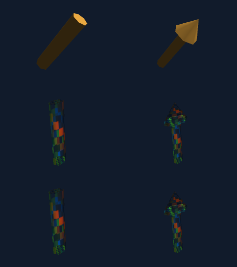

# Checked 3D segments and arrows

`three.CylinderBetween` and `three.ArrowBetween` construct real indexed triangle
meshes between explicitly authored endpoints. They render through the existing
CPU mesh/texture/light/depth/alpha/SSAA paths and can be supplied directly to
`scene3d.MeshTrack.Mesh`. No bitmap deformation, sphere-per-point construction,
native library or external runtime is involved.

```go
line, err := three.CylinderBetween(
    geom.Vec3{X: -1, Y: -.5, Z: -.8},
    geom.Vec3{X: 1, Y: .7, Z: 1.2},
    .04, 24, 2, // radius, radial segments, height segments
)
if err != nil { panic(err) } // Replace with application error handling.
arrow, err := three.ArrowBetween(
    geom.Vec3{X: -1, Z: -.8}, geom.Vec3{X: 1, Z: 1.2},
    three.ArrowOptions{
        ShaftRadius: .04, HeadRadius: .16, HeadLength: .4,
        RadialSegments: 24, ShaftSegments: 2, HeadSegments: 2,
    },
)
if err != nil { panic(err) }
// Both line and arrow are ordinary *three.Mesh.
```

The precise public signatures are:

```go
func CylinderBetween(start, end geom.Vec3, radius float64,
    radialSegments, heightSegments int) (*Mesh, error)
type ArrowOptions struct {
    ShaftRadius, HeadRadius, HeadLength float64
    RadialSegments, ShaftSegments, HeadSegments int
}
func ArrowBetween(start, end geom.Vec3, options ArrowOptions) (*Mesh, error)
```

Endpoints and dimensions are in authored mesh coordinates. An identity model
places them at the same world coordinates; a later instance/timeline TRS acts
on the actual geometry, including radii. Thus nonuniform scale creates elliptic
sections; normal transforms and reflection winding follow existing renderer
rules. No automatic screen-size or tip-size compensation is performed.

## Surface and endpoint contract

Let `D = normalize(end-start)` and `L = length(end-start)`.

* Cylinder cap centers are exactly `start` and `end`. Radius means radius, not
  diameter. It has two closed disks and a polygonal circular side surface.
* Arrow's closed tail disk is centered at `start`, and all split tip positions
  are exactly `end`. The head-base center is `J=end-D*HeadLength`.
* Its shaft joins `start` to `J` with radius `ShaftRadius`. Its cone joins the
  radius-`HeadRadius` ring at `J` to `end`.
* A flat annulus at `J`, from shaft radius to head radius, has normal `-D`.
  There is no shaft end disk and no cone base disk inside the union. This
  avoids invisible internal surfaces contributing extra transparent layers.
* The same radial angle samples align all surfaces. Normals and UVs are split
  at side/cap/shoulder boundaries; those boundaries are geometrically welded.
  Split cap/shoulder vertices copy existing side-ring positions exactly rather
  than relying on equivalent floating-point recalculation at the join.
  There is no beveled or smooth shoulder. One mesh uses one material; head
  and shaft cannot have separate material IDs in this API.

Every triangle winds counterclockwise when viewed from outside in this
right-handed coordinate system. Cylinder side normals point radially outward;
cone side normals are `(HeadLength*radial + HeadRadius*D)/hypot(...)` in exact
arithmetic. At the pointed apex each angular sector receives its own limiting
mid-angle normal and U. Tail normals are `-D`; cylinder end-cap normals are `D`.
Side normals are smooth around the radial polygon; the rendered surface is
still the finite triangle mesh, rather than an analytic cylinder/cone.

## Deterministic roll, UVs and seams

The cylinder/cone axis is local `+Z=D`. Choose the world coordinate axis with
the smallest absolute component of `D`, ties in X then Y then Z order. Project
that seed into the plane perpendicular to `D` and normalize it to obtain local
`+X=U`. Local `+Y=V` is `D cross U`. For `D=+Z`, `U=+X,V=+Y`; for `D=-Z`,
`U=+X,V=-Y`. Parallel, antiparallel and nearly axial directions need no special
angle-axis rotation or singular division.

Roll is deterministic for each endpoint pair. It can change discontinuously
where the least-aligned axis changes; this constructor is not a parallel-
transport frame for an animated path. For continuous orientation, construct
once and animate the mesh model, or explicitly author the desired geometry.

For a ring sample at angle `theta=2*pi*i/radialSegments`:

* Side position is `center + radius*(cos(theta)*U+sin(theta)*V)`.
* Side texture U is `i/radialSegments`; side texture V decreases from 1 at
  the base to 0 at the end. Arrow shaft and cone each restart this V range.
* The cylinder and cone radial seams duplicate positions and normals exactly
  with U=0 and U=1. The cone tip uses `(i+.5)/radialSegments` and V=0.
* Tail disk maps `(cos,sin)` to `(.5+.5*cos,.5+.5*sin)`. Cylinder end disk
  uses `(.5+.5*cos,.5-.5*sin)`.
* Shoulder UV is `(.5+x/(2*HeadRadius),.5+y/(2*HeadRadius))` in the local
  radial plane. Its hole keeps the central UV disk empty; the annulus is not
  stretched into an unrelated solid disk. The annulus's radial UV seam is
  geometrically duplicated with identical UVs.

Filtering/addressing and `texture alpha * material alpha` are the existing
material policies. Backface culling is optional; disable it to see rear layers
of translucent closed surfaces. Opaque meshes/points still depth-occlude these
triangles normally. No translucent or point-light shadows are newly provided.

## Checked numeric and resource limits

All invalid inputs return `nil,error`. No dimensions are clamped, no visible
surfaces are discarded, and no partial mesh escapes on failure.

| Input/property | Accepted range/policy |
| --- | --- |
| Endpoint components and generated positions | Finite, within `+/-three.MaxCoordinate` = 1e12 |
| Endpoint distance | At least 1e-6; bounded endpoints imply at most `2*sqrt(3)*1e12` |
| Cylinder radius; arrow shaft/head radius and head length | Finite [1e-6,1e12] |
| Arrow head minus shaft radius | At least 1e-6; equal/narrower heads rejected |
| Arrow residual shaft length `L-HeadLength` | At least 1e-6; short arrows/head-only cones rejected |
| Radial segments | Integer [3,256] |
| Height/shaft/head segments | Integer [1,256] |
| Output geometry | Existing `MaxVertices`, `MaxTriangles`, position/normal/UV validation |

Endpoints can be positive, negative, near the origin or large. The endpoint
distance is not incorrectly restricted to the origin-centered `Cylinder` height
limit. Large translated coordinates can, however, make small geometry
unrepresentable. Before output allocation, a conservative resolution check uses
32 ULPs at `max(abs(endpoint components))+largestRadius`:

* The smallest radial ring sagitta `2*r*sin(pi/n)^2` must meet that threshold.
  For the cone this uses the final nonzero ring radius `HeadRadius/HeadSegments`.
* Every axial step must meet it; arrow checks both shaft and head subdivisions.
* The shoulder radial gap must meet it, as must the shaft radial sagitta.

This explicit rejection policy preserves detail rather than silently collapsing
panels. It intentionally rejects some mathematically representable extreme
translations. Final generated positions/triangles are checked by `Mesh.Validate`;
out-of-bounds radial overhang is an error even if both endpoints are valid.
The bound is a floating-point reliability policy, not a physical tolerance or
an adaptive tessellator.

With `n=radialSegments`, `s=shaft/heightSegments`, `h=headSegments`:

| Shape | Output vertices (including seams) | Triangles |
| --- | --- | --- |
| Cylinder | `(s+3)*(n+1)` | `2*n*(s+1)` |
| Arrow | `(s+h+4)*(n+1)+n` | `2*n*(s+h+1)` |

Counts are computed only after segment validation; authored `MaxInt` arguments
cannot overflow them. Maximal settings give 66,563 vertices/131,584 triangles
for a cylinder and 132,868 vertices/262,656 triangles for an arrow. Construction
work and storage are O(output vertices + triangles), with no mutable cache.
On a 64-bit host the four output slice payloads consume at most 7,418,048 bytes
and 14,807,296 bytes respectively, excluding slice headers/allocator overhead.
Per-frame aggregate geometry/fragment/light budgets are unchanged. Reusing many
individually valid meshes may exceed a frame budget, which remains an error.

Constructors retain no inputs and share no backing arrays. Returned `Mesh`
slices are mutable/caller-owned like the other three constructors: finish
editing before concurrent renders. `scene3d` takes its own immutable snapshots
via its existing track APIs; this slice adds no special timeline object.

## Scope relative to pinned Manim

The read-only reference is Manim commit
`16ea443e2a5f1d79db0a721161411ce916d6e733`,
`manim/mobject/three_d/three_dimensions.py`, classes `Line3D` and `Arrow3D`.
For explicit point endpoints, that source uses Line3D `thickness` as cylinder
radius. Arrow3D shortens the shaft by explicit `height`, uses `base_radius`
for a conical tip, and places the tip at the supplied end. Those size meanings
motivate this API, with explicit checked dimensions and segment counts.

This is a deliberately narrower mesh API: no Mobject boundary attachment,
`pointify`, mutation/updaters, tip defaults, buffer trimming, rounded joins,
multiple tips or full ThreeDScene compatibility. Manim's independently capped
shaft/cone subobjects and their default styling/resolution are not reproduced;
the arrow here is one joined exterior with no internal cap overlap. Roll, UVs,
triangle topology and numerical limits are explicitly ours. Reference checks
are analytic geometry and independent ray renders, not a matched Manim render
or a claim of complete Manim 3D parity.

## Validation and artifacts

Central sources are `tests/_cases/three/segment*_test.go`; runtime additions are
only `three/segment.go`. Evidence is in `tests/data/three/segments/`.

The independent reference constructs coordinates from parameter-domain
cylinder/cone formulas and a cross-product frame, never reading the production
mesh/builder. Its TRS uses separate Rodrigues and inverse-scale normal math.
The ray oracle uses Moller-Trumbore intersections, independent camera rays,
clipping, filtering, illumination and transparent composition.

Geometry checks cover +/-Z, +/-coordinate directions, arbitrary and nearly
axial directions; scales 1e-5,1,1e10; analytic polygon volume, closed directed
edge incidences/Euler2, normals/winding/UVs/seams, exact endpoints, zero/short/
nonfinite/oversized inputs, inclusive subdivision bounds and unrepresentable
translated detail. Concurrent construction and eight renderer readers preserve
ownership. Triangle/instance permutations preserve exact pixels. Fragment,
point-light and aggregate geometry overflow return errors. Fragment/light
quota failures are followed by a successful render to check error isolation.

108 full-frame comparisons (41x31) cover two meshes, two projections, SSAA
1/2/4, three poses at angles 0/.43/1.13, nonuniform and reflected scale,
near/far/side clipping, opaque lighting, alpha and bilinear-alpha textures
with three colored point lights. Independent expected frames agree within one
byte per channel; existing legacy tests/hashes remain unchanged.

Opt-in contact sheet: columns cylinder/arrow; rows opaque, reflected nonuniform
pose angle .63 with texture alpha and point lights, independent expected frame.
Each panel is 240x180, SSAA2. Its seven radial sectors deliberately expose the
finite mesh rather than masking it with an analytic silhouette.



```sh
CGO_ENABLED=0 go run ./tests/cmd/run -pkg=three -run '^TestSegment' -count=1
CGO_ENABLED=0 go run ./tests/cmd/run -pkg=three -count=1
CGO_ENABLED=0 go run ./tests/cmd/run -pkg=three -race -count=1
CGO_ENABLED=0 go vet -tags noasm ./three
CGO_ENABLED=0 go build -tags noasm ./three
GOMATH_SEGMENT_ARTIFACTS="$PWD/tests/data/three/segments" CGO_ENABLED=0 \
  go run ./tests/cmd/run -pkg=three -run '^TestSegmentArtifacts$' -count=1 -v
CGO_ENABLED=0 go run ./tests/cmd/run -pkg=three -run '^$' \
  -bench '^(BenchmarkBuildSegments|BenchmarkRenderSegments)$' \
  -benchmem -benchtime=300ms -count=3 -p 1
```

The central runner supplies noasm and overlay-compiled private package tests.
This slice's results and source hashes are recorded separately; fifth-wave
checkpoint results do not validate these additions.

## Scoped results and cost observations — 2026-11-05

The final complete three suite passes in 4.616s; full three race passes in
31.133s. CGO_ENABLED=0/noasm vet and build pass. Existing legacy pixel hashes
pass, and all 15 preexisting three production source files retain their initial
hashes (`legacy-source-preservation.json`). Native dependency inspection is
empty. The contact sheet was generated with final production code, checked
against its ray reference and visually inspected. Raw logs and final source
hashes are in this slice's `tests/data/three/segments/` directory. These are
scoped results, not a new whole-repository checkpoint.

Environment: Go1.27.3, darwin/arm64, Apple M2, 16GiB, GOMAXPROCS8, CGO0/noasm.
Benchmarks ran after this agent's race finished, serially with `-p 1`, three
300ms samples per case. The host is shared; other agents' load is uncontrolled.
These are bounded workload observations, not claims that the library is faster.
`benchmark.txt` retains iteration counts and all samples, and `environment.txt`
records the host/toolchain metadata.

Construction measures full endpoint/frame/dimension/resolution checking, output
allocation, all surfaces/normals/UVs and final `Mesh.Validate`. Inputs use the
same arbitrary-direction endpoints as the ray scenes, radius .32 for cylinder,
shaft/head radii .22/.52 and head length .8 for arrow. Results escape to a sink;
there is no shape/template cache or prebuilt clone.

| Shape / radial / axial steps | Median microseconds/op | Observed range | Approx bytes/op | Allocs/op |
| --- | --- | --- | --- | --- |
| Cylinder / 24 / 4 | 8.326 | 8.224–8.441 | 19,040 | 5 |
| Arrow / 24 / shaft4,head4 | 17.285 | 16.181–18.830 | 32,736 | 5 |
| Cylinder / 256 / 256 | 3,415.638 | 3,325.485–3,425.382 | 7,446,630 | 5 |
| Arrow / 256 / shaft256,head256 | 6,727.606 | 6,596.840–6,731.423 | 14,827,616 | 5 |

Rendering includes one cylinder and one arrow together, both radial48, shaft/
height4 and cone4, giving 979 split vertices and 1,344 triangles. The frame is
320x240 perspective, with separately translated meshes at rotation angle .63
about (.3,1,.7). Opaque mode uses default directional lighting and backface
culling. UV-alpha-lights uses bilinear mixed-alpha texture, material alpha191,
three colored point lights and unculled front/rear surfaces. Timed work
includes fresh buffers, validation, model/normal/camera transforms, clipping,
texture/lighting, depth tests, alpha sorting/composition and SSAA resolution.
Asset/renderer creation, independent reference construction, scene3d wrapping,
encoding and I/O are excluded. No frame cache is used.

| Workload / SSAA | Median ms/frame | Observed range ms | Approx bytes/frame | Allocs/frame |
| --- | --- | --- | --- | --- |
| Opaque / 1 | 1.461667 | 1.347476–1.466159 | 1,004,105 | 12 |
| Opaque / 2 | 3.959692 | 3.934611–3.960805 | 4,076,169 | 14 |
| UV-alpha-lights / 1 | 3.234230 | 3.160095–3.389402 | 1,207,337 | 17 |
| UV-alpha-lights / 2 | 10.198969 | 10.195653–10.203290 | 4,672,617 | 23 |

The new code runs only at mesh construction time. Existing Cylinder/Cone/Box
implementations, camera/light/raster paths and default outputs are unchanged.
