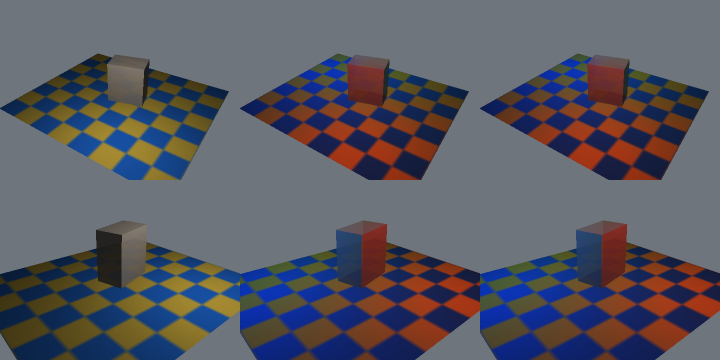

# three: portable CPU triangle rendering

This package implements a small 3D foundation using Go's standard library and
`gomath/geom`. Production code has no native dependencies, cgo, file I/O or
subprocesses. It renders indexed triangle meshes into fresh `*image.RGBA` frames
for the existing bitmap pipeline. It does not establish Manim feature parity.

For immutable mesh/camera keyframe timelines usable as `render.FrameSource`,
see [scene3d](../docs/SCENE3D.md).

## API

| API | Behavior |
| --- | --- |
| `Mesh{Vertices, Normals, Triangles, UVs}` / `Validate()` | Indexed triangles; optional vertex normals/UVs; count, index, finite, size and degeneracy validation |
| `Box(width, height, depth)` | Centered box, 24 vertices, 12 triangles, hard outward normals |
| `Sphere(radius, longitude, latitude)` | UV sphere with unique poles and wrapped longitude indices; outward radial normals |
| `Cylinder(radius, height, radialSegments, heightSegments)` | Closed Z-axis cylinder; split side seam and cap hard normals; complete analytic normals and UVs |
| `Cone(radius, height, radialSegments, heightSegments)` | Closed Z-axis cone; separate base and per-sector tip vertices; complete analytic normals and UVs |
| `Torus(majorRadius, minorRadius, majorSegments, minorSegments)` | Ring torus about Z; both periodic seams split; complete tube normals and UVs |
| `ParametricSurface(uMin, uMax, vMin, vMax, uSteps, vSteps, sample)` | Inclusive parameter grid; two triangles per cell; area-weighted vertex normals |
| `Camera{Position, Target, Up, Projection, Near, Far, FOVY, OrthoHeight}` | Look-at frame; perspective or orthographic projection |
| `Camera.Validate()` / `WorldToView(point)` / `Project(point, width, height)` | Camera validation, view coordinates, pixel coordinates and point visibility |
| `DefaultConfig(width, height)` / `NewRenderer(config)` | Bounded dimensions/buffers, transparent background, ambient + world-space lighting (directional by default) |
| `Light.Kind` / `DirectionalLight` / `PointLight` / `PointLightList` | Legacy single directional/point source or explicit bounded point list; zero/default preserves directional lighting |
| `Light.Position` / `Light.Attenuation` | Point-light world position and bounded nonnegative inverse-distance-squared coefficient; evaluated per sample |
| `PointLightSource{Position,RGB,Diffuse,Attenuation}` / `Config.PointLights` | At most 16 copied colored world-space sources in PointLightList mode; RGB is three finite [0,1] strengths |
| `Config.PointLightEvaluationLimit` | Point-list source evaluations across both mesh passes; 0 selects 67,108,864, explicit 1..268,435,456; overflow errors |
| `Config.Supersampling` | Linear scale 0/default=1, 1, 2 or 4; independent depth/shading samples followed by premultiplied area resolution |
| `Config.TransparentFragmentLimit` | Per-frame visible transparent sample-fragment budget; 0 selects 1,048,576, explicit 1..4,194,304; overflow errors |
| `Material.Color` | NRGBA base color/tint; multiplied by optional texture RGB and alpha |
| `NewTexture(image.Image)` | Immutable owned 8-bit NRGBA copy, normalized image bounds, bounded dimensions/storage |
| `texture.Bounds()` / `texture.Sample(UV, Sampler)` | Bounds by value; validated standalone sampling returns an NRGBA value without exposing pixel storage |
| `Material.Texture` / `Material.Sampler` | Optional triangle UV texture and nearest/bilinear, independently clamped/repeated U/V addressing |
| `UV{U,V}` / `Sampler{Filter, AddressU, AddressV}` | Normalized image coordinates; default sampler is `Nearest` / `Clamp` / `Clamp` |
| `NewInstance(mesh)` | Identity model matrix and opaque white material |
| `renderer.Render(camera, instances...)` | Validates inputs, clips triangles, rasterizes with depth, returns a new premultiplied RGBA frame |
| `NewPointCloud(positions, colors, radii)` | Immutable owned copies of world positions, per-point NRGBA colors and optional output-pixel radii |
| `cloud.Len()` / `cloud.Point(index)` | Count and position/color/effective radius by value; invalid indices error |
| `renderer.RenderWithPoints(camera, clouds, instances...)` | Circular CPU point sprites and triangle meshes in one sample/depth/transparent-sort pipeline |
| `Config.PointSampleLimit` | Conservative per-frame point bounding-box sample work budget, including opaque points; overflow errors |
| `Config.Shadow` / `ShadowConfig` | Optional world-space directional hard shadow map for opaque meshes; explicit volume/resolution/bias and bounded raster/lookup work |

See `tests/_cases/three/example_test.go` for runnable examples, including bitmap integration.

```go
mesh, err := three.Box(2, 2, 2)
if err != nil { return err }
instance := three.NewInstance(mesh)
instance.Material.Color = color.NRGBA{R: 80, G: 160, B: 240, A: 255}
camera := three.Camera{
    Position: geom.Vec3{X: 3, Y: 2, Z: 5}, Up: geom.Vec3{Y: 1},
    Projection: three.Perspective, FOVY: math.Pi/3, Near: .1, Far: 100,
}
renderer, err := three.NewRenderer(three.DefaultConfig(640, 360))
if err != nil { return err }
frame, err := renderer.Render(camera, instance)
if err != nil { return err }
object, err := rasterimage.New(frame, 8) // immutable bitmap, width 8 world units
if err != nil { return err }
// Parent Scene integration can return/use object in its absolute-time callback.
```

For animation, share completed immutable mesh slices and a renderer, create
local camera/instance values per call, and calculate transforms directly from
the callback's absolute time. For example,
`instance.Model = geom.Rotation(geom.Vec3{Y: 1}, angularSpeed*t)`.
`Render` has no accumulated frame state. Same-renderer and separate-renderer
concurrent calls are supported; authoring mesh slices concurrently is not.
Returned images own their pixels, and changing one frame cannot affect another.
The package does not register callbacks or modify Scene behavior.

## Coordinate and raster semantics

- The world is right handed. Triangle fronts are counterclockwise when viewed
  from the outward side. `Box` and `Sphere` are centered at the local origin.
- Look-at right is `unit((Target-Position) cross Up)` and corrected up is
  `right cross forward`. View coordinates are x right, y up, z **positive**
  toward the target. View axes thus have a different handedness from world axes.
- `FOVY` is the vertical perspective angle in radians. `OrthoHeight` is the
  full vertical extent. Horizontal extent follows image aspect ratio. `Near`
  and `Far` are positive view distances for both projections.
- `Camera.Project` maps viewport boundaries to x=0/width, y=0/height, with y
  increasing downward. `ProjectedPoint.Depth` is positive linear view distance.
  `Inside` includes the boundary; perspective points on/behind the eye error.
  Rendering clips polygons and does not drop triangles on a vertex visibility
  test.
- Sutherland-Hodgman clipping preserves intersections with all six view-volume
  planes, including triangles crossing the near plane or eye. Positions and
  world normals interpolate on each clipped edge before projection.
- The default samples pixel centers once with a top-left edge rule. Optional
  supersampling applies the same rule to each finer-grid sample. Backface culling
  is optional and off by default. A non-culled backface retains its authored
  outward normal; there is no automatic two-sided lighting.
- Perspective depth is `1 / sum(screenWeight/viewDepth)`. Smooth world normals
  use the same reciprocal-depth weights and are normalized per pixel.
  Orthographic depth and normals interpolate linearly in screen space.
  Strictly nearer opaque fragments win regardless of submission order; exact
  opaque depth ties keep the first submitted triangle. Transparent fragments
  are sorted separately at each sample as described below. No epsilon depth
  bias is applied to camera depth. Optional shadow bias applies only to light depth.
- Models are row-major `geom.Mat4` matrices applied to column vectors.
  `A.Mul(B)` applies B first. Only invertible affine transforms are supported.
  The zero model matrix is explicitly identity, as in `Instance{Mesh: m, ...}`.
  Normals use the inverse transpose, including nonuniform scale. Negative
  determinants reverse effective index winding automatically, preserving an
  outward-oriented object's front faces under reflection.
- Missing normals select flat face shading. Supplied normals need not be unit
  length, but must be nonzero and finite; they are normalized before use.
  Opposing normals whose interpolant cancels receive ambient light only.
  Mesh validation does not enforce manifoldness, closure, self-intersection
  freedom or normal/winding agreement.

## Cylinder, cone and torus meshes

All three constructors return independent, editable slices with one normal and
UV per vertex, and outward counterclockwise winding in the right-handed world.
They create actual indexed triangle surfaces consumed by the same clipping,
lighting, texture, opaque-depth, transparent-fragment and SSAA paths as authored
meshes. No image-plane replacement or runtime tessellation callback is used.
Existing `Box`, `Sphere` and `ParametricSurface` signatures and topology remain
compatible, including their absent UV arrays.

`Cylinder(r, h, N, H)` has its axis along Z, radius r in XY and cap centers at
(0,0,-h/2) and (0,0,+h/2). N is the number of angular sectors; H is the number
of equal axial side intervals. Each of the H+1 side rings has N+1 vertices.
For angle theta=2*pi*i/N and axial fraction t=j/H, positions are
`(r*cos(theta), r*sin(theta), h*(t-.5))`, normals are
`(cos(theta), sin(theta), 0)` and UVs are `(i/N, 1-t)`.
The positive angular direction is counterclockwise when viewed from +Z.
Each side quad has the bottom-left to top-right diagonal in this (theta,Z)
parameterization. Separate cap vertices provide normals (0,0,-1)/(0,0,+1),
with an N-triangle fan on each cap. The curved side never shares normal or UV
indices with a cap, even where positions coincide.

`Cone(r, h, N, H)` has base radius r at Z=-h/2 and tip at Z=+h/2; it is not
centered at its solid centroid. Side rings j=0..H-1 have radii `r*(H-j)/H`,
the same Z/UV convention as the cylinder, and analytic unit normals
`(h*cos(theta), h*sin(theta), r)/hypot(h,r)`. The final interval has N triangles
to the tip instead of a collapsed quad ring. There is one separate tip vertex
per sector, with U=(i+.5)/N, V=0 and the side normal at that midpoint angle.
A cone has no unique smooth normal or UV at its tip; this is the explicit
finite-mesh convention. Tip interpolation is therefore sector dependent.
The base uses its own hard-normal disk fan; there is no zero-area top cap.

Cap disk UVs for either shape use `(U,V)=(.5+x/(2*r), .5-zSign*y/(2*r))`
with zSign=-1 on the bottom, +1 on the top; equivalently top V is
`.5-y/(2*r)` and bottom V is `.5+y/(2*r)`. Centers map to (.5,.5).
U increases with +X on both caps. Thus the disk is upright when viewed from
its outward side with +X to the right. Only the inscribed polygon samples the
square texture; the unused square corners are not part of the cap geometry.

`Torus(R, r, N, K)` has its center at the origin and its central hole along Z.
R measures origin to tube center in XY, r is the circular tube radius, so the
outer/inner radial extents are R+r / R-r and Z extent is +/-r. Only ring tori
with **R>r** are supported; horn and spindle/self-intersecting tori error.
With theta=2*pi*i/N and phi=2*pi*j/K, position is
`((R+r*cos(phi))*cos(theta), (R+r*cos(phi))*sin(theta), r*sin(phi))`, normal is
`(cos(phi)*cos(theta), cos(phi)*sin(theta), sin(phi))`, and UV is `(i/N,j/K)`.
U turns around +Z from +X; V turns from the outward XY equator toward +Z,
then the inner equator, then -Z, returning to the outward equator. Increasing
V follows this tube angle even though image V increases downward. Each cell
uses the (i,j) to (i+1,j+1) diagonal. The central hole remains geometric.

Side and torus seam endpoints have **exactly equal positions and normals** but
distinct indices and 0/1 texture coordinates. The torus splits both seams,
including all four parameter corners. Cap perimeter vertices wrap by index
because their planar UVs have no discontinuity. Repeat addressing can blend a
periodic texture across the side seams; Clamp keeps the two authored endpoint
texels distinct. These analytic normals describe the smooth limiting surfaces,
while silhouettes and ray intersections follow the finite triangles.

| Constructor | Vertices | Triangles |
| --- | ---: | ---: |
| Cylinder | (H+3)*(N+1) | 2*N*(H+1) |
| Cone | (H+1)*(N+1)+N | 2*N*H |
| Torus | (N+1)*(K+1) | 2*N*K |

All radii/heights must be finite and in [1e-6,1e12]. N and K are 3..256;
H is 1..256. Torus additionally requires R+r<=1e12 and representable distinct
R+r and R-r offsets from R. Adjacent tube-ring radii must also remain distinct,
except the intentionally equal-radius pair straddling phi=pi with odd K;
otherwise the constructor errors before allocation to prevent folded axial
strips at extreme ratios. Counts are checked before allocation against the
shared mesh budgets. Under these subdivision limits the largest cylinder has
66,563 vertices / 131,584 triangles, cone 66,305 / 131,072, and torus
66,049 / 131,072. Storage is four exactly sized backing arrays: 64 bytes per
vertex (position, normal, UV) plus 24 bytes per triangle on this float64/int64
platform; the largest payload is 7,418,048 bytes, plus the Mesh and allocator
overhead. No hidden subdivision increase or automatic cap removal occurs.
Every result also passes `Mesh.Validate`; nonrepresentable or zero-area geometry
returns a nil mesh and explicit error. These are float64 checks, not an exact
geometry kernel or a minimum feature-precision guarantee across extreme ratios.

For example, `m, err := three.Torus(1.05, .4, 64, 32)` can be used immediately
with `in := three.NewInstance(m); in.Material.Texture = texture` after checking
err. No additional UV authoring is required. Open ends, conical frusta,
partial angular sweeps, arbitrary axes and per-cap materials are not constructor
options; place/rotate these meshes using `Instance.Model` or author a mesh.

The generated inspection sheet is `tests/data/three/primitives.png`: columns
are cylinder/cone/torus, rows are checker/UV-gradient/mixed-alpha. Each tile is
320x240 with 2x SSAA, a 64x64 bilinear texture, repeat-U/clamp-V addressing and
a perspective camera at (3.7,-4.1,2.8), FOVY pi/5. Opaque rows cull backfaces; the alpha
row includes both sides. The dark opaque background makes the holes and partial
alpha visible. These are local Go inspection outputs, not Manim references.
Regenerate using the opt-in test (normal tests use temporary output):

```sh
GOMATH_THREE_ARTIFACTS="$PWD/tests/data/three" CGO_ENABLED=0 \
  go run ./tests/cmd/run -pkg=three -run '^TestNewPrimitiveArtifacts$' -v
```

## CPU point clouds with triangle meshes

```go
cloud, err := three.NewPointCloud(
    []geom.Vec3{{X: -.3, Z: .2}, {X: .3, Z: -.2}},
    []color.NRGBA{{R: 240, G: 80, B: 40, A: 255}, {R: 40, G: 150, B: 240, A: 128}},
    []float64{2, 3}, // radius in output pixels, not diameter or world units
)
if err != nil { return err }
frame, err := renderer.RenderWithPoints(camera, []*three.PointCloud{cloud}, instance)
```

`NewPointCloud` takes `[]geom.Vec3`, `[]color.NRGBA`, and `[]float64` and returns
`(*PointCloud, error)`. Colors must match the position count exactly. A nil
radius slice selects radius **1 output pixel** for every point; a nonnil slice
must match exactly, including rejection of an empty nonnil slice. Construction
synchronously validates and copies all arrays; caller mutation is allowed after
construction completes. `Point(index)` returns `(geom.Vec3, color.NRGBA, float64,
error)` by value and exposes no storage. Nil/zero clouds have Len=0 and error on
Point/render. Use an empty/nil cloud list for no points. Completed clouds and
renderers support concurrent calls; returned frames own their pixels.

Points have immutable **world-space centers**. There is no point-instance model
matrix or material; transform data before construction if needed. Centers use
the existing camera frame and either projection. Each point is rasterized
directly as a camera-facing circular disk, with constant positive view depth
equal to its center. It allocates no per-point mesh or sphere triangles. Radius
is independent of perspective distance, orthographic scale and SSAA scale;
increasing output resolution keeps the same pixel radius and therefore reduces
the point's relative image size. Point colors are unassociated 8-bit NRGBA,
unlit, unaffected by mesh lighting and backface culling. No texture, normal,
radial alpha falloff or world-size attenuation is applied to points.

Near/far clipping includes centers exactly on either plane and rejects an
entire point whose center is outside, even with a large radius. Viewport
clipping keeps intersecting disk portions when the center is offscreen.
At each internal sample center, the disk covers exactly
`(sampleX-centerX)^2 + (sampleY-centerY)^2 <= radius^2`; the circle boundary is
inclusive. Bounding boxes are clipped in floating point before conversion to
integer indices, including projected centers outside the int64 range. Scale 1
has hard binary coverage; scale 2/4 samples this same output-pixel disk on the
finer grid. There is no analytic coverage filter. Very small points can miss
all sample centers and disappear, or cover one sample at another alignment.

All opaque mesh surfaces finish first, followed by opaque points writing the
same z-buffer. The final opaque depth then rejects mesh/point transparent
samples unless strictly nearer. Surviving mesh and point fragments use **one
shared per-sample depth sort and one shared fragment limit**. Constant point
alpha uses the existing 16-byte records; frames with textured partial alpha use
the existing 24-byte records for every layer, including points. Zero-alpha
points contribute no depth or fragments. SSAA resolves the combined scene only
after premultiplied transparent composition, so an edge crossing a mesh is
occluded and blended independently at every sample.

Exact opaque mesh/point depth ties keep the mesh. Exact opaque point/point ties
choose the smallest packed RGB (lexicographic R, then G, then B), independent
of point/cloud order: preparation sorts point records by color before the strict
opaque depth test. Existing opaque mesh/mesh ties still keep the first submitted
triangle. Transparent ties retain the existing ascending packed RGBA order for
far-to-near constant-color composition, or RGB then effective alpha in textured
frames. No depth epsilon, sphere-depth adjustment or point-specific painter's
order is used. Geometrically coplanar surfaces evaluated by different floating
point equations can still differ by rounding; these are exact float depth rules.

| Point resource | Limit / semantics |
| --- | --- |
| Point count | 1..262,144 per cloud, and at most 262,144 across a frame; repeated clouds count repeatedly |
| Clouds per call | At most 1,024, independent of the 1,024 mesh-instance cap |
| World position | Every component finite and within +/-1e12, including alpha-zero points |
| Radius | Finite [1/16,64] output pixels per point; no clamping or automatic reduction |
| Candidate samples per point | At most 513*513=263,169 at 4x SSAA, before viewport trimming |
| Point candidate work | `PointSampleLimit=0` selects 16,777,216; explicit 1..67,108,864 (`MaxPointSamples`) |
| Transparent fragments | Shared existing default 1,048,576 / hard 4,194,304, after opaque occlusion |

The point work budget sums each nonzero-alpha, near/far-visible point's clipped
integer bounding-box area exactly once, before allocating raster buffers.
It includes candidates outside the circle, duplicates, and points subsequently
hidden by opaque depth, and can therefore error even when few fragments survive.
Alpha-zero, center-clipped and entirely offscreen boxes do not consume it. The
separate fragment limit counts actual covered partial-alpha samples strictly
in front of final opaque depth. Both limits are per call; exceeding either
returns a nil image and explicit error, without dropping points or fragments.
Unsupported counts, radius values and malformed clouds also error. The fixed
count/radius bounds prevent overflow before budget arithmetic or allocation.

Cloud arrays have at most 9 MiB logical payload with explicit radii (24-byte
position + 4-byte color + 8-byte radius per point), or 7 MiB with default radii.
Preparation retains at most 262,144 projected records (at most 48 bytes each,
12 MiB/call),
and sorts in place when opaque points are present. This is additional to the
existing mesh preparation, raster and fragment budgets. Allocator metadata,
rounding/GC slack, caller arrays and concurrently active renders are additional;
there is no global process-memory or concurrent-call scheduler. `Render` and
`RenderWithPoints` with an empty cloud list allocate no point records. Existing
mesh raster loops and default mesh-only frame bytes remain unchanged.

This is a basic CPU point-sprite layer, **not complete Manim PMobject support**.
The read-only reference `manim/mobject/types/point_cloud_mobject.py` contains
mutable point/RGBA authoring, stroke-width family updates, gradients, filtering,
thinning, alignment/interpolation and submobject operations; those behaviors are
not provided by this immutable cloud API. `PointCloudDot`'s spatial distribution
radius/density is also distinct from this API's per-point pixel radius. There
is no PMobject/Scene bridge, point animation alignment, built-in cloud generator,
world-sized splat, Gaussian/surfel reconstruction or source-matched PMobject
rendering claim. A caller may construct/share snapshots using its own scene
callback, subject to the scene's authoring/sampling contract.

`tests/data/three/points.png` is a local inspection sheet: 2,048 colored
mixed-alpha points on a procedural wavy disk; columns are points alone, with
an opaque cylinder, and with a mixed-alpha textured cylinder; rows use 1x/4x
SSAA. Each tile is 320x240. The generator lives only in the centralized tests:

```sh
GOMATH_THREE_ARTIFACTS="$PWD/tests/data/three" CGO_ENABLED=0 \
  go run ./tests/cmd/run -pkg=three -run '^TestPointCloudArtifact$' -v
```

## Optional opaque-mesh directional hard shadows

`Config.Shadow` is a value copied by `NewRenderer`. Its zero value disables
shadows and ignores the other shadow fields. With the default directional light
it retains the existing raster records, shading arithmetic and output bytes.
Enabling it selects the world-attribute mesh receiver path and builds a fresh
light-space depth map on each frame:

```go
cfg := three.DefaultConfig(640, 360)
cfg.Shadow = three.ShadowConfig{
    Enabled: true,
    Center: geom.Vec3{Z: .5}, Size: 10, Depth: 12,
    Resolution: 512, Bias: .08,
    RasterSampleLimit: 16 * 1024 * 1024,
    LookupLimit: 16 * 1024 * 1024,
}
renderer, err := three.NewRenderer(cfg)
```

The map requires `Light.Kind == DirectionalLight` and uses the existing
`Light.Direction`, which points surface-to-light. `PointLight` together with
`Shadow.Enabled` returns an error from `NewRenderer`, even with Diffuse=0;
the directional map cannot represent rays from a finite point source.
Let L be its unit direction and F=-L. Choose auxiliary A=+Z, except when
`abs(F.Z) > .99`, where A=+Y. The fixed world axes are
`R=unit(F cross A)` and `U=R cross F`. For world point P, its light coordinates
are `((P-Center) dot R, (P-Center) dot U, (P-Center) dot F)`.
`Size` is the full square width/height and `Depth` the full signed depth span;
the local volume is `[-Size/2,+Size/2]² × [-Depth/2,+Depth/2]`.
Neither that volume, the axes nor map resolution follows the viewing camera.
Moving only the camera leaves the world shadow field fixed. Changing the
light direction can change the axes, including the auxiliary-axis threshold.

Casting uses the supplied indexed meshes and affine model transforms, clips
against the finite light box and rasterizes minimum float64 depth at texel
centers. It is two-sided, independent of observer backface culling and camera
near/far/viewport visibility. Any **visible transformed vertex upstream of
`-Depth/2` returns an error**, even outside the square: enlarge/recenter the
volume. This conservative rule prevents dropping an upstream caster that could
hide a receiver. Lateral sides and downstream geometry are clipped; downstream
geometry cannot block an in-volume receiver along the parallel light rays.
Receivers outside the closed local volume are explicitly unshadowed. This is
a local shadow volume, not automatic scene fitting or an infinite shadow field.

The receiver path carries world positions through observer clipping and uses
perspective-correct weights for world positions, normals and optional UVs.
Every depth-passing, positive-Lambert mesh sample with Diffuse>0 looks up one
nearest light texel. The containing cell is selected with floor; exact positive
square boundaries clamp to the last texel. Occlusion is the strict comparison
`receiverLightDepth > mapDepth + Bias`. Occluded samples retain Ambient and
lose the directional diffuse term. Ordinary camera z-buffer occlusion remains
unchanged. SSAA 1/2/4 evaluates this at every internal sample and resolves using
the existing premultiplied area average. Shared clipping edges use canonical
endpoint interpolation so opposite traversals produce identical intersections.

All mesh instances with material alpha>0 must have material alpha=255 and
either no texture or an **entirely opaque** immutable texture. Opaque textures
retain nearest/bilinear UV filtering and clamp/repeat addressing. A single
nonopaque texel, including binary cutouts or a fully transparent texture, makes
the visible mesh unsupported and returns nil image plus an error. There is no
silent conversion of transparent surfaces to opaque casters/receivers.
Material alpha=0 contributes no shadow, color or camera depth, but still receives
normal input/model validation. There are no per-instance cast/receive toggles.
Points remain unlit and neither cast nor receive shadows. They retain their
usual mesh depth occlusion, alpha sorting, shared fragment budget and SSAA.

| Shadow resource | Limit / semantics |
| --- | --- |
| Center | Finite world coordinates, components within +/-1e12 |
| Size / Depth | Mandatory finite full extents in [1e-6,1e12] |
| Resolution | Mandatory integer 1..2048 (`MaxShadowResolution`); square map |
| Bias | Finite constant light-depth/world distance in [0,Depth]; zero allowed |
| RasterSampleLimit | 0 selects 16,777,216; explicit 1..67,108,864 |
| LookupLimit | 0 selects 16,777,216; explicit 1..67,108,864 |
| Light | Finite nonzero direction required even when Diffuse=0 |

The two independent work counters use int64. The raster budget charges each
clipped fan triangle's integer bounding-box candidates **before** its pixel
loop, including uncovered and depth-rejected texels. The lookup budget charges
each depth-passing receiver query with positive Lambert and Diffuse>0, including
out-of-volume queries. A receiver can pass camera depth before a later instance
overwrites it, so lookup cost and budget success can depend on submission order;
with sufficient budgets, different non-tied geometry orders preserve the image.
Pure ambient/back-facing samples need no lookup. Exceeding either budget returns
nil image and an error, discards the partial frame and does not affect later or
concurrent calls. Existing frame geometry, point and fragment bounds still apply.

Map payload is exactly `8*Resolution²` bytes: 512 KiB at 256, 2 MiB at 512,
8 MiB at 1024, and at most 32 MiB at 2048. Per-frame caster position allocations
sum to at most `24*MaxVertices` = 6 MiB, additional to the ordinary receiver
world/view/normal scratch (at most 18 MiB) and existing raster buffers. Clipping
uses bounded stack arrays, not unbounded fragment lists. No map/cache/frame is
retained by Renderer. These are payload/allocation bounds per call, excluding
allocator overhead, GC slack, input meshes/textures and simultaneous renders;
`MaxRasterBufferBytes` continues to describe only its original raster buffers.
An enabled empty/point-only frame also pays map initialization cost.

Nearest-texel maps alias small casters and sharp boundaries. A constant bias
trades sloping-surface self-shadow acne for detached/thinner contact shadows;
choose it for the map texel size and scene/light slopes. No automatic bias,
slope-scaled offset, filtering/PCF, soft shadows, cascades, alpha transmission,
ambient occlusion, point-light shadows or multiple shadow lights are implemented.
SSAA smooths observer sample edges but does not supersample the light map.
Float64/extreme-scale precision limits still apply. This is an optional bounded
opaque-mesh shadow slice, not full Manim 3D lighting or rendering parity.

## Material, lighting and alpha

`Material.Color` is an unassociated `color.NRGBA`. Without a texture, alpha 255
follows the original opaque z-buffer path. Alpha 1..254 contributes transparent
layers; alpha 0 contributes neither color nor depth. With a texture, sampled
RGB multiplies material RGB before lighting, and sampled alpha multiplies
material alpha before sample classification/composition. `NewInstance` and
`DefaultMaterial` still select opaque white. The zero-value material is now
invisible rather than an error. All inputs, including invisible geometry and
its transformed vertices/normals, still undergo validation.

Each instance can use a different base color and texture. Per-vertex colors,
material groups and an alpha-threshold/discard option are not implemented.
Zero-alpha texels make holes without writing depth. Set
`instance.Material.Color.A = 128` for a translucent surface.

`Light.Kind` defaults to `DirectionalLight` (zero), including `DefaultConfig`.
`Light.Direction` is world-space and points **toward** this directional light.
Ambient and diffuse strengths must be finite and independently in [0,1].
Directional intensity is
`clamp(Ambient + Diffuse*max(0, unitNormal dot unitDirection), 0, 1)`.
With shadows disabled, zero direction is permitted only with diffuse=0.
Directional lights ignore the unused Position/Attenuation fields. The original
untextured and textured directional inner loops remain unchanged.

Set `Kind: PointLight` for a fixed world-space source:

```go
cfg := three.DefaultConfig(640, 360)
cfg.Light = three.Light{
    Kind: three.PointLight, Position: geom.Vec3{X: 1, Y: -2, Z: 4},
    Ambient: .15, Diffuse: .85, Attenuation: .12,
}
renderer, err := three.NewRenderer(cfg)
```

At each shaded sample with world position P, unit world normal N and distance
`d = |Position-P|`, point diffuse is
`max(0, N dot ((Position-P)/d)) / (1 + Attenuation*d*d)`.
Intensity is `min(1, Ambient + Diffuse*pointDiffuse)`. Attenuation is measured
in inverse world units squared; k>0 reaches half distance strength at
`d=1/sqrt(k)`. Zero disables distance falloff while direction still varies
across a triangle. Ambient never attenuates. Exact source/sample coincidence
has zero diffuse and retains ambient; backfaces keep their authored outward
normals, so light behind a normal contributes no diffuse. Point lights ignore
the unused Direction field. Unknown light kinds are errors.

World positions, normals and UVs travel through all six observer clip planes.
They use reciprocal-view-depth weights for perspective projection and linear
weights for orthographic projection. Point direction/distance are computed
from the resulting **per-sample world position**, rather than interpolating
vertex colors or a camera-space light. Flat face and authored smooth normals
share inverse-transpose model handling, including reflection and nonuniform
scales. Opaque depth rejection, texture/material alpha multiplication, common
per-sample transparent sorting/composition and 1/2/4x SSAA work as above.
Moving the camera does not move the light. To animate it, construct a local
Config/Renderer value with the desired Position; renderer configuration is
copied and immutable, with no shared mutable light state. Point clouds remain
unlit and use their usual mesh occlusion/composition.

| Point-light input/resource | Limit / semantics |
| --- | --- |
| Position | Finite world components within +/-1e12, including Diffuse=0 |
| Attenuation | Finite [0,1e12] (`MaxLightAttenuation`), including Diffuse=0 |
| Shadow.Enabled | Must be false; unsupported combinations error before allocating a map/frame |
| Work | One bounded light evaluation per shaded sample; existing geometry/sample/fragment limits apply |
| Storage | No light map, per-sample light array, retained cache or extra image buffer |

Nested `Hypot` and component division avoid reciprocal overflow at subnormal
source/sample separations. Under the position bounds, squared distance and
attenuation products stay finite (below approximately 1.3e37). Invalid
interpolated world coordinates return an error. Existing float64 precision
limits at extreme scale ratios remain; no epsilon snapping or hidden clamp
replaces the light position. The world-attribute path uses the existing
transformed world/view/normal scratch: at most 18 MiB vector payload per pass,
or up to 36 MiB total allocation for two-pass mixed-alpha geometry. Bounded
12-vertex clip arrays and triangle records carry the extra world attribute;
there is no per-pixel world-position buffer. Transparent records remain
16 bytes for constant alpha or 24 bytes for precise textured alpha. These
are payload bounds excluding stack/allocator/GC overhead and concurrent calls;
`MaxRasterBufferBytes` remains the original raster-buffer bound.
As with the original mesh rasterizer, pathological full-screen overlapping
triangles can require O(triangles * sample pixels) work in each of two passes;
the legacy single-source modes have no additional lighting-work quota or
wall-clock deadline. Point-list mode below adds an explicit evaluation quota.

The legacy modes select one directional **or** one point source. Point-list
mode below combines point sources. Neither point mode casts shadows or adds
specular terms or tone mapping.
RGB channels multiply directly in sRGB; this is illustrative lighting, not
linear-light/PBR shading. It supplies a world-space light-position capability
related to Manim ThreeDCamera's light source, without claiming source-matched
Manim shading or complete 3D parity. Opaque directional hard shadows are opt-in
as described above; enabled mesh shadows reject visible nonopaque materials
and textures. The alpha semantics below apply to all light kinds with shadows
disabled.

### Multiple world-space point lights

```go
cfg := three.DefaultConfig(640, 360)
// Replace the entire Light value: old per-source fields must be zero.
cfg.Light = three.Light{Kind: three.PointLightList, Ambient: .12}
cfg.PointLights = []three.PointLightSource{
    {Position: geom.Vec3{X: 2, Y: -1, Z: 3}, RGB: [3]float64{1, .12, .03},
        Diffuse: .85, Attenuation: .07},
    {Position: geom.Vec3{X: -2, Y: 1, Z: 2}, RGB: [3]float64{.03, .3, 1},
        Diffuse: .7, Attenuation: .04},
}
cfg.PointLightEvaluationLimit = 16 * 1024 * 1024 // optional, per Render call
renderer, err := three.NewRenderer(cfg)
```

`PointLightList` is explicit even for an empty/nil list: zero sources gives
ambient only. `Light.Ambient` is finite [0,1] and added **once** to each channel.
For channel c and unit normal N at world position P:

```
I[c] = min(1, Ambient + sum(source.RGB[c] * source.Diffuse *
             max(0, N dot unit(source.Position-P)) /
             (1 + source.Attenuation * |source.Position-P|^2)))
```

Each source is evaluated separately. Opposite source vectors do not cancel
before Lambert evaluation; back-facing or coincident sources contribute zero.
A canceled interpolated normal retains ambient only. Saturation occurs after
the nonnegative sum, independently per channel. Source RGB and Diffuse must be
finite [0,1]; negative, NaN and infinite values error. Zero RGB means black and
zero Diffuse disables that source's energy. There is no source alpha: existing
texture alpha times material alpha controls visibility and depth independently.
Position and Attenuation use the legacy bounds, even on black/disabled sources.
RGB multiplication uses the existing byte sRGB shading policy, without HDR,
exposure, linear-light conversion, point shadows or translucent shadows.

`NewRenderer` rejects nonempty PointLights or a nonzero list evaluation limit
unless Kind=PointLightList. List mode rejects legacy Direction, Position,
Diffuse and Attenuation unless each is zero, including their NaN values.
Setting only Kind on DefaultConfig therefore errors; replace Light as above.
It also rejects Shadow.Enabled, including an empty list or Diffuse=0 sources.
There is no directional-plus-point blend or point-light animation track.
Existing directional shadows and the two legacy lighting modes are unchanged.

`MaxPointLights=16` is checked before copying. Construction owns a copied,
canonically sorted list; it does not reorder the caller's slice. Light list
permutations produce identical sums/pixels, and mutation of the input list
after construction cannot affect concurrent Render or scene3d Sample calls.
Caller authoring must finish before construction; concurrent mutation *during*
construction is unsupported, as for existing geometry snapshots.

`PointLightEvaluationLimit=0` selects 67,108,864 (`DefaultPointLightEvaluationLimit`);
explicit limits are 1..268,435,456 (`MaxPointLightEvaluations`). Each shaded
internal mesh sample is charged the list length, even if normals cancel,
Ambient=1, or sources are black/disabled. Charges accumulate across opaque and
transparent passes, instances, textures and SSAA. Alpha-zero, wrong-pass,
clipped and currently depth-rejected samples are excluded. Opaque overdraw
that survives the current depth is charged even if a later triangle or point
covers it. Consequently submission order can affect budget success under
opaque overdraw, while successful frames keep the existing depth/tie policy.
Unlit point disks consume no light evaluations. Exceeding a quota returns nil
image/error; a later render starts a fresh local counter. Empty lists cost zero
evaluations. The quota does not bound triangle coverage/depth work, allocations,
or elapsed time; Render has no context/deadline cancellation API.

The list adds at most 1 KiB of copied source payload and one local counter per
render; per-sample RGB totals and source vectors are stack values. There is no
light map, per-light image, retained frame cache, or per-sample light array.
Existing world-attribute scratch and raster/fragment/point budgets still apply.
Up to 16 source distance/Lambert evaluations per shaded sample replace the
single source evaluation; no point/mesh/camera topology semantics change.

The background is `color.NRGBA`, and its alpha may be 0..255. It is converted
to premultiplied RGBA. Untouched pixels retain that background; visible mesh
opaque fragments replace the background with alpha=255 and write depth
**per sample**. Transparent layers then composite over that opaque surface or
background. With supersampling, output alpha combines material transparency,
geometric coverage and background alpha.
There is no MSAA, wireframe or line rendering. CPU circular point sprites are
described above.

## Immutable UV textures and samplers

`NewTexture(src image.Image)` synchronously copies `src.At` across its bounds,
converting with `color.NRGBAModel`. The texture stores tightly packed 8-bit
NRGBA texels; higher-bit-depth sources quantize during construction. Nonzero
origins, subimages and source stride are handled through the image interface.
The copy retains no source image or backing pixels. Finish source edits before
copying; after construction, source mutations cannot affect texture samples or
renders, including concurrent calls. Pixel storage is private and immutable;
`Bounds` and `Sample` return values. Nil images, empty/invalid/overflowing bounds,
axes above `MaxTextureDimension = 4096`, and more than
`MaxTexturePixels = 4,194,304` texels return errors before accessing pixels.
Each texture owns at most 16 MiB of pixel payload. Textures can be shared across
instances and frames; their persistent storage is separate from frame buffers.
A zero-value `Texture` is invalid for sampling/rendering; a nil material texture
selects the original untextured path.

`Mesh.UVs` is absent or has **exactly one `UV` per vertex**. Textured materials
require the complete array, even when material alpha is zero. Components must
be finite with magnitude at most `MaxUVCoordinate = 1e6`. A triangle index
selects position, normal and UV together. To place a discontinuous UV seam on a
shared position, duplicate that vertex, duplicate its normal if supplied, assign
the different UV, and update triangle indices. Duplicate vertices count toward
existing geometry caps. There is no separate per-corner UV index or automatic
unwrap. `Box`, `Sphere` and `ParametricSurface` retain their existing topology
and do not synthesize UVs; callers must author/split vertices as appropriate.
`Cylinder`, `Cone` and `Torus` supply the split-seam mappings described above.
Invalid or missing UVs return errors rather than using an implicit projection.

UV (0,0) is the image's top-left outer corner; U increases right and V down.
Texel (x,y) has center `((x+.5)/width, (y+.5)/height)`. UV attributes interpolate
linearly at six-plane clip intersections before projection, then with
reciprocal-depth weights inside each perspective triangle:
`UV = sum(screenWeight*vertexUV/viewDepth) / sum(screenWeight/viewDepth)`.
Orthographic UV interpolation is affine. This samples the mesh's actual
triangles, including clipped and reflected triangles, with no screen-quad
substitution. Reflections preserve all position/normal/UV index associations.

`Sampler{}` is nearest/clamp on both axes. `Filter` accepts `Nearest` or
`Bilinear`; `AddressU` and `AddressV` independently accept `Clamp` or `Repeat`.
Other values error. Clamp restricts normalized coordinates to [0,1], extending
edge texels. Repeat reduces coordinates to `x-floor(x)` before bounded texel
addressing, including negative values; addressing work does not grow with wrap
count. Repeat happens **after interpolation**: use continuous unwrapped UVs
such as .9..1.1 across a repeated seam, or explicitly split a discontinuity.
Nearest uses `floor(U*width)` and `floor(V*height)`, clamped at the far edge.
Bilinear uses coordinates `(U*width-.5, V*height-.5)` and interpolates four
premultiplied RGB/alpha texels with individually addressed taps. Thus Repeat
blends last/first texels at a wrap seam, and transparent texel RGB cannot add
colored fringes. One-texel dimensions work with all sampler modes.

`Texture.Sample` validates its arguments and returns a quantized NRGBA sample.
Rendering uses the internal float64 sample instead: filtered alpha times
`Material.Color.A/255` stays in float64 through layer compositing. Shaded/tinted
straight RGB rounds to 8 bits once before fragment storage. A 1/255 texture
alpha times a 1/255 material alpha can therefore accumulate across many layers;
it is not discarded by rounding their product to zero. Nearly opaque filtered
alpha also stays transparent until final output quantization.

Opaque classification is per sample, not per texture. The first pass writes
depth only where effective alpha equals 1; alpha 0 writes neither color nor
depth. The second pass emits partial-alpha texture samples and constant-color
layers strictly in front of the final opaque depth. All of them share the
existing fragment limit, depth sort, premultiplied composition and SSAA resolve.
This handles one textured triangle with mixed opaque, partial and empty texels
against other meshes independently of submission order (subject to documented
opaque depth ties). Both passes apply culling and lighting. Textured clipping
and raster records are separate; untextured geometry retains its original
vertex/clip record sizes and inner loops, with one dispatch per instance.

Filtering is in sRGB and uses the base texture level. Mipmaps, anisotropic
filtering, derivative-based level selection, UV transforms, normal maps,
procedural textures and physically based shading are not implemented.
Minification can alias despite bilinear filtering/SSAA. No image decoder,
native library or subprocess is involved in texture creation or rendering.

## Per-sample transparent layers and bounded storage

Rendering first completes all opaque surfaces in their original relative
submission order. It then collects every transparent fragment whose view
depth is **strictly less** than the final opaque z-buffer value at that sample.
Opaque surfaces win exact opaque/transparent depth ties. Transparent fragments
never write depth, so rear transparent surfaces remain visible through front
ones. Culling is applied to both material types using `CullBackfaces`.

Records are sorted by sample index and then far-to-near depth. Intersecting
triangles can exchange front/back order within one pixel footprint; their
individual sample depths determine blending. There is no object/triangle
centroid sorting or weighted approximation. Transparent instance and triangle
submission order does not affect the result for a fixed opaque image/depth
buffer. Exact transparent depth ties have no physical front/back order: the
explicit tie rule is ascending shaded R,G,B,A from far to near (float64
effective alpha in frames that can emit textured partial alpha). Equal
records retain all layers. Reordering equal-depth opaque faces can still change
the underlying opaque image under its existing first-submitted rule.

Coverage uses the same top-left rule as opaque rendering. Transparent edge
tests use an antisymmetric line equation so reversed shared edges cannot both
round positive and blend the same triangulated surface twice. Depth and normal
interpolation retain the original perspective/orthographic equations.

Shading rounds straight RGB to 8-bit channels, as in the opaque path. Source
RGB is then multiplied by alpha in float64 and combined with premultiplied
destination RGB/alpha using source-over. No intermediate layer is quantized;
all four channels round to nearest (half up) once at the end of each sample.
SSAA subsequently averages these premultiplied sample bytes. Blending and
filtering operate in sRGB, without linear-light/HDR conversion. This models
layered colored surfaces; it does not model refraction, transmission through
volumes, absorption, shadows or physically based glass.

`Config.TransparentFragmentLimit` is the total surviving fragment count over
all internal samples, including all SSAA samples. Its default (0) is
`DefaultTransparentFragmentLimit = 1,048,576`. Explicit values must be in
`1..MaxTransparentFragments`, with a hard limit of 4,194,304. Construction
rejects invalid budgets. A render exceeding its budget returns a nil image and
an explicit error; layers are never dropped, merged, coarsened or rendered
using a fallback. Alpha-zero, culled, clipped and opaque-occluded fragments do
not consume the budget. Even nearly opaque transparent layers retain every
surviving fragment and consume budget. Failed renders retain no renderer state.

Storage allocates fixed blocks of up to 4096 records without copying old
blocks or growing a slice of records. Constant-only transparency retains its
16-byte records. Frames that can emit textured partial alpha use 24-byte
records for **all** transparent layers, preserving their effective float64
alpha in the shared sort. For limit L, fragment payload is at most `16*L` or
`24*L` bytes, plus a directory of `ceil(L/4096)` slice headers (24 bytes each
on 64-bit Go). Blocks and the directory allocate
only when a surviving fragment arrives. Sorting is in place with O(F log F)
work and O(log F) stack for F fragments; no per-pixel layer arrays are allocated.
Default fragment payload is at most 16/24 MiB plus a 6 KiB directory; the hard
maximum is 64/96 MiB plus 24 KiB, **in addition to** raster/geometry buffers.
Raster plus fragment payload can reach 272/304 MiB plus the directory per call.
Allocator overhead, GC slack, callers' meshes/textures and concurrent calls
remain additional. Opaque-only frames allocate no fragment blocks/directories;
untextured opaque frames retain the original rasterizer and default output.

## Bounded supersampling

```go
config := three.DefaultConfig(640, 360)
config.Supersampling = 2 // 1280x720 internal raster, four samples/output pixel
renderer, err := three.NewRenderer(config)
```

`Supersampling` accepts **0, 1, 2 or 4**. Zero is an alias for 1 and preserves
existing default output, including hard edge alpha. At scale S, rendering uses
an `(outputWidth*S) x (outputHeight*S)` raster. The camera, viewport and model
retain their original meaning; each sample has its own z-buffer test, normal
interpolation and lighting. All instances render into this shared sample
buffer before a single resolve, so opaque occlusion and transparent layering
are evaluated per sample.

Each output pixel is the equally weighted area average of its S*S **stored
premultiplied RGBA** samples. RGB and alpha are independently rounded to the
nearest integer, with half rounded up. There is no unpremultiply or gamma
conversion. For example, opaque red covering half a clear pixel resolves to
`color.RGBA{R:128, A:128}`, not unassociated full red. Fully covered pixels
retain alpha=255; untouched background remains unchanged, including partial
background alpha. Near/far and viewport clipping happen before sample shading;
their newly created geometric edges receive the same coverage treatment.

Construction validates all bounds before allocating any raster buffers:

| Resource | Upper bound |
| --- | ---: |
| Output width/height | 4096 per axis |
| Output pixels | 4,194,304 |
| Internal sample width/height | 8192 per axis |
| Internal sample pixels | 16,777,216 |
| Simultaneous color/depth/output buffer payload per call | 218,103,808 bytes (208 MiB) |

For P output pixels, the raster buffer payload is `12*P` bytes at scale 1
(RGBA output and float64 depth), and `12*P*S*S + 4*P` at scales 2/4
(sample RGBA/depth plus resolved RGBA output). Limits are fixed exported
constants: `MaxDimension`, `MaxPixels`, `MaxSampleDimension`, `MaxSamplePixels`
and `MaxRasterBufferBytes`. Unsupported scales or exceeded limits return a
descriptive error from `NewRenderer`; scales are never silently reduced.
For example, 1280x720 at scale 4 fits; 1920x1080 at scale 4 exceeds the sample
pixel cap and returns an error. Maximum accepted working layouts are tested
without allocating their large buffers.

The 208 MiB figure bounds raster-buffer payload **per Render call**, not total
process memory. Transparent fragment storage has the separate limit above.
Each geometry pass allocates at most 18 MiB aggregate transformed world/view/
normal vector payload under the vertex cap. Mixed-alpha textured instances
with opaque material alpha are transformed in both passes, allowing up to
36 MiB total transformed-vector allocation per frame. Bounded preparation,
allocation metadata, stacks, caller-owned meshes and Go garbage collector
slack are additional. Concurrent renders multiply per-call memory usage; there
is no global worker scheduler or process RSS cap. Sample/depth buffers are not
pooled. Returned images own their pixels and do not retain sample buffers.

This is full supersampling, not MSAA or an analytical coverage integrator.
Shading and raster-buffer work grow with S*S (4x/16x samples), with an additional
resolution pass and output allocation. Tiny details between sample locations
can still alias, and box filtering does not eliminate all temporal shimmer.
Filtering operates on quantized 8-bit sRGB premultiplied channels; it is not
linear-light or HDR filtering. The default remains un-antialiased. See the
scale-specific measurements and exclusions in `BENCHMARKS.md`.

## Bounds and errors

- Maximum width/height: 4096; maximum total pixels: 4,194,304. Both must be >0.
  Supersampled working dimensions and raster buffers have the additional
  construction-time limits listed above.
- Maximum instances: 1024. Per mesh **and per Render call in total**:
  262,144 vertices and 524,288 triangles. Repeated instances count repeatedly.
- Mesh positions, camera position/target, model coefficients and transformed
  world positions have finite components with absolute value <= 1e12.
- Vertex UV components must be finite and within +/-1e6. UV arrays must be
  absent or exactly match vertex count; textured materials require them.
  Textures have separate 4096-axis / 4,194,304-texel construction limits.
- Near >= 1e-6; Near < Far <= 1e12. OrthoHeight and box dimensions are in
  [1e-6,1e12]. Sphere radius is in [1e-6,1e12]. FOVY is in
  [1e-4, pi-1e-4] radians.
- Sphere longitude: 3..256; latitude intervals: 2..256. Surface subdivisions
  per parameter axis: 1..256, with finite increasing ranges and finite spans.
  Surface callback runs synchronously at construction. Seams are separate
  vertices, and collapsed cells/poles are rejected; use `Sphere` for pole-safe
  sphere topology. Surface orientation follows dP/du cross dP/dv. Folded
  surfaces whose incident face normals cancel at a vertex return an error.
- Zero-area triangles, invalid indices, zero normals, nonaffine models and
  singular/ill-conditioned models return errors. Model determinant is measured
  after dividing its 3x3 block by its largest absolute coefficient; absolute
  normalized determinant <= 1e-12 is rejected. A camera up vector within 1e-10
  in normalized cross-product magnitude of its view direction is rejected.
- These bounds prevent resource/overflow failures; they do not promise uniform
  precision across extreme ratios. Geometry that becomes degenerate under
  floating-point transforms returns an error. This is a float64 renderer, not
  an exact-predicate geometric kernel.
- On any validation/render error, the result image is nil. Fully clipped or
  edge-on geometry legitimately produces no fragments. An empty instance list
  returns the background. A nil renderer is invalid.

## Validation

```sh
CGO_ENABLED=0 go run ./tests/cmd/run -pkg=three -count=3
CGO_ENABLED=0 go vet -tags noasm ./three
CGO_ENABLED=0 go run ./tests/cmd/run -pkg=three -run '^$' \
  -bench '^(BenchmarkRenderSphere|BenchmarkRenderTexturedTriangle)$' \
  -benchmem -count 3 -benchtime 200ms -p 1
```

Tests cover camera basis/projection, primitive indices/normals/winding,
near/far/eye and viewport crossings, full viewport coverage, shared-edge
coverage, opaque order independence, exact-depth ties, crossing-triangle
occlusion against independent ray intersections, perspective-correct normals
before/after clipping, inverse-transpose normals, reflected orientation,
culling, Lambert/ambient shading, alpha blending/premultiplication, input bounds,
concurrent independent frames and runnable bitmap integration. A seeded
240-triangle test compares both projections with per-pixel ray intersections.
Supersampling tests additionally verify default/1x byte equality, 2x/4x coverage
and premultiplication over clear/partial backgrounds, clipped near/far edges
against independent subpixel rays, viewport/shared-edge coverage, per-sample
opaque depth order, working-layout limits and concurrent frame determinism.
Transparent tests compare crossing triangles against independent per-sample
ray intersections and front-to-back transmittance, check instance and triangle
permutations, coplanar tie rules, opaque occlusion before budget accounting,
zero-alpha validation, clipped/shared edges without double blending,
perspective-correct clipped smooth lighting, inverse-transpose normals under
reflections, culling, 512 low-alpha layers without intermediate quantization,
exact/overflow fragment budgets, cross-block sorting, bounded record capacity,
per-sample SSAA occlusion, and shared/separate-renderer concurrent determinism.
Texture tests validate immutable source copies/subimages/16-bit conversion,
UV/texture/sampler bounds and counts, texel-center nearest/bilinear filtering,
independent clamp/repeat axes and negative/large coordinates, premultiplied
alpha filtering without RGB fringes, split-vertex and unwrapped repeat seams,
mixed opaque/partial/empty texels, alpha products before quantization, textured
and constant layers sharing a budget, overflow recovery and 24-byte block
capacity. Slanted checkerboard/UV-gradient triangles use independent world-space
ray barycentrics in 144 projection/filter/address/clip/SSAA combinations;
crossing textured alpha layers have separate per-sample ray/transmittance
references. Other checks cover clipped shared edges, reflected UV/culling and
inverse-transpose normals, variable bilinear alpha before SSAA resolve, source
mutation during concurrent rendering, shared immutable textures/renderers,
independent output storage and byte-identical untextured UV/no-UV rendering.
New primitive tests additionally weld positions to check closed two-face edge
incidence, opposite edge directions, Euler characteristic and positive volume;
check analytic side/tube/cap normals, exact seam duplicates, tip-sector UVs,
counts through maximum subdivisions, input/allocation bounds, precision-collapse
errors and independent storage. Independent world-space triangle rays compare
144 new-primitive checker/UV-gradient/mixed-alpha/material-alpha combinations
across both projections, near/far/viewport clipping and SSAA 1/2/4. Orthographic
views include bottom caps. Opaque rejection and multiple front/rear alpha layers
are compared against front-to-back transmittance, with at most one channel unit
of tolerance for independent float rounding. Reversed triangle lists and eight
concurrent shared-renderer calls preserve byte-identical frames.
Point-cloud regressions independently project centers and use Euclidean circle
coverage plus world-space triangle rays and front-to-back transmittance in 36
point-only/constant-mesh/textured-mesh, perspective/orthographic, rotated-camera,
SSAA 1/2/4 combinations. Another 36 small-disk cases check exact boundary
inclusion, clear/partial backgrounds, alpha and premultiplied SSAA edges.
Checks also cover fixed pixel radii at different depths, near/far inclusivity,
offscreen intersecting disks, projections beyond int64, copied source/value
storage, maximum cloud/frame counts, radius/count/working-sample bounds, shared
fragment limits and recovery, exact opaque and transparent point/mesh tie rules,
point/cloud/mesh permutations, 5,000 low-alpha layers crossing record blocks in
both storage formats, mesh-only byte compatibility, and shared/separate renderer
concurrency while caller source arrays are mutated.
Shadow regressions compare plane/box/triangle scenes against independent
camera and light-texel ray/triangle intersections, and a separate analytic
plane/ray-AABB slab footprint. They cover both observer projections, SSAA 1/2/4,
opaque gradient textures, smooth normals, inverse-transpose/reflected models,
observer near/far/side clipping, off-camera casters, finite light-side/far clipping,
local-volume boundaries, two-sided casting under observer culling, clipped
shared edges, isolated-plane acne with adequate bias, same-mesh overhang
self-occlusion, ambient/bias semantics, alpha rejection, exact/overflow work
budgets, config copies, disabled byte identity, unlit points over shadowed
receivers with alpha/depth, permutations and eight concurrent shared-renderer
frames. The independent textured reference allows one channel unit for its
eight-bit sampling versus the renderer's retained bilinear precision.
This is geometric validation, not a source-pinned Manim comparison.

Earlier opaque/transparent benchmark measurements are recorded in
`BENCHMARKS.md`. The UV-texture follow-up measurements are below.

## UV-texture benchmark observations — 2026-11-04

Command is the central runner benchmark command above, with `-p 1`, three
samples per sub-benchmark and `-benchtime 200ms`. Environment: Go 1.27.3,
darwin/arm64, Apple M2, default GOMAXPROCS=8, CGO_ENABLED=0 and runner-default
`noasm`. Package execution is serialized and each render is single-threaded.
Other agents were active on the shared machine; these are observations, not
isolated speed guarantees. In particular the variable bilinear 1x sample is
retained, and different workloads must not be compared as a texture speedup.

Textured workload: one slanted triangle with three vertices at
(-.8,-.8,-1), (6.4,-6.4,-8), (0,6.4,-8); UVs (-.13,.17), (3.71,.43),
(.67,2.61). The 64x64, 8-texel checker has alternating NRGBA
(240,220,80,255) and (40,90,170,128), with Repeat on both axes and opaque white
material tint. Output is 320x180; scale 1/2/4 uses 320x180 / 640x360 / 1280x720
samples. Camera is at the origin looking down -Z, FOVY pi/2, near=1, far=10.
Lighting is default ambient/directional, culling disabled, background clear.
Mixed texture alpha exercises both depth-writing and transparent passes.

The separate opaque control remains a radius-1 sphere with 64 longitude and
32 latitude intervals (1,986 vertices, 3,968 triangles), 320x180 at scale 1,
opaque white, default light and camera at (0,0,3) looking at the origin. It
retains the existing untextured raster/clip loops and nine allocations/frame;
the new material fields enlarge small instance metadata. Its 3 samples before
this change took 3.441 / 3.159 / 3.180 ms over 67 / 68 / 72 timed frames. Shared
machine variability prevents interpreting the final observations as a speedup.

| Workload / filter / scale | Timed frames, samples 1/2/3 | ms/frame, samples 1/2/3 | Bytes/frame, observed range | Allocations/frame |
| --- | --- | --- | ---: | ---: |
| Opaque sphere control 1x | 85 / 96 / 96 | 2.521 / 2.468 / 2.495 | 852,432–852,434 | 9 |
| Triangle nearest 1x | 231 / 228 / 234 | 1.031 / 1.023 / 1.017 | 908,525–908,528 | 15 |
| Triangle nearest 2x | 46 / 46 / 45 | 6.186 / 6.546 / 5.169 | 3,505,454–3,505,581 | 20 |
| Triangle nearest 4x | 13 / 13 / 13 | 17.961 / 18.130 / 17.941 | 13,270,316–13,270,328 | 35 |
| Triangle bilinear 1x | 199 / 100 / 194 | 1.284 / 2.664 / 1.197 | 908,527–908,533 | 15 |
| Triangle bilinear 2x | 42 / 42 / 40 | 5.552 / 5.601 / 5.697 | 3,702,056–3,702,068 | 22 |
| Triangle bilinear 4x | 10 / 10 / 10 | 20.527 / 20.468 / 20.654 | 13,761,840–13,761,851 | 40 |

Timing includes input validation, fresh sample/output/depth/fragment buffers,
transforms and clipping in both textured passes, sampling, material modulation,
lighting, opaque rejection, in-place per-sample depth sorting, premultiplied
composition and SSAA resolve. Texture/source/mesh/renderer construction and
the immutable texture copy are outside the timed loop, as are bitmap/Scene
integration, image/video encoding, I/O and benchmark calibration. Buffers are
not pooled. Bilinear creates additional partial-alpha samples around checker
boundaries, so its fragment allocation count can exceed nearest's.

Scoped checks passed: complete `-pkg=three -count=3`, texture regressions
`-pkg=three -run '^Test(Textur|Texture)' -count=10`, package vet and a noasm /
CGO-disabled dependency scan finding no native inputs or runtime process/plugin
imports. Fifteen texture regressions include the 144 UV ray-reference cases.
No full-repository run, race-detector result or source-pinned Manim parity is
claimed for that UV-texture slice. The later point-light validation below
includes a scoped race-detector run on the available toolchain.

## Primitive benchmark observations — 2026-11-04

```sh
CGO_ENABLED=0 go run ./tests/cmd/run -pkg=three -run '^$' \
  -bench '^(BenchmarkNewPrimitives|BenchmarkRenderTexturedPrimitives|BenchmarkRenderSphere)$' \
  -benchmem -count 3 -benchtime 200ms -p 1
```

Environment: Go 1.27.3, darwin/arm64, Apple M2, GOMAXPROCS=8, cgo disabled,
runner-default noasm. Package benchmarks are serialized; each timed operation
is single-threaded. Other agents were active on the machine. All three samples
are retained, including the cone checker outlier; these are observations, not
isolated speed guarantees. Raw output: `tests/data/three/primitives-benchmark.txt`.

Construction uses dimensions (1,.5) and segments (64,32) for each constructor:
radius/height for axial shapes, major/minor radii for the torus. It includes
input/precision checks, all geometry/UV/normal generation, four independent
backing allocations and final full mesh validation. No renderer, image, encoding
or I/O is included. Counts are cylinder 2,275 vertices / 4,224 triangles,
cone 2,209 / 4,096 and torus 2,145 / 4,096.

| Construction | Timed meshes, samples 1/2/3 | us/mesh, samples 1/2/3 | Bytes/mesh | Allocations/mesh |
| --- | --- | --- | ---: | ---: |
| Cylinder | 1966 / 2031 / 2007 | 116.262 / 117.469 / 115.182 | 262,240–262,243 | 5 |
| Cone | 2176 / 2157 / 2162 | 112.034 / 110.702 / 112.172 | 254,048 | 5 |
| Torus | 2214 / 2196 / 2233 | 109.398 / 110.332 / 109.941 | 254,048 | 5 |

Textured rendering uses 320x240 output, 2x SSAA (640x480 sample grid), clear
background, default lighting, opaque white material, 64x64 bilinear textures
with Repeat U / Clamp V, and a perspective camera at (3.7,-4.1,2.8) toward the
origin, Up=+Z, FOVY=pi/3, near=.1, far=20. Cylinder dimensions are (.9,2),
cone (1,2), torus (1.05,.4); all use 64 angular segments, axial shapes use
8 height intervals and torus 32 tube segments. Counts: cylinder 715 vertices /
1,152 triangles, cone 649 / 1,024, torus 2,145 / 4,096. The checker alternates
8x8 blocks of NRGBA (245,192,64,255) and (35,110,210,255), with culling on.
The mixed texture additionally cycles alpha 0/128/255 by `(x/8+y/8)%3`, with
culling off to exercise both sides and opaque occlusion of transparent layers.
Bilinear filtering also produces intermediate alpha values along boundaries.

| Render workload | Timed frames, samples 1/2/3 | ms/frame, samples 1/2/3 | Bytes/frame | Allocations/frame |
| --- | --- | --- | ---: | ---: |
| Cylinder checker | 56 / 62 / 54 | 3.904 / 4.414 / 5.030 | 4,053,520–4,053,603 | 11 |
| Cylinder mixed | 24 / 21 / 25 | 10.072 / 10.154 / 9.932 | 4,606,961–4,606,970 | 22 |
| Cone checker | 57 / 68 / 70 | 6.207 / 3.473 / 3.420 | 4,047,373–4,047,382 | 11 |
| Cone mixed | 31 / 32 / 32 | 7.379 / 7.382 / 7.363 | 4,398,068–4,398,078 | 20 |
| Torus checker | 43 / 40 / 40 | 5.682 / 5.761 / 5.857 | 4,170,256–4,170,278 | 11 |
| Torus mixed | 18 / 18 / 18 | 12.980 / 12.872 / 12.960 | 4,840,427–4,840,441 | 22 |
| Existing opaque sphere control | 91 / 100 / 100 | 2.463 / 2.401 / 2.423 | 852,426–852,436 | 9 |

The sphere control retains the earlier 320x180, 1x, untextured radius-1,
64x32-segment workload described above. No rasterizer path changed in this
primitive slice; the control is not a speed comparison between different meshes.
Rendering times include validation, transforms, clipping, fresh color/depth/
fragment buffers, UV/normal interpolation, lighting, texture sampling,
per-sample opaque depth rejection and transparent sorting/composition, and SSAA
resolution. Mesh/texture/renderer construction, source texture copying, PNG
encoding, disk I/O, bitmap/Scene integration and benchmark calibration are
excluded. Buffers are not pooled; returned images own their pixels.

Final scoped verification passed: full centralized `-pkg=three -count=3
-vet=all`, package `go vet -tags noasm ./three`, artifact regeneration and visual
inspection, and the serial benchmarks above. A CGO-disabled/noasm dependency
scan of `./three` found no native build inputs or os/exec/plugin runtime bridges.
No full-repository or race run is claimed. This adds three finite triangle
constructors with documented limits; it does not establish full Manim parity.

## Point-cloud benchmark observations — 2026-11-04

```sh
CGO_ENABLED=0 go run ./tests/cmd/run -pkg=three -run '^$' \
  -bench '^(BenchmarkNewPointCloud|BenchmarkRenderPointCloud|BenchmarkRenderSphere)$' \
  -benchmem -count 3 -benchtime 200ms -p 1
```

Environment: Go 1.27.3, darwin/arm64, Apple M2, GOMAXPROCS=8, CGO_ENABLED=0,
runner-default noasm. Each operation is single-threaded and package execution
is serialized. Other agents were active; all samples are retained, including
slow samples. No isolated throughput or unchanged-performance guarantee is
inferred from these runs. Raw outputs are `tests/data/three/points-benchmark.txt`,
`points-baseline.txt` (before implementation) and `points-control-recheck.txt`
(standalone control after implementation).

`BenchmarkNewPointCloud` validates and copies 32,768 positions, NRGBA colors
and explicit radii, including the owned cloud allocation. Source generation is
untimed. It took 170.361 / 169.271 / 172.531 us/cloud over 1369 / 1203 / 1417
timed clouds, allocating 1,179,729–1,179,737 bytes and four allocations per cloud.
The workload is the same deterministic mixed-alpha wavy disk used for rendering.

Render workloads use **4,096** point centers, radius .8..2.2 output pixels in
.35 increments, and a closed cylinder with radius .75, height 1.4, 48 angular
sectors, 6 axial intervals (441 vertices / 672 triangles). For point i in
0..4095, theta=i*2.399963229728653 and radius=2*sqrt((i+.5)/4096); world
positions are `(radius*cos(theta), radius*sin(theta),
.55*sin(4*theta)+.25*cos(3*radius))`. Colors encode world X/Y in R/G and cycle
B from 70..219. The opaque mode has point alpha=255. Mixed and textured modes
cycle point alpha 0/96/255. All modes include the cylinder: opaque/mixed use an
opaque NRGBA(210,200,180,255) material; textured uses opaque white tint and the
64x64 mixed-alpha checker described in the primitive workload, bilinear filtering,
Repeat U / Clamp V. This exercises a shared precise fragment buffer for points
and triangles. Mesh backface culling is off; lighting is default.

Output is 320x240 on a clear background. Scale 1 uses 320x240 samples; scale 2
uses 640x480. The camera is perspective at (3.6,-4.5,3.2), target origin,
Up=+Z, FOVY=pi/4, near=.1, far=20. Each frame includes validation, point
projection/clipping/work-budget accounting, color sorting for opaque point
ties, mesh transforms/clipping/lighting, point-circle and triangle coverage,
fresh raster/depth/preparation/fragment allocations, common opaque depth,
transparent per-sample sort/composition and optional SSAA resolve.

| Render workload | Timed frames, samples 1/2/3 | ms/frame, samples 1/2/3 | Bytes/frame | Allocations/frame |
| --- | --- | --- | ---: | ---: |
| Opaque points + cylinder, 1x | 100 / 128 / 144 | 2.002 / 1.721 / 1.675 | 1,155,405–1,155,408 | 10 |
| Opaque points + cylinder, 2x | 49 / 49 / 49 | 5.030 / 5.154 / 4.796 | 4,227,475–4,227,486 | 12 |
| Mixed points + cylinder, 1x | 127 / 127 / 127 | 1.882 / 2.155 / 1.877 | 1,293,053–1,293,055 | 14 |
| Mixed points + cylinder, 2x | 37 / 37 / 36 | 6.344 / 6.390 / 6.386 | 4,561,736–4,561,741 | 19 |
| Mixed points + textured cylinder, 1x | 66 / 67 / 67 | 5.041 / 3.600 / 3.589 | 1,489,583–1,489,586 | 19 |
| Mixed points + textured cylinder, 2x | 20 / 20 / 20 | 11.377 / 11.393 / 11.337 | 5,249,779–5,249,784 | 28 |
| Mesh-only sphere before change | 90 / 100 / 96 | 2.499 / 2.430 / 2.397 | 852,430–852,439 | 9 |
| Mesh-only sphere in final group run | 85 / 82 / 85 | 3.047 / 2.850 / 2.846 | 852,429–852,433 | 9 |
| Mesh-only sphere standalone recheck | 93 / 100 / 100 | 2.384 / 2.380 / 2.433 | 852,434–852,496 | 9 |

The sphere control is the existing 320x180, 1x untextured workload described
above. Its full-group slowdown was investigated with a separate three-sample
run using the same central runner, count, benchtime and -p 1. The standalone
result is close to the before-change observations, illustrating shared-machine
variability; none of the observed group/control samples are discarded. The
existing mesh raster loops remain unchanged and allocate no point storage.

Render timing excludes source/point/mesh/texture/renderer construction, source
copying, camera authoring, PNG encoding, disk I/O, Scene/bitmap integration and
benchmark calibration. There is no pooling or retained output frame. Opaque,
mixed and textured modes differ in visible point counts and mesh alpha; they
are distinct workloads rather than point-renderer speedup comparisons.

Scoped checks passed: complete centralized `-pkg=three -count=3 -vet=all`,
point regressions `-run '^TestPoint' -count=3`, package vet, artifact generation
and visual inspection, the serialized benchmarks above, and a CGO-disabled /
noasm dependency scan finding no native build inputs or os/exec/plugin bridges.
This slice has no full-repository or race-detector claim. It delivers immutable
CPU circular points sharing mesh visibility/composition, with the PMobject and
point-reconstruction limitations stated above.

## Directional-shadow validation and costs — 2026-11-04

```sh
CGO_ENABLED=0 go run ./tests/cmd/run -pkg=three -count=3 -vet=all
CGO_ENABLED=0 go vet -tags noasm ./three
GOMATH_THREE_ARTIFACTS="$PWD/tests/data/three" CGO_ENABLED=0 \
  go run ./tests/cmd/run -pkg=three -run '^TestShadowArtifacts$' -count=1 -v
CGO_ENABLED=0 go run ./tests/cmd/run -pkg=three -run '^$' \
  -bench '^(BenchmarkRenderDirectionalShadow|BenchmarkRenderSphere)$' \
  -benchmem -count 3 -benchtime 200ms -p 1
```

Complete three tests passed three times with vet; package noasm vet also passed.
The CGO-disabled/noasm dependency scan of `./three` found no native build inputs
or os/exec/plugin bridges. No full-repository or race-detector run is claimed.
The checked artifact `tests/data/three/directional-shadows.png` was generated
and visually inspected. Its three columns are disabled / enabled / independent
light-and-observer-ray reference; its two rows orbit the observer around the
same light, world volume and checker plane/box. Each panel is 320x240, 2x SSAA,
map resolution=512 and bias=.08. The box's reflected, nonuniformly scaled model
is preserved; the second row exposes its shadow on the opposite viewing side.

Benchmarks use Go 1.27.3, darwin/arm64, Apple M2, GOMAXPROCS=8,
CGO_ENABLED=0 and runner-default noasm. Each render is single-threaded; `-p 1`
serializes package execution. Other agents were active on this shared machine,
so the table retains all three observations, including slow samples; it does
not establish isolated throughput or a speedup. Raw data is in
`tests/data/three/shadow-benchmark.txt`; the original sphere control is
`shadow-baseline.txt`. An earlier complete run preceding the final finite
projection guard is retained in `shadow-benchmark-before-projection-guard.txt`
and is not mixed into the final table.

All shadow workloads contain 2,014 vertices / 3,982 triangles: an XY plane
at Z=0 spanning X=+/-3.1 and Y=+/-2.7 (4 vertices / 2 triangles), a box with
dimensions (1.1,.9,1.4), and a radius-.65 sphere with 64 longitudes and
32 latitude intervals. The box model is
`Translation(.23,.17,.7) * RotationZ(.27) * Scaling(-1.1,.85,1)`; its material
is NRGBA(210,97,42,255). The sphere is translated to (1.6,.5,.65) and is white.
The plane uses NRGBA(220,235,250,255) and full-rectangle UVs. Textured mode adds
the earlier 64x64 opaque checker, bilinear filtering, Repeat U / Clamp V.

Output is 320x240; scale 1 uses 320x240 samples, scale 2 uses 640x480.
Background is NRGBA(17,28,41,153), culling is off, light direction=(.65,-.3,1),
Ambient=.23, Diffuse=.77. The observer is perspective at (4,-6,5), target
(0,0,.4), Up=+Z, FOVY=.7, near=.1, far=20. All enabled modes use world Center
(0,0,.5), Size=10, Depth=12, default work budgets. The 256 map uses bias=.04;
the 1024 map uses bias=.01. Changing resolution does not change geometry or
observer sampling, but does change shadow aliasing/bias and map payload.

| Workload | Timed frames, samples 1/2/3 | ms/frame, samples 1/2/3 | Bytes/frame | Allocations/frame |
| --- | --- | --- | ---: | ---: |
| Disabled, 1x | 58 / 57 / 55 | 4.059 / 6.217 / 4.042 | 1,076,299–1,076,403 | 14 |
| Disabled, 2x | 21 / 18 / 18 | 13.954 / 22.028 / 13.716 | 4,148,368–4,148,683 | 16 |
| 256 map, 1x | 31 / 32 / 31 | 8.262 / 7.502 / 7.484 | 1,650,632–1,650,633 | 19 |
| 256 map, 2x | 15 / 15 / 15 | 15.054 / 14.840 / 15.130 | 4,722,697–4,722,701 | 21 |
| 1024 map, 1x | 19 / 19 / 19 | 11.886 / 11.974 / 12.095 | 9,514,971–9,514,977 | 19 |
| 1024 map, 2x | 12 / 12 / 12 | 19.242 / 19.303 / 19.255 | 12,587,024–12,587,052 | 21 |
| Textured 256, 1x | 28 / 28 / 26 | 8.262 / 9.401 / 9.379 | 1,650,633–1,650,646 | 19 |
| Textured 256, 2x | 13 / 13 / 13 | 17.887 / 17.788 / 17.852 | 4,722,700–4,722,708 | 21 |
| Original sphere before change | 75 / 85 / 84 | 2.921 / 2.918 / 3.057 | 852,430–852,498 | 9 |
| Original sphere final control | 93 / 100 / 99 | 2.457 / 2.424 / 2.427 | 852,434–852,555 | 9 |

The original sphere control is the existing 320x180, scale-1 untextured scene
described above. Shadow-disabled raster loops and their allocation counts
remain unchanged; timing differences across these runs include machine load.
For the three-mesh workload, enabling a 256 map adds approximately 561 KiB of
allocations/frame, while a 1024 map adds approximately 8.44 MB (decimal), with
five additional allocations in both cases. The 8-byte map texels dominate
resolution-dependent storage; caster transforms add geometry-dependent work.
SSAA increases receiver raster/lookup work without increasing map resolution.

Timing includes input validation, affine/normal transforms, six-plane clipping,
fresh light depth-map and receiver color/depth storage, caster rasterization,
receiver depth tests, normal/world/UV interpolation, lighting, shadow lookups,
optional texture sampling, and optional SSAA resolution. It excludes mesh,
texture and renderer construction, source copying, PNG encoding, disk I/O,
Scene/bitmap integration and benchmark calibration. No buffers are pooled and
there is no temporal shadow cache. These measurements cover bounded opaque
directional hard shadows, not complete Manim 3D rendering.

## World-space point-light validation and costs — 2026-11-04

```sh
CGO_ENABLED=0 go run ./tests/cmd/run -pkg=three -count=3 -vet=all
CGO_ENABLED=0 go run ./tests/cmd/run -pkg=three -race -count=1 -vet=all
CGO_ENABLED=0 go vet -tags noasm ./three
GOMATH_THREE_ARTIFACTS="$PWD/tests/data/three" CGO_ENABLED=0 \
  go run ./tests/cmd/run -pkg=three -run '^TestPointLightArtifacts$' -count=1 -v
CGO_ENABLED=0 go run ./tests/cmd/run -pkg=three -run '^$' \
  -bench '^(BenchmarkRenderPointLight|BenchmarkRenderSphere|BenchmarkRenderTexturedTriangle)$' \
  -benchmem -count 3 -benchtime 200ms -p 1
```

Complete three tests passed three times with vet (6.066 seconds total), and the
complete scoped race run passed (15.848 seconds). Package noasm vet passed.
The CGO-disabled/noasm dependency scan found no native source inputs or
os/exec/plugin runtime bridges. On this installed Go 1.27.3 darwin/arm64
toolchain, the central runner's CGO_ENABLED=0 race command succeeds; its saved
build trace confirms `-race=true`, `CGO_ENABLED=0`, instrumented compile/link
commands and runtime/race. This is a scoped three result, not a full-repository
run. Raw evidence is under `tests/data/three/point-light-validation.txt`,
`point-light-race.txt`, `point-light-race-trace.txt`, `point-light-vet.txt`
and `point-light-pure-dependencies.txt` (the last two are empty on success).

Before production changes, six raw RGBA SHA-256 hashes were captured in
`point-light-legacy-before.txt` and frozen in
`tests/_cases/three/point_light_legacy_test.go`. They remain identical for the
default directional opaque reflected/smooth sphere at SSAA 1/2/4, UV alpha,
directional shadows and mixed CPU points. These expectations are not regenerated
by the point-light tests. The directional inner raster loops are unchanged;
only the opt-in point-light path carries the additional world attributes.

The independent point-light reference shoots camera rays at world triangles
with Moller-Trumbore intersections, inverse-transpose normals, a separately
implemented nearest/four-tap premultiplied texture sampler and front-to-back
transmittance. It does not call production view framing, projection, clipping,
coverage, interpolation, sampling or lighting helpers. Its shared-index edge
hits admit a 1e-12 barycentric roundoff band and deduplicate one indexed surface
at that edge; ordinary exact unrelated coplanar ties are avoided. There are
144 combinations of constant/opaque-nearest/opaque-bilinear/mixed-nearest/
mixed-bilinear/tinted-bilinear materials, flat/smooth normals, perspective/
orthographic cameras, SSAA 1/2/4 and clipped/unclipped views. They include crossing
alpha triangles, opaque occlusion, reflected nonuniform scaling, UVs beyond
the unit square and camera near/far/viewport clipping with culling. Ray and
rendered channels agree within one unit for independent floating-point rounding.

A separate analytic XY-plane reference checks direction, regularized distance
falloff, material alpha, premultiplied compositing and SSAA without ray or
raster math. Other regressions cover source/sample coincidence, back-facing
light, canceling smooth normals, subnormal separation, maximal coordinates and
attenuation, invalid/unused light fields, rejection of point+directional-shadow
configs, exact and overflowing fragment budgets with opaque rejection, error
recovery, constant/precise-alpha storage, submission permutations, configuration
copying, eight concurrent workers sharing one renderer, joint world translation
of camera/scene/light, unlit point-only identity and lit-mesh/unlit-point depth
and alpha interleaving. Existing shadow ray/analytic regressions also pass
through the shared world-attribute receiver path.

`tests/data/three/world-point-light.png` was regenerated and visually inspected;
each 320x240 panel uses 2x SSAA. Columns are zero attenuation / attenuation .12 /
independent ray reference with attenuation .12. Rows use source positions
(1.2,-2,3) and (-2.3,1.2,1.5), with Ambient=.15 and Diffuse=.85. The checker
plane and reflected/scaled box use the shadow fixture's camera and geometry;
shadows are disabled, box alpha is 183 and its bottom is lifted .08 world units
above the plane to avoid a coplanar alpha/opaque depth ambiguity. Both reference
panels are checked against the rendered panels with the same one-unit tolerance.

Benchmarks use Go 1.27.3, darwin/arm64, Apple M2, GOMAXPROCS=8,
CGO_ENABLED=0 and runner-default noasm. Each frame renders on one goroutine;
`-p 1` serializes package execution. Other agents were active on this shared
machine. All observations, including slower control samples, are retained;
these do not establish isolated throughput or an unchanged-timing guarantee.
Raw results are `point-light-benchmark.txt`, `point-light-baseline.txt`
(captured before implementation) and `point-light-control-recheck.txt`.

The point-light workload contains the same 2,014 vertices / 3,982 triangles
as the directional-shadow benchmark: a 6.2x5.4 XY plane, a (1.1,.9,1.4) box
with `Translation(.23,.17,.7) * RotationZ(.27) * Scaling(-1.1,.85,1)`, and a
radius-.65, 64x32 sphere translated to (1.6,.5,.65). Output is 320x240 at
scale 1 (320x240 samples) or scale 2 (640x480). Camera is perspective at
(4,-6,5), target (0,0,.4), Up=+Z, FOVY=.7, near=.1, far=20; background is
NRGBA(17,28,41,153), culling and shadows are off. Source is (1,-2,4),
Ambient=.15, Diffuse=.85, Attenuation=.12.

Flat and smooth modes use opaque materials: plane NRGBA(220,235,250,255),
box (210,97,42,255), sphere white. Flat drops the sphere's authored normals to
exercise face normals; smooth retains them. MixedUV retains smooth normals,
sets box alpha=151 and adds the 64x64 mixed-alpha checker to the plane with
bilinear filtering, Repeat U / Clamp V. Checker colors are
NRGBA(245,192,64,A) / (35,110,210,A) in alternating 8x8 blocks, with
`A = [0,128,255][(x/8+y/8)%3]`. This adds both texel/product-alpha precision
and transparent depth sorting. It is a distinct workload, not a shading-speed
comparison with opaque mode.

| Point-light workload | Timed frames, samples 1/2/3 | ms/frame, samples 1/2/3 | Bytes/frame | Allocations/frame |
| --- | --- | --- | ---: | ---: |
| Flat, 1x | 40 / 44 / 40 | 5.538 / 5.604 / 5.488 | 1,027,151–1,027,287 | 13 |
| Flat, 2x | 15 / 15 / 15 | 14.941 / 14.992 / 15.015 | 4,099,225–4,099,227 | 15 |
| Smooth, 1x | 43 / 43 / 43 | 5.544 / 5.554 / 5.537 | 1,076,302–1,076,315 | 14 |
| Smooth, 2x | 15 / 15 / 15 | 15.130 / 15.023 / 15.077 | 4,148,365–4,148,395 | 16 |
| MixedUV, 1x | 27 / 27 / 26 | 8.796 / 8.779 / 8.833 | 1,574,632–1,574,648 | 24 |
| MixedUV, 2x | 8 / 8 / 8 | 27.814 / 27.797 / 27.822 | 6,121,264–6,121,290 | 41 |

Directional controls retain the 320x180 sphere and slanted textured-triangle
workloads defined in the UV benchmark section. Their final observations are:

| Directional control | Timed frames, samples 1/2/3 | ms/frame, samples 1/2/3 | Bytes/frame | Allocations/frame |
| --- | --- | --- | ---: | ---: |
| Sphere before implementation | 88 / 100 / 93 | 2.518 / 2.546 / 2.535 | 852,435–852,553 | 9 |
| Sphere in final group | 80 / 84 / 85 | 3.471 / 3.442 / 3.443 | 852,433–852,435 | 9 |
| Sphere standalone recheck | 90 / 100 / 100 | 2.376 / 2.392 / 2.444 | 852,429–852,495 | 9 |
| Triangle nearest 1x | 240 / 238 / 238 | .998 / 1.004 / 1.000 | 908,525–908,533 | 15 |
| Triangle nearest 2x | 51 / 50 / 51 | 4.817 / 4.867 / 4.891 | 3,505,455–3,505,464 | 20 |
| Triangle nearest 4x | 13 / 13 / 13 | 17.251 / 17.241 / 17.324 | 13,270,337–13,270,371 | 35 |
| Triangle bilinear 1x | 204 / 206 / 201 | 1.162 / 1.161 / 1.166 | 908,525–908,530 | 15 |
| Triangle bilinear 2x | 44 / 42 / 43 | 5.484 / 5.515 / 5.557 | 3,702,062–3,702,067 | 22 |
| Triangle bilinear 4x | 12 / 10 / 10 | 19.975 / 20.026 / 20.011 | 13,761,862–13,761,884 | 40 |

The sphere group slowdown was checked with a standalone run using the same
runner, count, benchtime and `-p 1`; its results are close to the before-change
control. The observations demonstrate machine-load variability, not a speedup.
All directional allocation counts remain unchanged. Baseline triangle timings
and counts are retained in full in `point-light-baseline.txt`.

Timing includes validation, fresh raster/depth/geometry/fragment allocations,
affine/normal transforms, six-plane clipping, world/normal/UV interpolation,
per-sample point direction and attenuation, texture sampling, depth rejection,
transparent sorting/composition and optional SSAA resolution. It excludes mesh,
texture and renderer construction, texture source copying, PNG encoding, I/O,
Scene/bitmap integration and benchmark calibration. No buffers are pooled and
no frame or light cache is retained. This validates one bounded world-space
point source without point-light shadows or a full Manim3D parity claim.

## Multiple-point-light verification and costs — 2026-11-04

Production changes are confined to `three/light.go`, `three/renderer.go` and
`three/world_renderer.go`. Scene3d needs no production change: every constructor
already owns the renderer returned by NewRenderer. Its new list-ownership and
validation regression is `tests/_cases/scene3d/multilight_test.go`.

The central three suite adds `multilight_test.go`, `multilight_decimal_test.go`,
`multilight_legacy_test.go` and `multilight_artifacts_test.go`. The existing
`point_light_reference_test.go` accepts an independent illumination callback
while retaining its separate primary-ray intersection, camera, inverse-transpose
normal, premultiplied texture-filter and alpha-composition math. A private
shadow-work test passes the added per-render work argument as nil; its original
shadow assertions are unchanged.

Verification includes:

- All three and scene3d central tests, under CGO_ENABLED=0 and noasm, plus full
  package race runs and scoped vet/build. Raw results and machine metadata are
  in `tests/data/three/multilight/`; no whole-repository result is claimed here.
- Six existing directional SHA256 frames (including shadows, UV alpha, points
  and SSAA) and nine single-point SHA256 frames captured **before** this change.
  All remain byte-identical. A single white list source also matches legacy
  PointLight bytes; an empty list matches ambient-only single-point output.
- Seventy frozen 90-digit Python Decimal cases from
  `tests/reference/three_multilight.py`, seed 20261104. These independently
  evaluate exact float64 inputs with high-precision squared distances, square
  roots, dot products, attenuation, per-channel sums and saturation. The Go
  shader agrees within 2e-14 relative error, including subnormal separation,
  maximal coordinates/attenuation, coincidence and opposing sources. Python
  is a development-only oracle; tests read JSON and have no Python dependency.
- 288 complete 43x31 pixel ray comparisons, within one byte per channel:
  perspective/orthographic, flat/smooth normals, reflected nonuniform model,
  1/2/4x SSAA, six texture/material-alpha modes, near/far/side clipping and
  culling. World source positions are evaluated at ray hits, not interpolated
  production vertices. Shared-edge deduplication follows the earlier reference
  policy; no new production clipping/raster/lighting helper is used.
- Independent mixed unlit-point/lit-mesh composition, opaque occlusion, precise
  texture alpha and transparent sorting; source permutations and common
  world/camera/light translations; constructor input preservation and mutation
  of authoring light slices during eight concurrent renderer/timeline readers.
- Invalid/mixed modes, source count/RGB/strength/position/attenuation bounds,
  disabled-source validation, zero/canceled normals, saturation, exact work
  quota exhaustion across both passes, opaque overdraw accounting, skipped
  samples and the separate fragment quota. Overflow returns nil, with fresh
  successful state on later renders/hidden-time samples. Scene3d integration
  includes independent TRS reconstruction, points, and both camera constructors.

`multiple-point-lights.png` below was generated and visually inspected. Rows
move only the observer; columns show the original white single source, three
colored sources, and an independent ray reference. The lifted box is translucent
above an opaque bilinear checker plane; point-light shadows are disabled and
unsupported. Each panel is 240x180 with 2x SSAA.



Reproduction (all tools/outputs remain in tests):

```sh
python3 tests/reference/three_multilight.py
CGO_ENABLED=0 go run ./tests/cmd/run -pkg=three -pkg=scene3d -count=1
CGO_ENABLED=0 go run ./tests/cmd/run -pkg=three -pkg=scene3d -race -count=1
CGO_ENABLED=0 go vet -tags noasm ./three ./scene3d
CGO_ENABLED=0 go build -tags noasm ./three ./scene3d
GOMATH_THREE_ARTIFACTS="$PWD/tests/data/three/multilight" CGO_ENABLED=0 \
  go run ./tests/cmd/run -pkg=three -run '^TestMultiLightArtifacts$' -count=1 -v
CGO_ENABLED=0 go run ./tests/cmd/run -pkg=three -run '^$' \
  -bench '^(BenchmarkRenderMultiLight|BenchmarkRenderPointLight|BenchmarkRenderSphere)$' \
  -benchmem -benchtime=500ms -count=3 -p 1
```

Benchmark environment: Go1.27.3, darwin/arm64, Apple M2, 16GiB, GOMAXPROCS=8
(Go benchmark suffix -8), CGO_ENABLED=0/noasm. Benchmarks run serially after
this agent's race/tests finished. Other agents share the host; external load
was not controlled. Results are observations, not a speedup claim. The legacy
mixedUV/SSAA1 control varied 9.113–12.877ms, showing host/timing noise; its
SSAA2 control measured 28.354–28.433ms, and default RenderSphere 2.955–2.976ms.

`BenchmarkRenderMultiLight` uses a fixed 320x240 camera, 2,014 vertices / 3,982
triangles (plane, box, smooth 64x32 sphere), bilinear mixed-alpha/repeat UV plane,
translucent box and two opaque/transparent unlit point disks. Sources are fixed
colored positions with attenuation and strengths divided by source count.
Each iteration renders a fresh frame: transforms, clipping, per-sample world
and normal interpolation, all lighting, filtering, both mesh passes, point
coverage/depth, transparent sorting/composition, allocations and SSAA resolve
are timed. Mesh/texture/cloud/renderer creation, validation at construction,
file I/O, independent references and encoding are excluded. No frame cache is
used. Three samples use independently selected iteration counts; full counts,
bytes and times are in `benchmark.txt` (8–73 timed frames per sample).

| Sources | SSAA | Median ms/frame | Observed range ms | Approx bytes/frame | Allocs/frame |
| --- | --- | --- | --- | --- | --- |
| 0 | 1 | 8.220 | 8.179–8.254 | 1,574,808 | 25 |
| 1 | 1 | 9.479 | 9.429–9.504 | 1,574,729 | 25 |
| 3 | 1 | 10.577 | 10.564–10.580 | 1,574,730 | 25 |
| 16 | 1 | 19.446 | 19.441–19.467 | 1,574,731 | 25 |
| 0 | 2 | 25.626 | 25.545–25.701 | 6,121,372 | 42 |
| 1 | 2 | 30.650 | 30.576–30.681 | 6,121,364 | 42 |
| 3 | 2 | 35.079 | 34.995–35.092 | 6,121,365 | 42 |
| 16 | 2 | 70.505 | 70.402–70.540 | 6,121,360 | 42 |

Per-frame allocation is independent of source count. Float64 accumulation is
bounded by 16 nonnegative sources and one [0,1] ambient term before clamping;
the position/attenuation products remain below about 1.3e37. The explicit
evaluation quota bounds illumination work; it does not remove the existing
triangle-coverage/overdraw cost or provide cancellation/deadlines. This is a
bounded multiple-world-point Lambert capability without a Manim parity claim.
